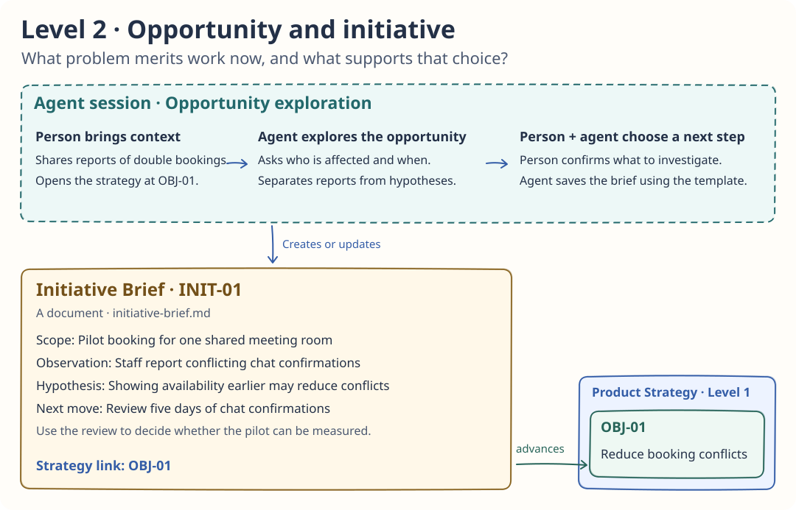

  

# Neotool

**An AI-driven product engineering framework for creating and evolving projects, products, and software solutions with people and AI agents.**

Neotool helps people and agents explore, structure, create, and evolve an initiative. Start with a rough idea, an observed problem, or a proposal with research behind it.

The framework is designed to be applied to your own needs. It establishes concepts, principles, and contracts that guide the work while leaving room for your team to choose how to implement them. Adapt its guidance when your context calls for a different approach, and make those decisions explicit.

## How to apply Neotool

Use the [Product Strategy skill](.agents/skills/neotool-product-strategy/SKILL.md) with your agent to define or review the product's vision, strategic choices, and objectives. The [Neotool Guideline](docs/guideline.md) walks you through the session. When an initiative advances an agreed objective, record the objective ID and link in the [Initiative Brief](spec/templates/initiative-brief.md).

1. **Understand your context.** Define the problem, the people involved, the intended outcomes, and the constraints of your initiative.
2. **Use the framework as a guide.** Identify the principles, responsibilities, and contracts relevant to your work.
3. **Make the guidance concrete.** Choose and implement the practices, artifacts, tools, and workflows that fulfill those needs in your context.
4. **Adapt deliberately.** Adjust guidance that does not fit, record the reasons, and revisit your choices as you learn.
5. **Build, validate, and evolve.** Connect decisions and specifications to implementation and evidence, and use what you learn to improve the solution.

## Design principles

- **Start with context.** Connect the work to the problems, users, and outcomes it serves.
- **Make decisions explicit.** Record the context and reasoning behind decisions so people and agents can understand and revisit them.
- **Use clear contracts.** Define expectations for artifacts, responsibilities, and workflows.
- **Keep work traceable.** Make it possible to follow the path from a problem and its specifications to implementation and validation.
- **Support people and agents.** Give both access to relevant context, guidance, and ways to verify results.
- **Adapt to your needs.** Apply the framework's direction using practices and implementations suited to your context.
- **Adopt progressively.** Introduce capabilities as they become useful to your initiative.

## Proposed structure

The [Product knowledge and traceability contract](docs/product-knowledge.md) organizes records into six levels: strategy, opportunity and initiative, product definition, experience and technical design, delivery and implementation, and verification and operation. These levels distinguish the questions records answer and connect intent to outcomes. The Product Map is a navigation view; typed links make records traceable in both directions.

Neotool organizes product knowledge and the capabilities that support it. These can coexist in a single repository. Folder names, repository boundaries, and deployment units are implementation choices.

### Canonical, abstract, and concrete

Canonical describes what the framework treats as an authoritative contract. Abstract and concrete describe how much of an element has been specified or implemented. These are separate dimensions: a canonical contract can have several concrete implementations.

| Dimension | What Neotool defines | What your team does |
| --- | --- | --- |
| **Canonical foundations** | The shared vocabulary, responsibilities, artifact relationships, and minimum expectations for a capability. | Applies those contracts and records any deliberate departures and their implications. |
| **Abstract elements** | Responsibilities and extension points that require decisions in the context of your initiative. | Defines domain boundaries, quality targets, roles, workflows, technology, and integration choices. |
| **Concrete elements** | Reusable artifacts and executable mechanisms that fulfill part of a contract, as they become available. | Adopts, configures, extends, or replaces templates, skills, validators, CLI commands, and adapters. |

For example, a delivery stage may have a canonical result contract, an abstract execution mechanism, and a concrete adapter for a particular coding agent. A product decision has a canonical minimum for an addressable record while its content and representation belong to your initiative.

### Product Knowledge levels

The six levels organize records by the questions they answer. A level is a role in the knowledge model, not a required folder or workflow stage. A document can contain records from multiple levels, and links can cross levels.

| Level | Question | Example records |
| --- | --- | --- |
| **1. Strategy** | Where are we going, for whom, and how will we judge progress? | Vision, strategic choices, objectives, and expected outcomes. |
| **2. Opportunity and initiative** | What problem merits work now, and what supports that choice? | Initiative briefs, needs, research findings, hypotheses, and product decisions. |
| **3. Product definition** | What must the product do, and what counts as acceptable? | PRDs, requirements, product rules, constraints, and acceptance criteria. |
| **4. Experience and technical design** | How will the experience and system realize the agreed behavior? | UX flows, prototypes, technical designs, interface contracts, and architecture decisions. |
| **5. Delivery and implementation** | What work is planned, what changed, and where did it ship? | Work items, plans, pull requests, implementation, and releases. |
| **6. Verification and operation** | What was observed, against which version, and did the outcome improve? | Test cases, execution results, operational observations, and outcome measurements. |

A short Product Map helps people and agents navigate from broad topics to relevant records. Typed links connect an objective to an initiative, a need to a requirement, and a criterion to a test result and the implementation revision examined. The [contract](docs/product-knowledge.md) defines the relationships and shows a complete example.

Both diagrams use the same visual key. A **teal dashed frame** groups the conversation with the agent, and a **purple pill** names a skill the agent uses within it. **Blue cards** show strategy documents, **green cards** show objectives (`OBJ-*`), **yellow cards** show Initiative Briefs (`INIT-*`), and **gray cards** show navigation indexes such as the Product Map.

#### Level 1 · Product Strategy

Start a conversation with your agent and ask it to use the [Product Strategy skill](.agents/skills/neotool-product-strategy/SKILL.md). Share your idea and any existing material. The skill guides the agent to ask about the audience, focus, and desired outcome, then draft the strategy using the template. You review and confirm the choices, and the agent saves the agreed strategy and records any open questions.

The **Product Strategy** is the document a person and an agent create together. In this example it is a Markdown file. It records who the product serves, where to focus, and what should improve. **Fewer confirmed overlapping reservations** is the desired outcome. **OBJ-01** is the objective recorded in the document. It gives that outcome a stable reference and defines how to measure it.

The **Product Map** is a short index of links that people and agents can consult later. It can be a Markdown file such as `product-map.md` or part of an existing workspace index. In the example, **Shared room booking** is the topic for a product that helps staff reserve a physical meeting room. Its **Strategy** link opens the strategy document. The **Initiative Brief** describes the proposed pilot and links directly to `OBJ-01`, so anyone reviewing the pilot can see which objective it advances.

[Product Strategy template](spec/templates/product-strategy.md) · [Worked example](docs/examples/product-strategy.md) · [Editable Excalidraw diagram](docs/images/level-1-strategy.excalidraw)

#### Level 2 · Opportunity and initiative

Open the relevant objective and ask your agent to explore the opportunity with you using the Initiative Brief template. Bring what you've seen and any sources. The agent asks who is affected and what happens today, then records observations, hypotheses, and open questions. Together you decide whether to explore the problem, research, benchmark, or start designing. In this example, you agree to check whether five days of chat confirmations give you a usable baseline.

The **Initiative Brief** is the document the agent drafts and you review. It captures the scope and agreed next step. Its **Strategy link** points directly to `OBJ-01` inside the strategy document, so a person or agent can recover why `INIT-01` exists and how progress will be measured.

[Initiative Brief template](spec/templates/initiative-brief.md) · [Worked example](docs/examples/initiative-brief.md) · [Editable Excalidraw diagram](docs/images/level-2-opportunity.excalidraw)

### Capabilities across the levels

These capabilities support work throughout the knowledge model; they are introduced as the initiative needs them:

- **AI collaboration and context management:** agents find authoritative records through the Product Map, load relevant context progressively, distinguish assumptions from evidence, and preserve handoffs.
- **Skills and guidance:** reusable procedures help people and agents conduct discovery, shape product definitions, design, deliver, and evaluate outcomes. The Product Strategy skill is available today.
- **Harness, CLI, tools, and adapters:** the agent's execution environment provides tool access, permissions, feedback, and continuity. Neotool-specific automation and a dedicated harness are planned; existing agent tools can support the initial workflow.
- **Design and architecture:** experience design, system boundaries, contracts, and architecture decisions connect product intent to a workable solution.
- **Quality, security, and governance:** appropriate controls apply across the work, including review, access, verification, and clear decision authority.
- **Traceability and learning:** stable references link intent, decisions, changes, and evidence; findings and operational measurements inform subsequent decisions.

### Shared knowledge and governance

Every level needs discoverable knowledge and explicit authority. Security, quality, and governance apply throughout, with controls appropriate to the initiative.

- **Name the authoritative record.** Keep one maintained record per concept and link to it. Give durable records a stable ID, kind, concise statement, state, and resolvable location; keep ownership discoverable when needed.
- **Separate intent from observed behavior.** Specifications for a proposed change define the target. Behavioral records describe what currently exists and cite implementation or validation evidence. Track discrepancies explicitly.
- **Load context progressively.** Provide a small entry point that directs people and agents to the relevant records, skills, and implementation paths. Include summaries, status, and conditions for loading deeper material.
- **Keep knowledge current.** Define when an artifact must be updated, how it is verified, and how superseded records are identified. Keep generated views tied to their authoritative sources.
- **Make authority and limits explicit.** Define which actions can run automatically, which require human decisions, and how execution handles permissions, budgets, retries, failures, and recovery.

### What stays canonical and what varies

The [product knowledge contract](docs/product-knowledge.md) defines the current record and traceability foundations. The table below proposes additional contracts and capabilities. The [Spec template](spec/templates/first-delivery.md) illustrates how context, decisions, intended behavior, and evidence can be recorded; the remaining concrete examples are possible implementations.

| Element | Candidate canonical contract | Abstract choices for your initiative | Possible concrete support |
| --- | --- | --- | --- |
| **Product strategy and context** | Distinguish evidence, hypotheses, decisions, and initiatives; preserve their relationships and lifecycle. | Business domain, audiences, strategy, and outcome measures. | Record templates, metadata validation, and a query tool. |
| **Design** | Record journeys and relevant states; identify authoritative design values and their relationship to implementation. | Visual identity, interaction patterns, platforms, and design tools. | Design templates, token tooling, and component validation. |
| **Architecture** | Declare boundaries, dependency rules, contracts, and decision rationale. Make enforceable constraints executable where practical. | System topology, domain decomposition, stack, and quality targets. | Decision templates, contract schemas, and dependency checks. |
| **Delivery / SDD** | Connect intended outcomes, acceptance criteria, decisions, work, and verification evidence. Define entry and completion conditions. | Work tracker, task sizing, stage sequence, and release policy. | Specification templates, workflow definitions, and readiness validators. |
| **Skills** | Describe when a procedure applies, its inputs, expected output, and completion checks. | Domain expertise, stack conventions, and role-specific procedures. | Skill packages with references and scripts. |
| **Harness, CLI, and tools** | Expose clear operations and structured outcomes; preserve enough state to resume work and report failures. | Agent provider, execution environment, persistence, and integrations. | CLI commands, adapters, checkpoint storage, and workflow runners. |
| **Implementation and operation** | Provide verifiable behavior, explicit interfaces, reproducible execution, and operational feedback. | Application architecture, infrastructure, deployment mechanisms, and observability tools. | Stack-specific starters, test fixtures, CI checks, and runbooks. |

An initial project can fulfill these responsibilities with a small set of records and commands. More automation and orchestration should be introduced as the initiative needs them.

## Research informing the proposal

The [initiative orientation benchmark](docs/research/initiative-orientation.md) compares discovery, context loading, and agent handoff practices and explains which patterns Neotool adopts.

These references inform the proposed structure; their specific tools and architectures remain choices for each initiative.

- [OpenAI — Harness engineering](https://openai.com/index/harness-engineering/) describes repository knowledge maps, mechanically enforced architecture boundaries, and agent access to application behavior and telemetry.
- [Anthropic — Effective context engineering](https://www.anthropic.com/research/effective-context-engineering-for-ai-agents) discusses selective context retrieval and clear, focused tool contracts.
- [Anthropic — Harness design for long-running application development](https://www.anthropic.com/research/harness-design-long-running-apps) explores structured handoffs, evaluation, and revisiting harness complexity as model capabilities change.
- [GitHub — Spec Kit](https://github.github.com/spec-kit/) demonstrates structured specification, planning, implementation, and convergence, with customizable processes and integrations.
- [Agent Skills specification](https://agentskills.io/specification) provides a reusable packaging format for instructions, references, scripts, and assets.
- [Birgitta Böckeler — Harness engineering for coding agent users](https://martinfowler.com/articles/harness-engineering.html) distinguishes guidance before execution from feedback that helps agents correct their results.

## Project status

Neotool provides the Guideline, the product knowledge and traceability contract, the Product Strategy skill, a strategy template and worked example, an Initiative Brief template, and a Spec template and worked example. You can use them with your current coding agent. Additional skills, a CLI, and a dedicated execution harness are planned capabilities.
