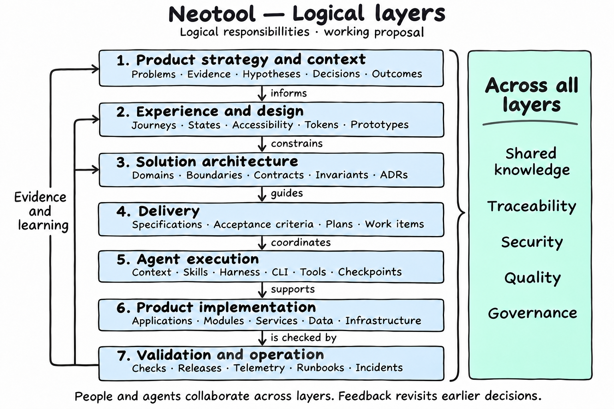

  

# Neotool

**An AI-driven product engineering framework for creating and evolving projects, products, and software solutions with people and AI agents.**

Neotool helps people and agents explore, structure, create, and evolve an initiative. Start with a rough idea, an observed problem, or a proposal with research behind it.

The framework is designed to be applied to your own needs. It establishes concepts, principles, and contracts that guide the work while leaving room for your team to choose how to implement them. Adapt its guidance when your context calls for a different approach, and make those decisions explicit.

## How to apply Neotool

Start with the [Neotool Guideline](docs/guideline.md) and the [Start Initiative skill](.agents/skills/neotool-start-initiative/SKILL.md). Bring what you know, create a short [Initiative Brief](spec/templates/initiative-brief.md) with your agent, and agree whether to explore the problem, research, benchmark, or design a solution.

1. **Understand your context.** Define the problem, the people involved, the intended outcomes, and the constraints of your initiative.
2. **Use the framework as a guide.** Identify the principles, responsibilities, and contracts relevant to your work.
3. **Make the guidance concrete.** Choose and implement the practices, artifacts, tools, and workflows that fulfill those needs in your context.
4. **Adapt deliberately.** Adjust guidance that does not fit, record the reasons, and revisit your choices as you learn.
5. **Build, validate, and evolve.** Connect decisions and specifications to implementation and evidence, and use what you learn to improve the solution.

## Design principles

- **Start with context.** Connect the work to the problems, users, and outcomes it serves.
- **Make decisions explicit.** Record the context and reasoning behind decisions so people and agents can understand and revisit them.
- **Use clear contracts.** Define expectations for artifacts, responsibilities, and workflows.
- **Keep work traceable.** Make it possible to follow the path from a problem and its specifications to implementation and validation.
- **Support people and agents.** Give both access to relevant context, guidance, and ways to verify results.
- **Adapt to your needs.** Apply the framework's direction using practices and implementations suited to your context.
- **Adopt progressively.** Introduce capabilities as they become useful to your initiative.

## Proposed structure

Neotool's proposed structure defines logical responsibilities and the relationships between them. These responsibilities can coexist in a single repository. Folder names, repository boundaries, and deployment units are implementation choices.

### Canonical, abstract, and concrete

Canonical describes what the framework treats as an authoritative contract. Abstract and concrete describe how much of an element has been specified or implemented. These are separate dimensions: a canonical contract can have several concrete implementations.

| Dimension | What Neotool defines | What your team does |
| --- | --- | --- |
| **Canonical foundations** | The shared vocabulary, responsibilities, artifact relationships, and minimum expectations for a capability. | Applies those contracts and records any deliberate departures and their implications. |
| **Abstract elements** | Responsibilities and extension points that require decisions in the context of your initiative. | Defines domain boundaries, quality targets, roles, workflows, technology, and integration choices. |
| **Concrete elements** | Reusable artifacts and executable mechanisms that fulfill part of a contract, as they become available. | Adopts, configures, extends, or replaces templates, skills, validators, CLI commands, and adapters. |

For example, a delivery stage may have a canonical result contract, an abstract execution mechanism, and a concrete adapter for a particular coding agent. A product decision may have a canonical record format while its content belongs entirely to your initiative.

### Logical layers

The following layers are a working proposal. They organize responsibilities across the product lifecycle; several can participate in the same task.

The arrows illustrate a main information flow and its feedback. Layers can collaborate throughout a change; their numbering does not prescribe a fixed delivery sequence.

| Layer | Responsibility | Main elements |
| --- | --- | --- |
| **1. Product strategy and context** | Establish why the initiative exists, whom it serves, and which outcomes matter. | Problem statements, research evidence, hypotheses, product decisions, initiatives, and success measures. |
| **2. Experience and design** | Define how people interact with the solution and how the experience stays coherent. | Journeys, interaction states, accessibility criteria, design decisions, tokens, component contracts, and prototypes. |
| **3. Solution architecture** | Define the system's boundaries, constraints, and permitted relationships. | Domain maps, modules, dependency rules, data and API contracts, invariants, quality attributes, and architectural decisions. |
| **4. Delivery** | Turn an intended change into bounded, verifiable work. | Specifications, acceptance criteria, technical plans, work items, dependencies, review criteria, and delivery evidence. |
| **5. Agent execution** | Give people and agents a repeatable way to perform and resume work. | Context loading, skills, workflow execution, structured results, checkpoints, tool access, CLI commands, integration adapters, and development environments. |
| **6. Product implementation** | Realize the solution's behavior through working software. | Applications, domain modules, services, schemas, migrations, integrations, and infrastructure definitions. |
| **7. Validation and operation** | Establish whether the solution meets expectations and preserve its health over time. | Automated checks, architectural fitness checks, release gates, deployments, telemetry, runbooks, incident records, and regression evidence. |

Product intent informs design and architecture. A delivery selects a bounded change, agent execution supports the work, implementation realizes it, and validation supplies evidence. Operational findings feed future product, design, and architecture decisions.

SDD connects specifications to planning, implementation, and verification across these layers. Skills package procedures; a CLI exposes operations; tools and adapters connect execution to the chosen environment. The harness coordinates agent execution and its feedback mechanisms.

### Shared knowledge and governance

Every layer needs discoverable knowledge and explicit authority. Security, quality, and governance apply across the layers, with controls appropriate to the initiative.

- **Name the authoritative record.** Keep one maintained record per concept and link to it. Give linked artifacts stable identifiers and a clear owner.
- **Separate intent from observed behavior.** Specifications for a proposed change define the target. Behavioral records describe what currently exists and cite implementation or validation evidence. Track discrepancies explicitly.
- **Load context progressively.** Provide a small entry point that directs people and agents to the relevant records, skills, and implementation paths. Include summaries, status, and conditions for loading deeper material.
- **Keep knowledge current.** Define when an artifact must be updated, how it is verified, and how superseded records are identified. Keep generated views tied to their authoritative sources.
- **Make authority and limits explicit.** Define which actions can run automatically, which require human decisions, and how execution handles permissions, budgets, retries, failures, and recovery.

### What stays canonical and what varies

The table below maps the proposed framework capabilities. The [first delivery Spec template](spec/templates/first-delivery.md) shows how to record context, decisions, specification, and evidence. The concrete examples below show how those contracts and related capabilities could be implemented.

| Element | Candidate canonical contract | Abstract choices for your initiative | Possible concrete support |
| --- | --- | --- | --- |
| **Product strategy and context** | Distinguish evidence, hypotheses, decisions, and initiatives; preserve their relationships and lifecycle. | Business domain, audiences, strategy, and outcome measures. | Record templates, metadata validation, and a query tool. |
| **Design** | Record journeys and relevant states; identify authoritative design values and their relationship to implementation. | Visual identity, interaction patterns, platforms, and design tools. | Design templates, token tooling, and component validation. |
| **Architecture** | Declare boundaries, dependency rules, contracts, and decision rationale. Make enforceable constraints executable where practical. | System topology, domain decomposition, stack, and quality targets. | Decision templates, contract schemas, and dependency checks. |
| **Delivery / SDD** | Connect intended outcomes, acceptance criteria, decisions, work, and verification evidence. Define entry and completion conditions. | Work tracker, task sizing, stage sequence, and release policy. | Specification templates, workflow definitions, and readiness validators. |
| **Skills** | Describe when a procedure applies, its inputs, expected output, and completion checks. | Domain expertise, stack conventions, and role-specific procedures. | Skill packages with references and scripts. |
| **Harness, CLI, and tools** | Expose clear operations and structured outcomes; preserve enough state to resume work and report failures. | Agent provider, execution environment, persistence, and integrations. | CLI commands, adapters, checkpoint storage, and workflow runners. |
| **Implementation and operation** | Provide verifiable behavior, explicit interfaces, reproducible execution, and operational feedback. | Application architecture, infrastructure, deployment mechanisms, and observability tools. | Stack-specific starters, test fixtures, CI checks, and runbooks. |

An initial project can fulfill these responsibilities with a small set of records and commands. More automation and orchestration should be introduced as the initiative needs them.

## Research informing the proposal

The [initiative orientation benchmark](docs/research/initiative-orientation.md) compares discovery, context loading, and agent handoff practices and explains which patterns Neotool adopts.

These references inform the proposed structure; their specific tools and architectures remain choices for each initiative.

- [OpenAI — Harness engineering](https://openai.com/index/harness-engineering/) describes repository knowledge maps, mechanically enforced architecture boundaries, and agent access to application behavior and telemetry.
- [Anthropic — Effective context engineering](https://www.anthropic.com/research/effective-context-engineering-for-ai-agents) discusses selective context retrieval and clear, focused tool contracts.
- [Anthropic — Harness design for long-running application development](https://www.anthropic.com/research/harness-design-long-running-apps) explores structured handoffs, evaluation, and revisiting harness complexity as model capabilities change.
- [GitHub — Spec Kit](https://github.github.com/spec-kit/) demonstrates structured specification, planning, implementation, and convergence, with customizable processes and integrations.
- [Agent Skills specification](https://agentskills.io/specification) provides a reusable packaging format for instructions, references, scripts, and assets.
- [Birgitta Böckeler — Harness engineering for coding agent users](https://martinfowler.com/articles/harness-engineering.html) distinguishes guidance before execution from feedback that helps agents correct their results.

## Project status

Neotool provides the Guideline, the Start Initiative skill, an Initiative Brief template, a Spec template, and a worked example. You can use them with your current coding agent. Additional skills, a CLI, and a dedicated execution harness are planned capabilities.
