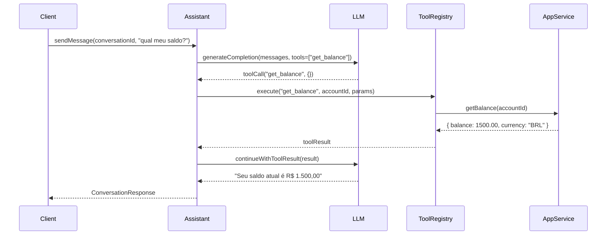

# Assistant Service Blueprint

## Module Name

**Module name:** `assistant`

- Centralized service for all LLM interactions across the platform
- Follows the same conventions as all other backend services: Kotlin + Micronaut, GraphQL Federation subgraph, PostgreSQL, Flyway
- Provider-agnostic design supports multiple LLM providers (OpenAI, Anthropic, etc.)
- Handles cross-cutting concerns: routing, observability, cost management, rate limiting

## Overview

The `assistant` service is the **centralized LLM interaction layer** for the platform. It abstracts LLM provider complexity, manages prompts as versioned assets, handles tool/function calling, and provides comprehensive observability.

**Core responsibilities:**
- **Prompt Management**: Versioned prompt templates with variables
- **Completion**: One-shot completions and short multi-turn conversations
- **Structured Output**: JSON-mode completions for data generation use cases
- **Tool Calling**: Registry and execution of function calling (e.g., fetch account balance)
- **Context Management**: Short conversation history via sliding window
- **Resilience**: Retries, fallback chains, circuit breakers, rate limiting
- **Observability**: Token tracking, cost attribution, latency metrics
- **Security**: Input/output validation, audit logging, LGPD compliance

## Use Cases (v1)

The three primary use cases driving this service:

1. **Structured data generation** — "Given scenario X, generate JSON with data Y"
   - One-shot prompt, no conversation
   - Requires reliable structured output (JSON mode)

2. **Recommendations** — "Given scenario X, make recommendation Y"
   - One-shot prompt, no conversation

3. **FAQ Chatbot with escalation** — User asks questions, LLM responds; if it cannot answer, escalates to a human agent
   - Short conversation (3–8 turns max before escalation)
   - Tool calling for domain-specific data (e.g., current account balance)
   - Escalation pattern when LLM cannot answer with confidence

## Goals

- Provide a **single, consistent interface** for all services that need LLM capabilities
- **Abstract provider complexity**: Switch providers without changing client code
- **Ensure reliability**: Automatic retries, fallback chains, circuit breakers
- **Track everything**: Token usage, costs, latency per service/account/feature
- **Support tool calling**: Allow the LLM to query domain data within the authenticated account scope
- **Maintain security**: Content validation, audit logging, LGPD compliance

## Hard Requirements (v1)

- **Strict account isolation**: rate limits, usage, and conversation memory are scoped by `accountId`; cross-account data reuse is forbidden.
- **Federation subgraph**: `assistant` is a GraphQL Federation subgraph, following the same conventions as `app` and `security`. `accountId` is derived from the authenticated JWT context propagated by Apollo Router — never trusted from client input.
- **Provider-agnostic growth path**: v1 runs with OpenAI, but routing/fallback design must support multiple providers without API redesign.
- **LGPD compliance by default**: data minimization, purpose limitation, configurable retention, encryption at rest/in transit, auditable access.

## Non-Goals (v1)

- Fine-tuning or training custom models
- Embedding generation and vector search (separate service, future)
- Complex multi-agent workflows (future)
- Image/video generation (focus on text completion first)
- Model hosting (use external providers only)
- Response caching (deferred — see Phase 8; insufficient volume in v1 to justify)
- Complex model routing (single provider in v1)
- PII detection and redaction pipeline (deferred to post-v1)

## Bounded Context and Ownership

`assistant` owns:
- Prompt catalog (`Prompt`, `PromptVersion`, `PromptVariable`)
- Provider configurations and credentials
- Tool/function registry and execution records
- Completion requests and responses (audit trail)
- Cost tracking and budgeting
- Rate limit enforcement per account/service/feature
- Short conversation context (sliding window, scoped by `accountId`)

`assistant` does **not** own:
- Application business logic (client services)
- User authentication (security service)
- Business domain data (fetched at runtime via tool calling)
- Embeddings and vector storage (future embedding service)

## Architecture: Federation Integration

`assistant` is a **GraphQL Federation subgraph**, identical in structure to `app` and `security`:

```
Client → Apollo Router → assistant subgraph (Kotlin + Micronaut)
                                ↓
                          OpenAI API (provider)
                                ↓
                     Tool executors → app / other services
```

Inter-service calls from tool executors follow the same authentication patterns defined in [ADR-0008](../../../92-adr/0008-interservice-security.md).

## Core Domain Model (v1)

### Prompt Management

- **`Prompt`**
  - `id`, `name`, `category`, `description`, `tags`
  - `createdBy`, `createdAt`, `updatedAt`

- **`PromptVersion`**
  - `id`, `promptId`, `version`, `status` (`draft`, `active`, `deprecated`)
  - `template`, `variables`, `metadata`
  - `modelRequirements` (min context, required capabilities)
  - `outputFormat` (`TEXT`, `JSON`) — drives structured output mode
  - `performanceMetrics` (avg latency, success rate, escalation rate)

- **`PromptVariable`**
  - `name`, `type`, `required`, `defaultValue`, `validation`

### Provider Management

- **`LLMProvider`**
  - `id`, `name`, `type` (`OPENAI`, `ANTHROPIC`, `GOOGLE`, etc.)
  - `baseUrl`, `apiKeyRef`, `status`, `priority`

- **`LLMModel`**
  - `id`, `providerId`, `modelName`, `displayName`
  - `capabilities` (streaming, tools, json_mode, vision, etc.)
  - `contextWindow`, `maxOutputTokens`
  - `costPerInputToken`, `costPerOutputToken`
  - `status` (`active`, `deprecated`, `disabled`)

### Completion Management

- **`CompletionRequest`**
  - `id`, `accountId`, `requestedBy` (service/user), `promptId`, `promptVersionId`
  - `messages`, `variables`, `modelPreference`
  - `options` (temperature, maxTokens, stream, tools, outputFormat)
  - `purpose` (required for LGPD audit/retention tagging), `metadata`, `createdAt`

- **`CompletionResponse`**
  - `id`, `requestId`, `accountId`, `providerId`, `modelId`
  - `response`, `finishReason`, `usage` (tokens)
  - `latencyMs`, `cost`
  - `escalate` (boolean — FAQ escalation signal)
  - `completedAt`

### Tool Calling

- **`Tool`**
  - `id`, `name`, `description`, `category`
  - `inputSchema` (JSON Schema), `outputSchema`
  - `executorService`, `executorEndpoint`
  - `timeout`, `retryPolicy`
  - `status` (`active`, `disabled`)

- **`ToolExecution`**
  - `id`, `completionRequestId`, `toolId`
  - `input`, `output`, `status`, `error`
  - `latencyMs`, `executedAt`

### Conversation (FAQ Chatbot)

- **`Conversation`**
  - `id`, `accountId`, `userId`
  - `messages` (short sliding window, max 10 turns)
  - `status` (`active`, `escalated`, `closed`)
  - `escalatedAt`, `metadata`
  - `createdAt`, `expiresAt`

- **`Message`**
  - `role` (`USER`, `ASSISTANT`, `SYSTEM`, `TOOL`)
  - `content`, `toolCalls`, `timestamp`

### Cost & Usage

- **`UsageLog`**
  - `id`, `accountId`, `requestId`, `service`, `userId`, `feature`, `purpose`
  - `promptTokens`, `completionTokens`, `totalTokens`
  - `cost`, `modelId`, `timestamp`

- **`UsageBudget`**
  - `id`, `scope` (`account`, `service`, `feature`), `scopeId`
  - `period` (`daily`, `weekly`, `monthly`), `limitAmount`
  - `currentUsage`, `alertThreshold`

### Critical Relationships

- One `Prompt` has many `PromptVersion` records
- One active `Prompt` has exactly one active `PromptVersion`
- One `CompletionRequest` has one `CompletionResponse` (1:1)
- One `CompletionRequest` may have many `ToolExecution` records
- One `LLMProvider` has many `LLMModel` records
- `Conversation.accountId` is always set — no cross-account conversation access

## Context Management (Sliding Window)

For FAQ conversations, context is managed via a simple sliding window. No LLM-based summarization in v1 — conversations are expected to escalate within 3–8 turns, so context overflow is not a practical concern.

```kotlin
fun truncateToFit(messages: List<Message>, maxTokens: Int): List<Message> {
    val system = messages.filter { it.role == SYSTEM }
    val recent = messages.filter { it.role != SYSTEM }.takeLast(RECENT_MESSAGES_LIMIT)
    return system + recent
}

companion object {
    const val RECENT_MESSAGES_LIMIT = 10 // configurable
}
```

One-shot completions (data generation, recommendations) do not use conversation context.

## Escalation Pattern (FAQ)

When the LLM cannot answer with confidence, it signals escalation via a structured response. The system prompt instructs this behavior explicitly, requiring no tool calling.

```
System prompt includes:
"If you cannot answer confidently, respond ONLY with valid JSON:
 { \"escalate\": true, \"reason\": \"<brief reason>\" }"
```

The `assistant` service detects this signal, sets `CompletionResponse.escalate = true`, and returns the full conversation history to the caller for human handoff. The client is responsible for the escalation flow (e.g., routing to a support queue).

## Tool Calling Architecture

Tool calling supports FAQ use cases where the LLM needs domain data to answer (e.g., "what is my current balance?").

### Tool Registry Pattern

```kotlin
interface ToolExecutor {
    suspend fun execute(accountId: UUID, input: JsonObject): Result<JsonObject>
}

@Singleton
class ToolRegistry {
    private val executors = mutableMapOf<String, ToolExecutor>()

    fun register(toolName: String, executor: ToolExecutor) {
        executors[toolName] = executor
    }

    suspend fun execute(toolName: String, accountId: UUID, input: JsonObject): Result<JsonObject> {
        return executors[toolName]?.execute(accountId, input)
            ?: Result.failure(ToolNotFoundException(toolName))
    }
}
```

`accountId` is always passed to tool executors — tools never query data outside the authenticated account scope.

### Tool Calling Flow



### Built-in Tools (v1)

- `get_current_time` — current date/time (no external dependency)

Domain-specific tools (e.g., `get_account_balance`, `get_portfolio_summary`) are registered by client services at application startup via the tool registry. Each tool must implement `ToolExecutor` and respect the `accountId` isolation contract.

## Resilience Patterns

### Retry Strategy

```kotlin
data class RetryPolicy(
    val maxAttempts: Int = 3,
    val initialDelay: Duration = 1.seconds,
    val maxDelay: Duration = 30.seconds,
    val multiplier: Double = 2.0,
    val retryableErrors: Set<ErrorType> = setOf(
        ErrorType.RATE_LIMIT,
        ErrorType.TIMEOUT,
        ErrorType.SERVER_ERROR
    )
)
```

### Circuit Breaker

```kotlin
data class CircuitBreakerConfig(
    val failureThreshold: Int = 5,
    val successThreshold: Int = 2,
    val timeout: Duration = 60.seconds,
    val halfOpenRequests: Int = 1
)

enum class CircuitState { CLOSED, OPEN, HALF_OPEN }
```

### Fallback Chain (v1 — single provider)

1. Try primary model (e.g., `gpt-4o`)
2. If fails, try fallback model (e.g., `gpt-4o-mini`, same provider)
3. If all fail, return graceful error

Multi-provider fallback is deferred to Phase 7.

## Rate Limiting

```kotlin
data class RateLimit(
    val scope: RateLimitScope, // PROVIDER, ACCOUNT, SERVICE, FEATURE
    val scopeId: String,
    val windowSize: Duration,
    val maxRequests: Int,
    val maxTokens: Long
)
```

Rate limit hierarchy (v1):
1. **Provider Level**: Respect OpenAI rate limits
2. **Account Level**: Fair-use enforcement per customer account
3. **Feature Level**: Budget allocation per feature/use case

## Security & Compliance

### LGPD Compliance Defaults

- Data minimization: send and store only data required for the request purpose.
- Purpose limitation: every request requires a `purpose` field for auditability and retention policy.
- Configurable retention (default: 30 days for completion logs; configurable by purpose).
- Encryption at rest for persisted payloads.
- Data subject rights: deletion/anonymization of conversation and usage data on request.

### Audit Logging

All LLM interactions are logged:
- Request initiator (service, user), `accountId`, feature/purpose
- Prompt used (version), model used, tokens, cost
- Tool calls executed (tool name, accountId scope, result status)
- Escalation events (reason)
- Retention: 30 days default, configurable per purpose

### Input/Output Validation

```kotlin
interface ContentFilter {
    fun validateInput(text: String): ValidationResult
    fun validateOutput(text: String): ValidationResult
}

data class ValidationResult(
    val allowed: Boolean,
    val violations: List<ContentViolation>
)

enum class ContentViolationType {
    HARMFUL, EXPLICIT, SPAM, INJECTION_ATTEMPT
}
```

## GraphQL Surface (v1)

### Queries

```graphql
type Query {
  # Prompt management
  prompts(category: String, tags: [String!]): [Prompt!]!
  prompt(id: ID!): Prompt
  promptVersions(promptId: ID!): [PromptVersion!]!

  # Usage tracking
  myUsage(period: UsagePeriod!): UsageStats!
  serviceUsage(serviceId: String!, period: UsagePeriod!): UsageStats!

  # Tool registry
  availableTools: [Tool!]!

  # Model catalog
  availableModels(capabilities: [ModelCapability!]): [LLMModel!]!
}
```

### Mutations

```graphql
type Mutation {
  # One-shot completion (data generation, recommendations)
  generateCompletion(input: CompletionInput!): CompletionResponse!

  # Conversation — FAQ chatbot
  startConversation(metadata: JSON): Conversation!
  sendMessage(conversationId: ID!, message: MessageInput!): ConversationResponse!
  closeConversation(conversationId: ID!): Conversation!

  # Prompt management (admin)
  createPrompt(input: CreatePromptInput!): Prompt!
  publishPromptVersion(promptId: ID!, versionId: ID!): PromptVersion!

  # Tool registration (admin/internal)
  registerTool(input: RegisterToolInput!): Tool!

  # Budget management (admin)
  setUsageBudget(input: SetBudgetInput!): UsageBudget!
}

input CompletionInput {
  promptId: ID
  promptVariables: JSON
  messages: [MessageInput!]

  # Model selection
  modelPreference: String
  requiredCapabilities: [ModelCapability!]

  # Parameters
  temperature: Float
  maxTokens: Int
  outputFormat: OutputFormat  # TEXT (default) | JSON

  # Tools
  tools: [String!]

  # LGPD required
  purpose: String!
  metadata: JSON
}

type CompletionResponse {
  id: ID!
  content: String!
  finishReason: String!
  usage: TokenUsage!
  model: String!
  latencyMs: Int!
  cost: Decimal!
  escalate: Boolean!
  toolCalls: [ToolCall!]
}

type ConversationResponse {
  conversation: Conversation!
  lastMessage: CompletionResponse!
}

enum OutputFormat {
  TEXT
  JSON
}
```

### Subscriptions

```graphql
type Subscription {
  # Streaming completions — FAQ chatbot UX
  messageStream(conversationId: ID!, input: MessageInput!): CompletionChunk!
}

type CompletionChunk {
  delta: String!
  finishReason: String
  usage: TokenUsage
  escalate: Boolean
}
```

## Provider Abstraction Layer

```kotlin
interface LLMProviderClient {
    suspend fun complete(request: ProviderCompletionRequest): ProviderCompletionResponse
    suspend fun streamComplete(request: ProviderCompletionRequest): Flow<ProviderCompletionChunk>
    fun estimateTokens(text: String): Int
    fun validateApiKey(): Boolean
}

data class ProviderCompletionRequest(
    val model: String,
    val messages: List<ProviderMessage>,
    val temperature: Double? = null,
    val maxTokens: Int? = null,
    val tools: List<ProviderTool>? = null,
    val responseFormat: ResponseFormat? = null, // JSON mode
    val stream: Boolean = false
)
```

### Provider Implementations (v1)

- `OpenAIProviderClient` — primary provider (`gpt-4o`, `gpt-4o-mini`)
- `MockProviderClient` — testing

Additional providers (Anthropic, Google) deferred to Phase 7.

## Database Constraints

- Unique `(promptId, version)` for prompt versions
- One active prompt version per prompt: `UNIQUE WHERE status = 'active'`
- `NOT NULL account_id` on completion_requests, completion_responses, usage_log, conversations
- Foreign key: `completion_responses.request_id` → `completion_requests.id`
- Check constraints: `cost >= 0`, `tokens >= 0`
- Audit timestamps (`created_at`, `updated_at`) on all tables

## Recommended Indexes

```sql
-- Completion tracking
CREATE INDEX idx_completion_requests_account_created
  ON completion_requests(account_id, created_at DESC);

CREATE INDEX idx_completion_requests_service_created
  ON completion_requests(requested_by_service, created_at DESC);

-- Usage analytics
CREATE INDEX idx_usage_log_account_timestamp
  ON usage_log(account_id, timestamp DESC);

CREATE INDEX idx_usage_log_service_timestamp
  ON usage_log(service, timestamp DESC);

-- Conversations
CREATE INDEX idx_conversations_account_status
  ON conversations(account_id, status, created_at DESC);

-- Tool execution
CREATE INDEX idx_tool_execution_request
  ON tool_execution(completion_request_id);
```

## Observability

### Key Metrics

- `assistant_requests_total{service, model, status, output_format}`
- `assistant_request_duration_ms_bucket{service, model}`
- `assistant_tokens_total{service, model, token_type}`
- `assistant_cost_total{service, model}`
- `assistant_tool_executions_total{tool, status}`
- `assistant_escalations_total{reason}`
- `assistant_provider_errors_total{provider, error_type}`
- `assistant_circuit_breaker_state{provider}`

### Alerts

- **High error rate**: >5% errors in 5-minute window
- **Circuit breaker open**: Provider unavailable
- **High latency**: P95 > 10s
- **Budget threshold**: >80% of budget consumed
- **Rate limit approaching**: >90% of rate limit used
- **Escalation spike**: Unusual escalation rate (signals prompt quality degradation)

### Structured Logging

```kotlin
log.info(
    "completion_request",
    "service" to service,
    "accountId" to accountId,
    "promptId" to promptId,
    "purpose" to purpose,
    "model" to model,
    "outputFormat" to outputFormat,
    "estimatedTokens" to estimatedTokens
)

log.info(
    "completion_response",
    "requestId" to requestId,
    "model" to model,
    "tokens" to tokens,
    "latencyMs" to latencyMs,
    "cost" to cost,
    "escalate" to escalate
)
```

## Rollout Plan

### Phase 1 — Foundation + One-shot Completion
- Apollo Federation subgraph setup (Kotlin + Micronaut, following service patterns)
- OpenAI provider client (`gpt-4o`, `gpt-4o-mini`)
- Prompt management (CRUD + versioning)
- `generateCompletion` endpoint (one-shot, synchronous, no streaming)
- Token counting and cost tracking (`UsageLog`)
- Basic observability (metrics, structured logging)

### Phase 2 — Structured Output
- `OutputFormat.JSON` support via OpenAI JSON mode
- JSON schema validation for structured responses
- `outputFormat` configuration per `PromptVersion`

### Phase 3 — FAQ Conversation + Escalation
- `Conversation` entity and CRUD (`startConversation`, `sendMessage`, `closeConversation`)
- Short conversation context (sliding window, max 10 turns)
- Escalation pattern: detection and `escalate` flag in response
- Conversation history returned on escalation for human handoff

### Phase 4 — Tool Calling
- `ToolRegistry` and `ToolExecutor` interface
- Tool calling support via OpenAI function calling format
- `get_current_time` built-in tool
- Framework for domain-specific tools registered by client services at startup

### Phase 5 — Rate Limiting + Resilience
- Retry logic with exponential backoff
- Circuit breaker for provider
- Rate limiting per account, service, and feature
- `UsageBudget` enforcement and threshold alerts

### Phase 6 — Streaming
- SSE streaming for FAQ chatbot UX
- `messageStream` subscription
- Streaming escalation detection

### Phase 7 — Multi-Provider
- Anthropic provider client (`claude-haiku-4-5`, `claude-opus-4-6`)
- Provider health monitoring and automatic failover
- Model routing: cost + performance scoring
- Gradual traffic shifting (`100/0` → `90/10` → `50/50`)

### Phase 8 — Caching (when volume justifies)
- Exact match cache (PostgreSQL-backed, `account_id` scoped)
- Cache invalidation on prompt version change
- Cache hit/miss metrics
- LGPD deletion workflows for cached data

## Decisions

| # | Decision | Resolution |
|---|----------|------------|
| Token estimation | tiktoken (OpenAI-compatible, consistent with primary provider) | **Closed** |
| Streaming transport | SSE (simpler, auto-reconnect, firewall-friendly) | **Closed** |
| Provider credentials | Shared platform keys (per-account deferred) | **Closed** |
| Tool execution | Synchronous (blocking, 10s timeout) | **Closed** |
| Routing rules semantics | Preference-only, never hard override | **Closed** |
| Context truncation | Sliding window (no LLM summarization in v1) | **Closed** |
| Cache backend | PostgreSQL when Phase 8 is reached | Open (Phase 8) |
| Cost attribution | Account + Service + Feature | **Closed** |
| LGPD: PII storage | Redacted-first default; originals only with documented legal basis | **Closed** |

## Future Enhancements (Post-v1)

- Response caching (Phase 8 — when volume justifies the operational complexity)
- LLM-based conversation summarization for long-lived sessions (async, pre-computed)
- Embedding service integration (separate service)
- Semantic caching (requires embedding service)
- Prompt A/B testing framework
- PII detection and redaction pipeline
- Admin UI for prompt management
- Per-account provider credentials

## Suggested Next Artifacts

- `docs/03-features/ai/assistant/DECISIONS.md` — detailed decision log with rationale
- `docs/03-features/ai/assistant/api-examples.md` — GraphQL usage examples per use case
- `docs/03-features/ai/assistant/tool-integration-guide.md` — how client services register tools
- `docs/92-adr/0011-assistant-service.md` — Architecture Decision Record
- `services/kotlin/assistant/schema.graphql` — GraphQL subgraph schema
- `services/kotlin/assistant/src/main/resources/db/migration/V001__initial_schema.sql` — Database schema

## References

- [OpenAI API Documentation](https://platform.openai.com/docs/api-reference)
- [OpenAI Function Calling](https://platform.openai.com/docs/guides/function-calling)
- [OpenAI Structured Outputs](https://platform.openai.com/docs/guides/structured-outputs)
- [Anthropic Claude API](https://docs.anthropic.com/claude/reference)
- [Apollo Federation Subgraphs](https://www.apollographql.com/docs/federation/building-supergraphs/subgraphs-overview)
