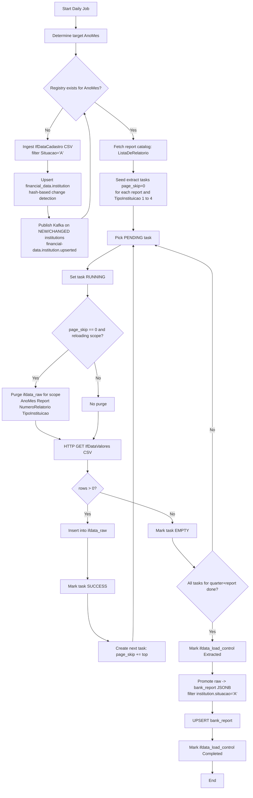

# Feature: bacen-ifdata-ingestion

## Overview

The **bacen-ifdata-ingestion** feature ingests **regulatory financial data published by the Brazilian Central Bank (BACEN)** via the **IFData OData APIs**, stages it safely in PostgreSQL, and enables downstream processing and synchronization through Kafka events.

This feature belongs to the **Financial Data** bounded context and acts as the **entry point for all BACEN IFData datasets** inside Invistus.

It is a **batch-oriented, pull-based ingestion pipeline**, designed with:
- strong idempotency guarantees
- explicit execution control
- full auditability
- safe reprocessing capabilities

---

## Goal

- Reliably ingest official BACEN IFData datasets.
- Persist **raw regulatory data exactly as published**.
- Provide a controlled and observable ingestion process.
- Support historical and quarterly reprocessing.
- Enable downstream transformations and Kafka-based synchronization.
- Minimize external API calls while avoiding request explosion.

This feature intentionally favors **correctness and traceability over speed**.

---

## Execution Schedule & Historical Start Date

### Schedule

- **Frequency**: The ingestion job runs **every day**.
- **Historical Start Date**: The flow processes data starting from **201603** (March 2016, first quarter available in BACEN IFData).

### Daily Execution Logic (high-level)

1. **Read last extracted quarter**: `last_extracted_ano_mes = max(ano_mes_ref)` from `financial_data.ifdata_load_control`. If none exists, fall back to historical start (201603) for backfill.
2. **Compute next quarter candidate**: Compute the next quarter after `last_extracted_ano_mes` (e.g., if `last_extracted_ano_mes = 202512`, next candidate is `202603`).
3. **Check publication window**: Determine if today's date falls within the expected publication window for the next candidate:
   - **March, June, September quarters**: up to 60 days after quarter end
   - **December quarter**: up to 90 days after quarter end
4. **Set target quarter**:
   - If data for the next candidate is not yet available, keep waiting (do not advance).
   - If the publication window passed and data is still not available, advance to the next candidate quarter and keep waiting.
5. **Refresh registry if needed**: For the target quarter, ingest `IfDataCadastro` (registry) if missing.
6. **Proceed or skip**: If registry remains absent after refresh, **skip the day**. Otherwise, proceed with extraction tasks for `target_ano_mes`.
7. **Historical backfill**: A separate/manual flow starting at 201603; the daily job only advances when the next quarter is actually available.

### Manual run and reprocessing

- **Manual trigger**: allow a CLI/flag to force a specific `AnoMes` (even if earlier), running the same steps: refresh registry, extract values, transform, upsert hot.
- **Reprocess**:
  - Re-run *transform + load* against existing raw for an `AnoMes` by doing idempotent UPSERT into `bank_report`.
  - If re-extraction is required, purge raw **only for the specific scope being reloaded** (see Raw rules).
- **Raw purge**: Prefer **not** to purge globally. If storage is a concern, purge only **older-than-N quarters** after successful promotions, with safeguards (e.g., keep the last 2–4 quarters). Never purge the in-flight/most recent quarter.

---

## Periodicity and Disclosure Deadlines

Reports are published **quarterly**. The disclosure deadlines, counted from the end of the respective base date, are as follows:

- **March, June, and September**: up to 60 days
- **December**: up to 90 days

If a document is replaced after the regular publication deadline, the new information is incorporated into the IF.Data reprocessing flow (performed annually in March of the subsequent year).

---

## Forms of Disclosure (BACEN consolidation perspectives)

Reports available on the IF.Data platform can be consulted from multiple consolidation perspectives, according to the organizational structure of supervised institutions:

1. **Individual Institutions**
2. **Prudential Conglomerates**
3. **Financial Conglomerates**
4. **Institutions with Foreign Exchange Operations**

This feature ingests data for **all institution types** exposed by the API via `TipoInstituicao = 1..4`, without filtering by individual institution.

---

## Data Sources (BACEN)

Base URL:

```
https://olinda.bcb.gov.br/olinda/servico/IFDATA/versao/v1/odata/
```

### Documentation Links

- General functional rules: https://www3.bcb.gov.br/ifdata/
- API documentation: https://olinda.bcb.gov.br/olinda/servico/IFDATA/versao/v1/documentacao

---

### Institutions Registry (Quarterly Snapshot)

Endpoint:

```
IfDataCadastro(AnoMes=@AnoMes)?@AnoMes=YYYYMM
```

Rules:
- Quarterly snapshots only (months: **03, 06, 09, 12**).
- Use **CSV** for performance: `$format=text/csv`.
- Use `$top=1000` to reduce the number of requests.
- Filter only active institutions: `$filter=Situacao eq 'A'`.

Example:

```
.../IfDataCadastro(AnoMes=@AnoMes)?@AnoMes=202403&$top=1000&$filter=Situacao%20eq%20'A'&$format=text/csv
```

---

### Report Catalog (Small Dataset)

Endpoint:

```
ListaDeRelatorio()
```

Rules:
- Use **JSON** (small payload, easier to inspect).
- Select only needed columns: `NomeRelatorio, NumeroRelatorio`.
- Natural key: **(NomeRelatorio, NumeroRelatorio)**.

Example:

```
.../ListaDeRelatorio()?$top=100&$format=json&$select=NomeRelatorio,NumeroRelatorio
```

---

### Financial Values (Core Dataset)

Endpoint:

```
IfDataValores(AnoMes=@AnoMes,TipoInstituicao=@TipoInstituicao,Relatorio=@Relatorio)
```

Rules:
- Loop `TipoInstituicao` from **1 to 4**.
- Use **CSV**: `$format=text/csv`.
- Use pagination: `$top=1000` and `$skip`.
- **Do NOT filter by institution** in standard ingestion.

Example:

```
.../IfDataValores(AnoMes=@AnoMes,TipoInstituicao=@TipoInstituicao,Relatorio=@Relatorio)
?@AnoMes=202403&@TipoInstituicao=1&@Relatorio='1'&$top=1000&$format=text/csv
```

---

## Core Tables and Responsibilities

### Control: Request-Level Tasks

**Table:** `financial_data.ifdata_extract_task`

Purpose:
- Controls **every external request** made to BACEN.
- Works as a queue + audit log for HTTP calls.
- Enables parallelism, retries, and idempotency at request level.

Natural key (unit of work):

```
(AnoMes, TipoInstituicao, NomeRelatorio, NumeroRelatorio, page_skip)
```

Each row represents:

> "Fetch page `page_skip` for this period, institution type, and report."

Status lifecycle:

```
PENDING -> RUNNING -> SUCCESS | EMPTY | ERROR
```

- **PENDING**: created, not executed yet
- **RUNNING**: request in progress
- **SUCCESS**: request returned rows and data was persisted
- **EMPTY**: valid request returned zero rows (**end of pagination**)
- **ERROR**: technical failure (timeouts, 5xx, parse error)

**Important:** `EMPTY` is the termination signal for pagination and is not an error.

Recommended columns:
- dimensions: `ano_mes`, `tipo_instituicao`, `nome_relatorio`, `numero_relatorio`
- pagination: `page_top` (default 1000), `page_skip`
- control: `status`, `attempt_count`, `last_error`, `last_http_status`
- timestamps: `started_at`, `finished_at`, `created_at`, `updated_at`

---

### Control: Logical Load Control (Coarse)

**Table:** `financial_data.ifdata_load_control`

Declared granularity:

```
(AnoMes, NomeRelatorio)
```

Purpose:
- Tracks extraction and promotion success at a coarse level.
- Enables safe reprocessing of an entire quarter+report.
- Decouples "did we finish all requests?" from "did we promote/hydrate hot tables?".

**Clarification:** although `ifdata_load_control` is coarse, extract completion is determined by the terminal state of all
`ifdata_extract_task` rows across:
- `NumeroRelatorio`
- `TipoInstituicao`
- all paginated `page_skip` pages

Only once *all* tasks for the quarter+report are terminal (`SUCCESS` or `EMPTY`) should the coarse record be marked as extracted.

---

### Staging: Raw Layer

**Table:** `financial_data.ifdata_raw`

Purpose:
- Tall/raw staging table.
- Stores the BACEN payload **as-is** (CSV rows), preserving original values.
- Enables auditing, debugging, and full reprocessing.

Raw purge and idempotency rules (pagination-safe):

- **Never purge globally.**
- **Purge once per scope**, only when reloading a scope:
  - Scope = `(AnoMes, NomeRelatorio, NumeroRelatorio, TipoInstituicao)`
- Purge must happen **only once before the first page** of that scope is inserted:
  - i.e., only when `page_skip = 0`
- **Do not purge per page**, otherwise later pages would delete rows from earlier pages.

---

### Hot / Product-Facing Layer

**Table:** `financial_data.bank_report`

Purpose:
- One row per:

```
(CodInst, AnoMes, NomeRelatorio, NumeroRelatorio)
```

- Stores aggregated/normalized report data as JSONB.
- Built by promoting from `ifdata_raw`.
- Optimized for reads, analytics, and downstream services.

Promotion filter rule (active institutions):
- During promotion, include only institutions that are active in the registry:
  - `financial_data.institution.situacao = 'A'`
- Do **not** use `Atividade` as a proxy for active/inactive (it is a classification field, not the status).

---

## Institution Registry (`financial_data.institution`) — Change Detection & Kafka Publishing

This section explains **how** the pipeline detects that a BACEN institution is **new** or **changed**, and therefore must emit a Kafka event.

### Table role

`financial_data.institution` stores the **current-state BACEN registry** (plus minimal ingestion metadata) so we can:

- Upsert institutions from `IfDataCadastro(AnoMes)`
- Detect NEW vs CHANGED deterministically (idempotent)
- Publish Kafka events for Banking BC synchronization

### Recommended columns (v1)

- `bacen_cod_inst` (TEXT, PK) — store as text to preserve leading zeros
- `ano_mes_ref` (CHAR(6), NOT NULL) — last snapshot quarter that updated this row
- `nome_instituicao` (TEXT)
- `nome_reduzido` (TEXT)
- `situacao` (CHAR(1))
- `segmento_tb` (TEXT, nullable)
- `atividade` (TEXT, nullable)
- `tipo_controle` (TEXT, nullable)
- `uf` (CHAR(2), nullable)
- `municipio` (TEXT, nullable)
- `cod_conglomerado_financeiro` (TEXT, nullable)
- `cod_conglomerado_prudencial` (TEXT, nullable)
- `cnpj_instituicao_lider` (TEXT, nullable)
- `source_hash` (CHAR(64), NOT NULL) — sha256 hex of event-relevant fields
- `created_at` (TIMESTAMPTZ, NOT NULL default now())
- `updated_at` (TIMESTAMPTZ, NOT NULL default now())

### Change detection technique (idempotent)

We compute a **stable `source_hash`** from the fields that Banking cares about.

Recommended hash inputs:
- `bacen_cod_inst`
- `nome_instituicao`
- `nome_reduzido`
- `situacao`
- `segmento_tb`
- `atividade`
- `tipo_controle`
- `uf`
- `municipio`
- `cod_conglomerado_financeiro`
- `cod_conglomerado_prudencial`
- `cnpj_instituicao_lider`

Normalization rules:
- trim strings
- convert empty strings to NULL
- serialize as JSON with sorted keys
- compute SHA-256 hex => `source_hash`

Upsert rules:
- **NEW**: `bacen_cod_inst` not found -> INSERT -> publish Kafka event (`CREATED`)
- **CHANGED**: found AND hash differs -> UPDATE -> publish Kafka event (`UPDATED`)
- **UNCHANGED**: found AND hash equal -> no-op -> no Kafka event

---

## Kafka Integration (single source of truth)

### Topic

```
financial-data.institution.upserted
```

### What triggers a new message

A message is published when (and only when) the registry changes:

- a new institution is inserted into `financial_data.institution`, or
- an existing institution is updated because `source_hash` changed

### Message key

- `bacen_cod_inst`

### Payload (minimum)

- `schema_version`
- `event_id`
- `occurred_at`
- `source = "BACEN"`
- `bacen_cod_inst`
- `change_type` = `CREATED` | `UPDATED`
- institution fields Banking needs (e.g., `nome_reduzido`, `situacao`/`is_active`, etc.)
- optional: `source_hash`, `ano_mes_ref`

---

## End-to-End Execution (Explained Simply)

### Step A — Determine Target Quarter

1. Resolve `target_ano_mes` using the daily schedule logic (publication window checks).

### Step B — Ensure Registry Exists for the Quarter

2. If registry rows for `target_ano_mes` do not exist, ingest `IfDataCadastro(target_ano_mes)` and upsert into `financial_data.institution` (hash-based change detection + Kafka publishing).
3. If registry still does not exist, **skip the day**.

### Step C — Build the Extraction Plan

4. Fetch report catalog via `ListaDeRelatorio()`.
5. For each report and each `TipoInstituicao` in 1..4:
   - create `ifdata_extract_task` with `page_skip = 0`

### Step D — Execute Paginated Extraction Tasks

6. Worker picks `PENDING` task and sets it to `RUNNING`.
7. If `page_skip == 0` and this scope is being reloaded, purge raw rows for the scope:
   - `(AnoMes, NomeRelatorio, NumeroRelatorio, TipoInstituicao)`
8. Call BACEN with pagination (`$top=1000`, `$skip`) and CSV format.
9. Insert CSV rows into `ifdata_raw`.
10. If rows > 0:
    - mark task `SUCCESS`
    - create next page task with `page_skip += 1000`
11. If rows == 0:
    - mark task `EMPTY`

### Step E — Mark Coarse Extract Completion

12. When all extract tasks related to the quarter+report are terminal (`SUCCESS` or `EMPTY`), mark the coarse `ifdata_load_control` record as extracted.

### Step F — Promote Raw -> Hot

13. Transform: pivot tall `ifdata_raw` rows into one JSONB document per:
    - `(CodInst, AnoMes, NomeRelatorio, NumeroRelatorio)`
14. Promotion filter: only include institutions with `financial_data.institution.situacao = 'A'`.
15. Load: UPSERT into `financial_data.bank_report`.
16. Mark `ifdata_load_control` as completed.

---

## Operational Notes (Implementation-Oriented)

- Prefer CSV everywhere except small catalogs.
- Use `$select` whenever possible (especially for `IfDataCadastro`) to reduce payload.
- Retry logic is task-based:
  - `attempt_count`
  - exponential backoff
  - store `last_http_status` and `last_error`
- Never include `CodInst` in the extraction plan (avoid request explosion).
- Enforce idempotency via:
  - unique task key on `ifdata_extract_task`
  - purge-once-per-scope for raw reloads (pagination-safe)
  - UPSERT on hot tables
- Consider an outbox pattern for Kafka in a future iteration if stronger delivery guarantees are needed.

---

## Mermaid Diagram


