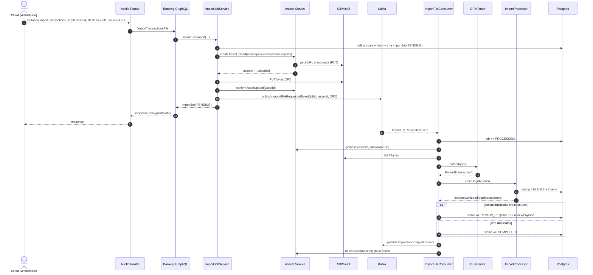
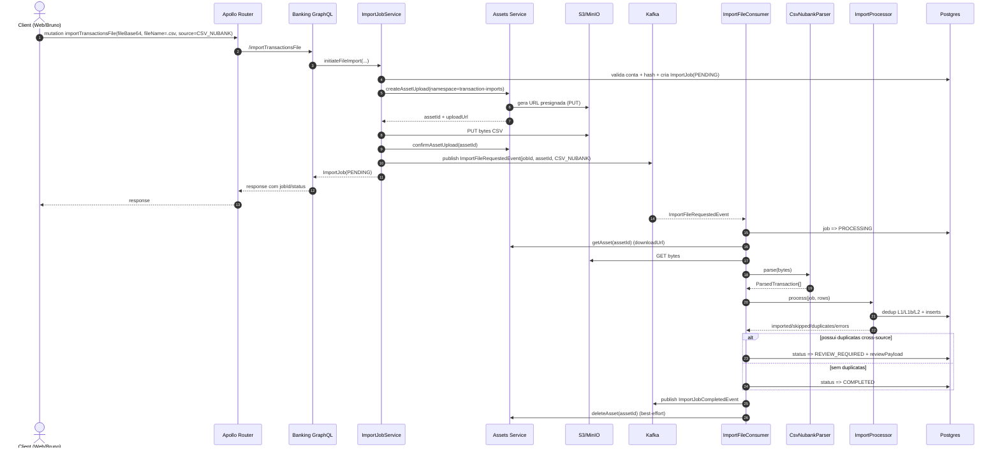

# Upload e Processamento Assíncrono — OFX e CSV

Resumo rápido:
- Os dois fluxos começam em `importTransactionsFile` e criam um `ImportJob` em `PENDING`.
- O arquivo é salvo no namespace `transaction-imports` do assets service.
- O processamento é assíncrono via Kafka (`ImportFileRequestedEvent`).
- A diferença principal entre OFX e CSV está no parser (`OFXParser` vs `CsvNubankParser`) e no `source` (`OFX` vs `CSV_NUBANK`).

## OFX

## CSV (Nubank)

