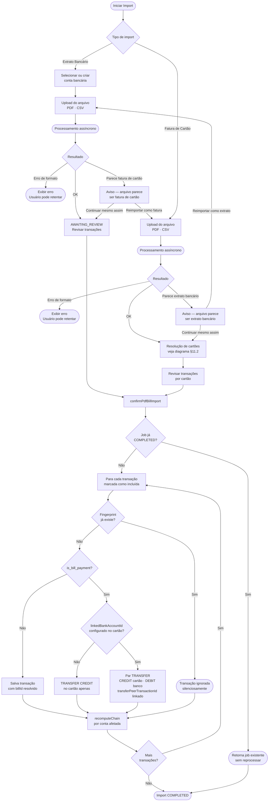
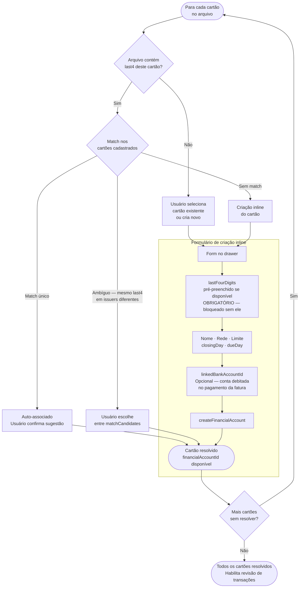

# Phase 4 v2 — Import Rules & UX Redesign

> **Purpose**: Define the full ruleset for the next iteration of the import feature, covering PDF and CSV files, credit card bill and bank statement flows, card matching/creation logic, idempotency guarantees, and the bill payment (transfer pair) model.

---

## 1. Import Types — Always Explicit

The user **must always choose the import type upfront**, before uploading any file. There is no automatic inference of document type from file content alone.

### Available types

| Type | Description |
|---|---|
| `CREDIT_CARD_BILL` | A fatura (bill) from a credit card — one or more cards per file |
| `BANK_STATEMENT` | A bank account statement (extrato bancário) |

> **Rationale**: CSV exports from Nubank fatura contain only `date`, `title`, `amount` — no last 4 digits, no bank name. Inferring type from content would be unreliable and silently create wrong data.

### Error detection (best-effort)

After upload, if the extracted content strongly contradicts the declared type, show a non-blocking warning:

- User declared `BANK_STATEMENT` but file shows installments, negative "Pagamento recebido" rows, no running balance → *"Este arquivo parece ser uma fatura de cartão. Deseja reimportar como fatura?"*
- User declared `CREDIT_CARD_BILL` but file shows PIX/TED deposits, running balance column → *"Este arquivo parece ser um extrato bancário. Deseja reimportar como extrato?"*

Detection is advisory only — the user may override and proceed.

---

## 2. One File = One Bill (Fatura)

A single uploaded file always maps to exactly **one `CreditCardBill`** (when type is `CREDIT_CARD_BILL`).

That bill may reference **one or more physical cards** (e.g. a Bradesco PDF that shows the main card and an additional card on the same statement). Each physical card is represented as a `FinancialAccount` with `type = CREDIT` in the system.

```
File
 └── Bill (1)
      ├── Card A (last4: 5048)  → FinancialAccount.id = uuid-a
      └── Card B (last4: 1639)  → FinancialAccount.id = uuid-b
```

For bank statements, the file maps to exactly **one `FinancialAccount`** with `type = BANK`.

---

## 3. Card Matching Rules

After the LLM/extractor processes the file, each card section in the bill is matched against existing `FinancialAccount` records for the current `accountId`.

### 3.0 `lastFourDigits` — obrigatoriedade por contexto

| Contexto | Obrigatoriedade |
|---|---|
| Criação geral de conta (Settings) | Opcional — hint "facilita o import automático" |
| Criação inline durante import (cartão não encontrado) | **Obrigatório na UI** — o botão confirmar fica bloqueado sem ele |
| Arquivo sem last4 (ex: Nubank CSV) | Campo aparece vazio; usuário preenche manualmente na criação inline |

> **Rationale**: quando o usuário está no fluxo de import e cria um cartão inline, ele tem a fatura ou o cartão físico em mãos — o last4 está disponível. Sem ele, futuras importações do mesmo arquivo sempre cairão em "sem match", degradando a experiência.

### 3.1 When the file contains `last_four_digits`

| Condition | Action |
|---|---|
| Exactly one account matches `cardLastFourDigits` | Auto-match. `matchedFinancialAccountId` is set. User sees a suggestion to confirm. |
| Multiple accounts match (same last4, different issuers) | `matchAmbiguous = true`. User must choose from `matchCandidates`. |
| No account matches | `matchedFinancialAccountId = null`. User must create the card (see §4). |

### 3.2 When the file does NOT contain `last_four_digits` (e.g. Nubank CSV)

- Matching by last4 is impossible.
- User **must explicitly select** an existing card or create a new one.
- The `lastFourDigits` field on the extracted card will be `null` or empty; the form allows the user to fill it in during card creation.

### 3.3 Matching is per-card, not per-file

Each card section within the same file is matched independently. A file with two cards may result in one auto-matched and one requiring creation.

---

## 4. Card Creation Inline (Unmatched Cards)

When a card has no match and requires creation, the confirmation flow pauses at that card and presents a mini creation form **within the same drawer/wizard**.

### Data pre-filled from extraction

| Field | Source |
|---|---|
| `cardLastFourDigits` | Extracted `lastFourDigits` (readonly if present) |
| `issuerName` | Extracted `bankName` (editable) |
| `closingDay` | Extracted `closingDate.day` (editable) |
| `dueDay` | Extracted `dueDate.day` (editable) |
| `subtype` | Defaulted to `CREDIT_CARD` (user can change) |

### Data the user must provide

- Account name (e.g. "Nubank Roxinho")
- Card network (Visa, Mastercard, etc.)
- Credit limit (optional)
- `linkedBankAccountId` — the bank account from which bill payments are debited (optional; see §7)

### Multi-card wizard

If the file has N unmatched cards, the wizard presents N sequential steps (or N forms stacked in the drawer). All cards must be resolved (matched or created) before the final confirmation button is enabled.

### Account creation is separate from bill confirmation

The frontend:
1. Calls `createFinancialAccount` for each new card → receives UUIDs.
2. Then calls `confirmPdfBillImport` with all `financialAccountId` values resolved.

The backend's `confirmPdfBillImport` always expects a valid `financialAccountId` per card — it never creates accounts internally.

---

## 5. Idempotency Rules

All import operations **must be idempotent**. Re-submitting the same file or re-confirming the same job must not create duplicate transactions.

### 5.1 Job-level deduplication

A `PdfImportJob` has a unique `fingerprint` derived from:
- `accountId`
- `SHA-256(fileBytes)`

If a job with the same fingerprint already exists and is in state `COMPLETED`, the new submission is rejected with `DUPLICATE_IMPORT` error.

If the existing job is in `FAILED` or `AWAITING_REVIEW`, it may be resubmitted (replaces the old job).

### 5.2 Transaction-level deduplication (`ImportFingerprintService`)

Each transaction created from an import carries a `importFingerprint` composed of:

```
SHA-256(financialAccountId + date + description + amount + creditDebitType)
```

Before saving, the system checks if a non-deleted transaction with the same fingerprint already exists for the `accountId`. If so, the transaction is **skipped** (not duplicated, not errored).

**Rules:**
- Fingerprint check is scoped to `accountId` (tenant boundary).
- Soft-deleted transactions (`deleted_at IS NOT NULL`) do NOT block re-import — they are considered gone.
- Bill payment TRANSFER pairs are fingerprinted on the card side only; the bank side peer is always created/skipped together.

### 5.3 Confirmation idempotency

`confirmPdfBillImport` for a job already in `COMPLETED` state returns the existing job without re-processing.

---

## 6. Transaction Rules per Type

### 6.1 Regular card transaction

- `type` = `CARD` (or appropriate subtype)
- `creditDebitType` = as extracted
- `billId` = resolved via `CreditCardBillService.resolveBillForTransaction(date, closingDay, dueDay)`
- Subject to fingerprint deduplication (§5.2)

### 6.2 Installment transactions

- Each installment row is a **separate transaction** with its own `date` and `amount` (the single installment value, not the total).
- The `installment` field carries `{ current, total }` for display purposes only — it does not affect billing or deduplication logic.
- Fingerprint includes `amount` (per-installment value), so each installment is individually deduplicated.

### 6.3 Bill payment (`is_bill_payment = true`)

A transaction flagged as bill payment represents the user paying off a previous bill balance. This must **not** create a regular card expense; instead it creates a TRANSFER pair to avoid double-counting.

#### Card side
- `financialAccountId` = the card account
- `type` = `TRANSFER`
- `creditDebitType` = `CREDIT` (reduces the card's outstanding balance)
- `billId` = `null` (bill payments are not assigned to any bill cycle)

#### Bank side (only if `linkedBankAccountId` is set on the card's `CardData`)
- `financialAccountId` = `linkedBankAccountId`
- `type` = `TRANSFER`
- `creditDebitType` = `DEBIT` (deducts from bank account)
- `transferPeerTransactionId` = card side transaction ID
- Card side is updated with `transferPeerTransactionId` = bank side transaction ID

If `linkedBankAccountId` is `null`, only the card side CREDIT is created. The bank debit must be imported separately (e.g. via bank statement import).

#### Why TRANSFER?

`TRANSFER` type is excluded from `totalIncome` and `totalExpenses` in `MonthlyBalanceSnapshot` calculations, preventing the bill payment from appearing as both an expense (card statement) and a deduction (bank statement).

---

## 7. Linked Bank Account (`linkedBankAccountId`)

A credit card account (`FinancialAccount` with `type = CREDIT`) may optionally reference a bank account via `cardData.linkedBankAccountId`.

This field:
- Is set by the user during card creation or card edit.
- Drives automatic TRANSFER pair creation for bill payments (§6.3).
- Is optional — a card without a linked bank account is fully supported; bill payments will only generate the card-side CREDIT.

---

## 8. Bill (Fatura) Lifecycle

Each `CreditCardBill` covers a closing cycle determined by `closingDay` and `dueDay` from the card's `CardData`.

| Field | Description |
|---|---|
| `closingDate` | Last day of the billing cycle. Computed from transaction date + `closingDay`. |
| `dueDate` | Payment due date. First occurrence of `dueDay` after `closingDate`. |
| `totalAmount` | SUM(DEBIT) - SUM(CREDIT) of non-deleted, non-`BALANCE_ADJUSTMENT` transactions with `billId = this bill`. |
| `status` | `OPEN` → `CLOSED` → `PAID` / `OVERDUE` |

### Bill auto-creation

Bills are created lazily: `CreditCardBillService.resolveBillForTransaction()` creates the bill if it doesn't exist for the computed `closingDate`. The unique constraint `uq_credit_card_bills_account_closing` prevents duplicates.

### Multi-card bill

A single `CreditCardBill` represents the fatura for **one physical card**. If a PDF contains two cards (e.g. main + additional), each card gets its own `CreditCardBill` record, even though they arrived in the same file. The `PdfImportJob` references all affected `financialAccountId`s.

---

## 9. Bank Statement Import Rules

### 9.1 Account matching

Before upload, the user selects the `FinancialAccount` (bank account). No inference — always explicit.

### 9.2 Transaction type

All transactions from a bank statement are `type = BANK` (or matching `TransactionType` enum). TRANSFER detection (recognising a bank-side debit as a mirror of an existing card-side CREDIT) is **out of scope** for v2 — the user handles this manually via the transfer pairing UI.

### 9.3 Idempotency

Same fingerprint rules apply (§5.2).

---

## 10. API Contract Summary

### Submit

```graphql
mutation {
  submitPdfBillImport(input: {
    fileName: String!
    fileBase64: String!
    importType: ImportType!          # NEW: CREDIT_CARD_BILL | BANK_STATEMENT
    financialAccountId: ID           # Required for BANK_STATEMENT; optional for CREDIT_CARD_BILL
  }): PdfImportJob!
}
```

### Review payload (`PdfBillExtractionResult`)

```
cards[]:
  lastFourDigits: String?
  matchedFinancialAccountId: ID?
  matchAmbiguous: Boolean!
  matchCandidates: [{ id, name }]
  transactions[]:
    date, description, amount, creditDebitType
    installment: { current, total }?
    isBillPayment: Boolean!
    confidence: Float
```

### Confirm

```graphql
mutation {
  confirmPdfBillImport(input: {
    jobId: ID!
    cards: [{
      lastFourDigits: String!
      financialAccountId: ID!          # Must always be resolved before confirming
      transactions: [{
        date, description, amount, creditDebitType
        include: Boolean!
        isBillPayment: Boolean
        installment: { current, total }?
      }]
    }]
  }): PdfImportJob!
}
```

---

## 11. Frontend UX Flow

Two diagrams: the **main flow** (paths from start to completion) and the **card matching detail** (zoom on the card resolution step).

### 11.1 Main flow



---

### 11.2 Resolução de cartões (detalhe)

Executado para **cada cartão** presente no arquivo, em sequência. Todos devem ser resolvidos antes da etapa de revisão de transações.



---

### 11.3 Estados do job e transições

```
PENDING           → processamento em andamento
AWAITING_REVIEW   → extração concluída; aguarda confirmação do usuário
COMPLETED         → confirmação processada com sucesso
FAILED            → erro irrecuperável (formato inválido, LLM falhou, etc.)
```

| De | Para | Gatilho |
|---|---|---|
| `PENDING` | `AWAITING_REVIEW` | Worker conclui extração com sucesso |
| `PENDING` | `FAILED` | Erro de extração / formato inválido |
| `AWAITING_REVIEW` | `COMPLETED` | `confirmPdfBillImport` processado |
| `AWAITING_REVIEW` | `FAILED` | Erro durante salvamento das transações |
| `AWAITING_REVIEW` | `AWAITING_REVIEW` | `confirmPdfBillImport` de job já `COMPLETED` retorna o job existente sem alterar estado |

> **Job expirado**: não há TTL implementado. Um job em `AWAITING_REVIEW` permanece nesse estado indefinidamente até o usuário confirmar ou o job ser descartado manualmente.

---

## 12. Test Scenarios Matrix

> There is no literal “all possible scenarios” in a mathematical sense (infinite combinations of text/value/format).  
> The practical goal is **exhaustive coverage by equivalence classes + boundaries + concurrency**.

### 12.1 How to test comprehensively (in practice)

Use 5 complementary layers:

1. **Unit tests (deterministic)**
   - Pure rules: matching, fingerprint, dedup, bill resolution, input validation.
2. **Integration tests (real DB + domain services)**
   - Idempotency with real constraints, soft-delete behavior, recomputes, status transitions.
3. **Contract tests (GraphQL + Kafka payloads)**
   - `submitPdfBillImport`/`confirmPdfBillImport`, enums, required fields, event payload shape.
4. **E2E UI/API (user flow)**
   - Multi-card wizard, inline creation, contradictory type warnings, confirm-button blocking.
5. **Concurrency/resilience**
   - Parallel submit of the same file, confirm retries, event replay.

### 12.2 Scenario catalog (functional + negative)

#### A) Submit / import type

| ID | Scenario | Expected |
|---|---|---|
| SUB-001 | Submit `CREDIT_CARD_BILL` with a valid file | Job created (`PENDING`) |
| SUB-002 | Submit `BANK_STATEMENT` with valid `financialAccountId` (BANK) | Job created (`PENDING`) |
| SUB-003 | Submit `BANK_STATEMENT` without `financialAccountId` | Validation error |
| SUB-004 | `financialAccountId` from another tenant | Authorization/validation error |
| SUB-005 | File with invalid extension/type | Validation error |
| SUB-006 | File above max size limit | Validation error |
| SUB-007 | Same fingerprint with existing `COMPLETED` job | `DUPLICATE_IMPORT` |
| SUB-008 | Same fingerprint with existing `FAILED` job | Resubmit allowed (replace) |
| SUB-009 | Same fingerprint with existing `AWAITING_REVIEW` job | Resubmit allowed (replace) |
| SUB-010 | Declared type contradicts extracted content (bill vs statement) | Non-blocking warning |

#### B) Card matching

| ID | Scenario | Expected |
|---|---|---|
| MATCH-001 | `last4` with exactly 1 match | `matchedFinancialAccountId` is set |
| MATCH-002 | `last4` with multiple matches | `matchAmbiguous=true` + `matchCandidates` |
| MATCH-003 | `last4` with no match | `matchedFinancialAccountId=null` |
| MATCH-004 | File without `last4` | User must select/create card explicitly |
| MATCH-005 | File with 2+ cards (mixed result) | Per-card matching, independent outcomes |

#### C) Inline card creation

| ID | Scenario | Expected |
|---|---|---|
| INLINE-001 | Prefilled fields (`issuerName`, `closingDay`, `dueDay`) | Form opens prefilled |
| INLINE-002 | `lastFourDigits` present | Read-only in form |
| INLINE-003 | `lastFourDigits` absent | User fills manually |
| INLINE-004 | Empty `lastFourDigits` in inline flow | Confirm button stays disabled |
| INLINE-005 | N unresolved cards | Wizard requires all to be resolved before confirm |
| INLINE-006 | 2 inline card creations | 2 `createFinancialAccount` calls before confirm |

#### D) Confirmation and idempotency

| ID | Scenario | Expected |
|---|---|---|
| CONF-001 | `confirmPdfBillImport` on `AWAITING_REVIEW` | Processes and moves to `COMPLETED` |
| CONF-002 | `confirmPdfBillImport` on `COMPLETED` | Returns existing job without reprocessing |
| CONF-003 | Job in invalid status for confirm | Validation error |
| CONF-004 | Fingerprint already exists (regular tx) | Transaction skipped silently |
| CONF-005 | Fingerprint already exists (bill payment) | TRANSFER pair skipped together |
| CONF-006 | Soft-deleted tx with same fingerprint | Reimport allowed |

#### E) Transaction rules (bill)

| ID | Scenario | Expected |
|---|---|---|
| TX-001 | Regular DEBIT purchase | `type=CARD`, `billId` resolved |
| TX-002 | CREDIT reversal on bill | `type=CARD`, `creditDebitType=CREDIT` |
| TX-003 | Installment `3/12` | Single installment tx, `installment={3,12}` |
| TX-004 | `is_bill_payment=true` without `linkedBankAccountId` | Creates only card-side TRANSFER CREDIT |
| TX-005 | `is_bill_payment=true` with `linkedBankAccountId` | Creates pair (card CREDIT + bank DEBIT) with peer IDs |
| TX-006 | Bill payment has no `billId` | `billId=null` |

#### F) Bank statement rules

| ID | Scenario | Expected |
|---|---|---|
| BS-001 | Statement import with explicit BANK account | Transactions linked to selected account |
| BS-002 | Mixed statement rows (PIX/TED/boleto/deposit) | Processed as bank transactions |
| BS-003 | No auto-pairing with card bill payments | No automatic transfer matching (v2) |
| BS-004 | Duplicate fingerprint in statement | Row skipped (idempotency) |

#### G) Job state machine / errors

| ID | Scenario | Expected |
|---|---|---|
| JOB-001 | Happy path | `PENDING -> AWAITING_REVIEW -> COMPLETED` |
| JOB-002 | Parsing/extraction failure | `PENDING -> FAILED` |
| JOB-003 | Failure during confirmation | `AWAITING_REVIEW -> FAILED` |
| JOB-004 | Retry after `FAILED` | New processing allowed |

#### H) Security and tenant isolation

| ID | Scenario | Expected |
|---|---|---|
| SEC-001 | Confirm with `financialAccountId` from another tenant | Blocked |
| SEC-002 | Query job from wrong tenant | Job not returned |
| SEC-003 | Tenant A fingerprint does not affect tenant B | Full isolation |

### 12.3 Combinatorial matrix (pairwise)

To approximate “all scenarios” without combinatorial explosion, generate pairwise cases over these axes:

- `importType`: `CREDIT_CARD_BILL`, `BANK_STATEMENT`
- `fileFormat`: `PDF`, `CSV`
- `cardsInFile`: `0`, `1`, `2+`
- `last4Presence`: `present`, `absent`
- `matchState`: `unique`, `ambiguous`, `none`
- `txNature`: `regular`, `installment`, `bill_payment`
- `linkedBankAccount`: `null`, `set`
- `fingerprintState`: `new`, `duplicate_active`, `duplicate_soft_deleted`
- `jobInitialState`: `PENDING`, `AWAITING_REVIEW`, `COMPLETED`, `FAILED`

Criterion: every pair of values across axes must appear in at least 1 automated test case.

### 12.4 Coverage acceptance criteria

- 100% of critical scenarios (`SUB-007`, `CONF-002`, `TX-004`, `TX-005`, `SEC-001`) covered by automated tests.
- All job states and valid/invalid transitions covered.
- Idempotency regression protection with replay tests (same file + same confirm).
- Minimum concurrency tests:
  - parallel submit of the same file (2 concurrent requests)
  - parallel confirm of the same job (2 concurrent requests)
- Contract tests for versioned GraphQL/Kafka payloads.

### 12.5 Recommended pipeline execution

1. Fast PR checks: unit + contract.
2. Nightly: integration + concurrency + E2E.
3. Release candidate: full suite with anonymized real fixtures (Nubank, Itaú, Bradesco multi-card, mixed bank statement).

---

## 13. Open Questions / Out of Scope for v2

| Topic | Decision |
|---|---|
| Auto-detect document type from file name heuristics | Out of scope — always ask user |
| TRANSFER pairing for bank-statement debits matching card bill payments | Out of scope — manual pairing UI |
| OFX import unification with this flow | Out of scope — OFX has its own pipeline |
| Partial bill payment (payment < totalAmount) | Supported — `is_bill_payment` flag applies regardless of amount |
| Multiple files for the same bill period | Not supported — one job per file; duplicates are rejected by fingerprint |
