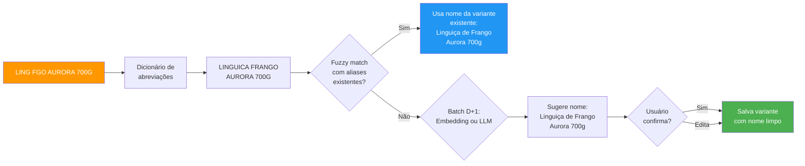

# Product Price Tracking — Requirements Document

**Service:** Invistus Banking Service
**Module:** Personal Finance — Product Price Tracking
**Document date:** 2026-03-31
**Status:** Phases 0, 1A, 1B and 2A completed — infrastructure, catalogue, synchronous standardization, price analytics and NFC-e deduplication ↔ manual delivered; SVRS expansion remains delayed

---

## 1. Overview

Product Price Tracking allows the user to monitor the price of the products they consume over time, using the **NF-e / NFC-e** (Electronic Consumer Invoice) as the primary source. Today, NFC-e import already exists and creates an aggregate transaction, but **discards individual items**. This feature persists each item, normalizes products, and enables price and consumption analysis.

### Objectives

**Phase 1 — Price & Personal Consumption:**
- How much am I paying on average for product X?
- Did my consumption of product Y increase/decrease by %?
- Am I paying X% above/below the regional average?

**Phase 2 — Inflation & Cost of Living:**
- What is my personal inflation (personal basket vs IPCA)?
- If I moved cities, what would my estimated cost of living be?

---

## Implementation Status

### Phase 0 — Data Infrastructure

| Item | Status | File(s) |
|---|---|---|
| Strategy Pattern: `NfceFetcher` interface + `NfceFetcherRouter` | ✅ Completed | `service/import/nfce/NfceFetcher.kt`, `NfceFetcherRouter.kt` |
| `SpNfceFetcher` — SP HTML scraper (validated with real NFC-e, 46 items) | ✅ Completed | `service/import/nfce/SpNfceFetcher.kt`, `SpNfceHtmlParser.kt` |
| `DefaultNfceClient` as XML fallback (implements `NfceFetcher`) | ✅ Completed | `service/import/nfce/DefaultNfceClient.kt` |
| `NfceItem` with additional fields | ✅ Completed | `cEAN`, `vUnCom`, `vDesc`, `cProd`, `nItem`, `vTribItem` |
| `NfceData` with `cpfDestinatario` and `vTotTrib` | ✅ Completed | `domain/import/nfce/NfceData.kt` |
| SP parser and router unit tests | ✅ Completed | `SpNfceHtmlParserTest`, `SpNfceFetcherTest`, `NfceFetcherRouterTest`, `NfceClientTest` |
| **Phase 0.1** — `NfceData` with `cMunFG` (city IBGE code) | ✅ Completed | `domain/import/nfce/NfceData.kt`, `service/import/nfce/DefaultNfceClient.kt`, `service/import/nfce/SpNfceHtmlParser.kt` |
| **Phase 0.2** — `SvrsNfceFetcher` (~19 states) | ⏸ Postponed — outside current scope | — |
| **Phase 0.3** — Migration: all new tables (`nfce_documents`, `purchase_items`, `products`, `product_variants`, `product_alias`, `ncm_codes`) | ✅ Completed | `db/migration/V0_12__create_product_price_tracking_tables.sql` |
| **Phase 0.4** — JPA entities + mappers + repos for the new tables | ✅ Completed | `model/import/nfce/*`, `repo/import/nfce/*` |
| **Phase 0.5** — `ImportJobService.importNfce()`: persist `NfceDocument` + `PurchaseItem` with layers 1-3 | ✅ Completed | `service/import/ImportJobService.kt` |
| **Phase 0.6** — Seed `ncm_codes` (~14,000 lines IRS) | ✅ Completed | `db/migration/V0_13__seed_ncm_codes.sql` |

### Phase 1A — Catalog + Synchronous Normalization

| Item | Status | File(s) |
|---|---|---|
| CRUD of `Product` and `ProductVariant` | ✅ Completed | `service/import/nfce/ProductCatalogService.kt`, `graphql/product/ProductResolver.kt` |
| GraphQL queries + product and item mutations | ✅ Completed | `resources/graphql/schema.graphqls`, `graphql/product/*`, `web/src/lib/graphql/operations/banking/*` |
| Unmapped Items Screen (Revision) | ✅ Completed | `web/src/app/personal-finance/finance-transactions/transaction/UnmappedItemsDrawer.tsx`, `FinanceTransactionsHeaderBar.tsx`, `FinanceTransactionsDialogs.tsx` |
| SVRS Expansion (~19 states) | ⏸ Postponed — out of current Phase 1A | — |

### Phase 1B, 1C, 1D, 2A, 2B

| Phase | Status | Scope |
|---|---|---|
| Phase 1B | ✅ Completed | Price analytics by product/variant, consumption trend, comparison between establishments, dashboard and analytics by NCM |
| Phase 1C | 🔲 Pending | Automatic batch normalization + AI |
| Phase 1D | ✅ Completed | NFC-e import drawer (frontend): image upload with QR code or URL input |
| Phase 1E | ✅ Completed | NF-e visualization drawer: all document data and items, accessible from the transaction |
| Phase 2A | ✅ Completed | Matching by account + amount + 1-day window and NFC-e review/linking UX with existing manual transaction |
| Phase 2B | 🔲 Pending | Personal inflation and cost of living |

---

## 2. The Problem of Product Standardization

This is the biggest technical challenge of the feature. The same product appears in completely different ways between establishments:

```
"PIPOCA YOKI 500G"
"PIPOCA P/MICRO YOKI"
"PIPOCA"
"MILHO P/ PIPOCA 500G"
"PIPOCA DOCE 100G"
```

Furthermore:
- Units vary: UN, KG, G, L, ML, PCT, CX, FD, DZ, M, M2, M3
- Weight may or may not be in the description
- Brand may or may not be present
- NCM (8 digits) groups by tax type, but is very broad (ex: 19042000 = all prepared cereals)
- EAN/GTIN (barcode) when present is the best identifier, but it is not always included in the NFC-e

### 2.1 Normalization Strategy (6 Layers — cheapest → most expensive)

Normalization follows a layered pipeline. Each item moves through the layers in order until resolved. The goal is for **AI to be the last resort, not the first**.

| Layer | Method | Cost | Coverage (home) | Coverage (mature*) |
|---|---|---|---|---|
| 1 | EAN/GTIN internal catalog | Zero | ~0% (empty catalog) | ~40-60% |
| 2 | Reused alias (cache) | Zero | ~0% | ~30-40% |
| 3 | Same CNPJ + cProd | Zero | ~0% | ~5-10% |
| 4 | Text Heuristics | Zero | ~15-20% | ~15-20% |
| 5 | Embeddings (offline batch) | Bass | ~10% | ~5% |
| 6 | LLM (on user demand) | High | ~5% | ~2% |
| — | **Unsolved / manual** | Zero | **~65-70%** | **~3-5%** |

\* "Mature" = after ~6 months of active use with growing user base. Tiers 1-3 have a network effect: coverage grows organically as more users map products. In the beginning, most items will depend on manual mapping or will be pending for the D+1 batch (heuristics + embeddings).

#### Layer 1 — EAN/GTIN via Internal Catalog (Automatic, zero cost)

When the barcode is present on the NFC-e (`cEAN` / `cEANTrib`), it uniquely identifies the product + presentation. The match is made against the **internal cross-tenant catalog** (`product_variants.ean`): if any user has already mapped that EAN, the new item is automatically resolved. The catalog feeds on itself — the more NFC-e imported into the platform, the greater the coverage.

> **External sources of EAN — Assessment:**
>
> There is currently no open and reliable EAN/GTIN base for Brazilian products. All options evaluated are unfeasible in v1:
>
> | Source | Problem |
> |---|---|
> | Bluesoft Cosmos | ToS prohibits commercial use without agreement; free = 25 req/day; paid = R$2,000/month for 500 req |
> | Open Food Facts | ~33K BR products, very low coverage for the Brazilian market |
> | DotCompany | 50 req/day no free, non-public enterprise pricing |
> | GS1 Brazil (CNP) | Access restricted to members, pricing not public |
> | SEFAZ CCG | API requires digital certificate from NF-e issuer; manual portal is not automatic |
> | EAN-Search.org | Paid (from EUR 19/month), no focus Brazil |
> | RSC Systems | Small base, low quality |
>
> **Decision:** No dependence on external EAN source. The EAN is used exclusively as the **internal dedup key** in the cross-tenant catalog. When a product with a given EAN is mapped (by any layer), the EAN starts to resolve automatically for all users. The catalog is built organically with the use of the platform. External sources may be re-evaluated in the future if a viable option emerges.

#### Layer 2 — Reused Alias ​​(Permanent cache, zero cost)

If `raw_description` has already been mapped before (by this or another user), reuse it directly via the `product_alias` table. It works as a cache: the more NFC-e imported, the greater the coverage. Network effect between users.

#### Tier 3 — Same CNPJ + cProd (Zero cost)

Same establishment (CNPJ) + same internal code (`cProd`) = certainly the same product. Resolves items from a store that the user has purchased from before, even if the description has changed slightly.

#### Layer 4 — Text Heuristics + Abbreviation Dictionary (Zero cost, D+1 batch)

Deterministic, non-AI rules running in the nightly job:
- Normalize text: uppercase, remove accents, trim extra spaces
- **Abbreviation expansion** via dictionary (see section 2.5)
- Fuzzy match (Jaro-Winkler) against existing aliases, threshold ≥ 0.85
- Regex to extract recurring patterns: `(tag)? (product) (quantity)(unit)`
- Same NCM + high textual similarity → suggest match with high `confidence`

Flow example:
```
raw: "LING FGO AURORA 700G"
  → expandir abreviações: "LINGUICA FRANGO AURORA 700G"
  → fuzzy match contra aliases existentes
  → se match ≥ 0.85 com "LINGUICA DE FRANGO AURORA 700G" → vincula à mesma variante
```

#### Layer 5 — Batch Embeddings (Low cost, D+1 batch)

For items that no previous layer has resolved:
- Offline job (nightly or weekly, not real-time)
- Generate embedding of pending items and compare via cosine similarity with the existing catalog
- **~100x cheaper than LLM** per token processed
- Generates suggestions with `confidence` score in the `product_alias` table
- You can also suggest an expanded name for the variant using the closest embedding from the catalog
- User confirms or rejects on the review screen

#### Tier 6 — LLM On Demand (High cost, controlled usage)

Last resort. Invoked **only when the user opens the pending item review screen**, never automatically. LLM receives the item + context (NCM, similar catalog items) and does two things:
1. **Expands the description** abbreviated in a readable name: `"LING FGO AURORA 700G"` → `"Aurora Chicken Sausage 700g"`
2. **Suggest classification**: canonical product ("Chicken Sausage") + variant

### 2.2 AI Cost Mitigation

#### Shared Catalog (Cross-Tenant)

The biggest cost reduction lever. If user A mapped `"RICE CAMIL T1 5KG"` → Rice Camil 5kg, user B receives the same mapping automatically via Layer 2 (alias reused). Network effect: the more users, the less AI needed.

**Privacy:** Share only `raw_description → product_variant` (anonymous mapping). Never user data, amounts paid, or establishment information.

#### Smart Prioritization

Don't normalize everything indiscriminately. Criteria for prioritizing AI spending:
- **Recurrence:** Items purchased 3+ times have more analytical value — prioritize
- **Value:** Items with `effective_price` < R$ 1.00 probably do not justify the cost
- **Impact:** Focus on items that represent the highest % of total user spending

#### Rate Limiting per Account

Limit AI calls by period to control cost:
- Free plan: up to N AI normalizations/month (e.g. 50)
- Premium plan: highest limit or unlimited
- User can always do manual mapping without limit

#### Manual Mapping (Always available, zero cost)

User can always:
- Create a canonical product manually
- Link any NFC-e item to an existing product
- Ungroup incorrectly grouped items
- This applies both as a fallback and as a correction for incorrect suggestions.

### 2.3 NCM Limitations

NCM has good coverage (~90% of grocery items), but there are exceptions:

| Case | Example | Impact |
|---|---|---|
| **Generic NCM (catch-all)** | `21069090` "Other food preparations" | NCM exists but doesn't help — it groups different things |
| **In natura / bulk products** | Fruit and vegetables, bakery, butcher shop | Correct NCM (`07`=vegetables) but generic description ("HORTIFRUTI") |
| **Services** | Parking, washing | No NCM (empty field or `00000000`) |
| **Wrong NCM** | Issuer registration error | More common in small businesses |
| **Cancellations (CFOP 5,929)** | Items canceled within NFC-e | Can come without NCM |

**Treatment:** Items without valid NCM (`NULL`, `00000000`, or catch-all such as `21069090`, `39249000`) are excluded from analytics by NCM but remain eligible for normalization by canonical product via the other layers.

### 2.4 Short Descriptions — Expansion and Readable Name

NFC-e descriptions are proprietary and typically abbreviated. The same product appears in different forms in different stores:

```
Supermercado A:  "LING FGO AURORA 700G"
Supermercado B:  "LINGUICA FRANGO AURORA 700"
Supermercado C:  "LG FGO AUR 700G"
Atacadão:        "AURORA LING FRANGO 700G"
```

There are **4 different aliases** for the same variant. The data model clearly separates:

```
raw_description (imutável, do estabelecimento) ──── chave de matching
       ↓ alias
product_variant.name = "Linguiça de Frango Aurora 700g" ──── nome limpo, exibido ao usuário
       ↓ pertence a
product.name = "Linguiça de Frango" ──── produto canônico, para analytics agregados
```

The user never sees "LING FGO AURORA 700G" in the analytics — they see "Aurora Chicken Sausage 700g".

#### Dictionary of Common Abbreviations

Supermarkets use recurring abbreviations. A static dictionary (zero cost) solves most of the cases in layer 4:

| Abbreviation | Expansion | | Abbreviation | Expansion |
|---|---|---|---|---|
| LING | SAUSAGE | | DET | DETERGENT |
| FGO, FRANG | CHICKEN | | SAB | SOAP/SOAP |
| CX | BOX | | COND | CONDITIONER |
| PCT | PACKAGE | | DESINF | DISINFECTANT |
| BG, BEB | DRINK | | ALM, ALMOND | MEATBALLS |
| ACU, ACUC | SUGAR | | HAMB | BURGER |
| MARG | MARGARINE | | MC, MACA | LITTER |
| SC, SUC | JUICE | | BAN | BANANA |
| ERV | HERB | | ARR | RICE |
| PP, PAP | PAPER | | FJ, FEIJ | BEANS |
| LT, LTE | MILK | | MANT | BUTTER |
| BISQ, BSC | COOKIE | | SAMP | SHAMPOO |
| MACA, MAC | NOODLES | | DESOD | DEODORANT |
| MOL | SAUCE | | SOFTENER, AMAC | SOFTENER |
| PASS | BIRD* | | PRES | HAM |

\* Context-dependent: "FGO PASS" = "Frango à Passarinho", "PASS ROUPA" = "Ironing".

The dictionary is extensible and can be enriched over time as new patterns appear. Expansion is used to:
1. **Improve fuzzy matching** — "LING FGO" expanded to "LINGUICA FRANGO" matches better with existing aliases
2. **Suggest name for variant** — when the user maps, the system can pre-populate the expanded name
3. **Group by NCM + expanded description** — reduces ambiguity in layer 4

#### Name Expansion Flow



> **Note about manufacturer/distributor:** Information such as "COOPERATIVA CENTRAL AURORA ALIMENTOS" **is not in the NFC-e** — comes from the GS1 registry via EAN. Without an external EAN source, we will not have it automatically in v1. The manufacturer can be inferred by the brand in the variant name ("Aurora"), but the formal data remains for when/if we integrate with an EAN base.

### 2.5 Canonical Product Concept

A **Canonical Product** (`Product`) represents the abstract concept of the product, regardless of brand, size or supplier:

- **Example:** "White Rice" is the canonical product
  - "CAMIL T1 RICE 5KG" → White Rice, Camil brand, 5kg
  - "PRATO FINO RICE 1KG" → White Rice, Prato Fino brand, 1kg

This allows you to answer both “how much do I pay for rice?” (canonical) as "how much do I pay for Camil rice 5kg?" (specific variant).

---

## 3. Data Model

### 3.1 `banking.products` Table — Canonical Product

Represents the standardized concept of the product.

| Field | Type | Required | Notes |
|---|---|---|---|
| `id` | UUID v7 PK | Yes | |
| `account_id` | UUID | Yes | Tenant — each user has their own catalog |
| `name` | TEXT | Yes | Standardized name ("White Rice", "Whole Milk") |
| `ncm_code` | CHAR(8) | No | Most common associated NCM code |
| `default_unit` | TEXT | No | Standard unit for comparison (KG, L, UN) |
| `category` | TEXT | No | Product category (Food, Cleaning, Hygiene...) |
| `created_at` | TIMESTAMPTZ | Yes | |
| `updated_at` | TIMESTAMPTZ | Yes | |

**Unique:** `(account_id, name)` — prevents duplicates in the user catalog.

### 3.2 `banking.product_variants` Table — Variant/Presentation

Represents a specific presentation (brand + size + packaging).

| Field | Type | Required | Notes |
|---|---|---|---|
| `id` | UUID v7 PK | Yes | |
| `product_id` | UUID FK → products | Yes | Parent canonical product |
| `account_id` | UUID | Yes | Tenant |
| `name` | TEXT | Yes | Full name ("Arroz Camil Type 1 5kg") |
| `brand` | TEXT | No | Brand extracted |
| `ean` | TEXT | No | Barcode (EAN/GTIN) when available |
| `quantity_value` | NUMERIC(12,4) | No | Packaging quantity (e.g. 500) |
| `quantity_unit` | TEXT | No | Packaging unit (e.g. G, ML, UN) |
| `normalized_quantity_value` | NUMERIC(12,4) | No | Quantity converted to standard unit (ex: 0.5 KG) |
| `normalized_quantity_unit` | TEXT | No | Standard unit (KG, L, UN) |
| `created_at` | TIMESTAMPTZ | Yes | |
| `updated_at` | TIMESTAMPTZ | Yes | |

**Unique:** `(account_id, ean)` WHERE ean IS NOT NULL — EAN is globally unique.

### 3.3 `banking.product_alias` Table — Raw Description Mapping → Variant

Each distinct NFC-e description (`xProd`) is an alias that points to a variant.

| Field | Type | Required | Notes |
|---|---|---|---|
| `id` | UUID v7 PK | Yes | |
| `product_variant_id` | UUID FK → product_variants | Yes | Associated variant |
| `account_id` | UUID | Yes | Tenant |
| `raw_description` | TEXT | Yes | NFC-e's original xProd |
| `source` | TEXT | Yes | How it was created: MANUAL, AI_SUGGESTED, EAN_MATCH, HEURISTIC |
| `confidence` | NUMERIC(3,2) | No | Match confidence (0.00–1.00); null for MANUAL |
| `confirmed` | BOOLEAN | Yes | If the user confirmed the mapping |
| `created_at` | TIMESTAMPTZ | Yes | |

**Unique:** `(account_id, raw_description)` — same description always maps to the same variant.

### 3.4 `banking.purchase_items` Table — Purchase Items

Each individual item of each imported NFC-e.

| Field | Type | Required | Notes |
|---|---|---|---|
| `id` | UUID v7 PK | Yes | |
| `transaction_id` | UUID FK → transactions | Yes | Parent transaction (the purchase) |
| `account_id` | UUID | Yes | Tenant |
| `product_variant_id` | UUID FK → product_variants | No | Null if not yet normalized |
| `sequence` | INT | Yes | Item order in NFC-e (nItem, 1-based) |
| `raw_description` | TEXT | Yes | original xProd |
| `ncm_code` | CHAR(8) | No | Item NCM |
| `ean` | TEXT | No | cEAN of the item ("WITHOUT GTIN" treated as null) |
| `issuer_product_code` | TEXT | No | cProd — internal product code in the issuer |
| `quantity` | NUMERIC(12,4) | Yes | qCom |
| `unit` | TEXT | Yes | uCom |
| `unit_price` | NUMERIC(18,4) | Yes | vUnCom (gross unit price, without discount) |
| `total_price` | NUMERIC(18,4) | Yes | vProd (gross value = qCom × vUnCom, **no discount**) |
| `discount` | NUMERIC(18,4) | No | vDesc (discount applied to this item; default 0) |
| `effective_price` | NUMERIC(18,4) | Yes | vProd - vDesc (amount actually paid; computed on insert) |
| `created_at` | TIMESTAMPTZ | Yes | |

**Consistency rule:** `Σ(effective_price)` of all items ≈ `vNF` (total NFC-e), which may differ due to rounding or additions (freight, insurance, ICMS ST).

**Index:** `(product_variant_id, created_at)` — for price history queries.

### 3.5 `banking.nfce_documents` Table — Document Metadata

Persists NFC-e metadata separately from the transaction, allowing for reprocessing.

| Field | Type | Required | Notes |
|---|---|---|---|
| `id` | UUID v7 PK | Yes | |
| `transaction_id` | UUID FK → transactions | Yes | 1:1 with transaction |
| `account_id` | UUID | Yes | Tenant |
| `access_key` | CHAR(44) | Yes | chNFe — access key |
| `issuer_cnpj` | CHAR(14) | Yes | Issuer's CNPJ |
| `issuer_name` | TEXT | Yes | Name/business name |
| `emission_date` | TIMESTAMPTZ | Yes | dhEmi |
| `total_value` | NUMERIC(18,4) | Yes | vNF |
| `municipality_code` | TEXT | No | cMunFG (IBGE code) |
| `municipality` | TEXT | No | xMun |
| `state` | CHAR(2) | Yes | UF |
| `xml_url` | TEXT | No | Original QR code URL |
| `created_at` | TIMESTAMPTZ | Yes | |

**Unique:** `(account_id, access_key)` — prevents duplicate NFC-e.

### 3.6 `banking.ncm_codes` table — NCM reference (static lookup)

Reference table to translate NCM code into readable name. Public data from the Federal Revenue (~14,000 lines). Annual update.

| Field | Type | Notes |
|---|---|---|
| `code` | TEXT PK | NCM code (2, 4, 6 or 8 digits) |
| `description` | TEXT | Official description |
| `depth` | INT | Level: 1=chapter, 2=position, 3=subposition, 4=item |

NCM Hierarchy:

```
Capítulo  (2 dígitos)  → "Cereais"                  (10)
Posição   (4 dígitos)  → "Arroz"                     (1006)
Subposição(6 dígitos)  → "Arroz branqueado"           (1006.30)
Item      (8 dígitos)  → "Arroz parboilizado polido"  (1006.30.21)
```

---

## 4. Unit of Measurement — Standardization

To allow unit price comparison between different presentations, we need to normalize units to a **base unit** per category:

| Group | Accepted units | Base unit | Conversion |
|---|---|---|---|
| Pasta | G, KG, MG | KG | 1 KG = 1000 G |
| Volume | ML, L | L | 1 L = 1000 ML |
| Unit | UN, PCT, CX, DZ, FD, SC, PR | UN | No automatic conversion* |
| Length | M, CM, MM | M | 1M = 100CM |

\* For UN-like: the conversion depends on the context (1 PCT of 6 = 6 UN). This can be entered manually or extracted from the description.

The field `normalized_quantity_value` + `normalized_quantity_unit` in `product_variants` stores the result of the conversion.

**Normalized unit price** = `effective_price / normalized_quantity_value`

> **Important:** The price for analytics is always the `effective_price` (amount paid), not the `total_price` (gross amount).
> `vProd` in NFC-e is **always the gross value (without discount)**. The discount is separated in `vDesc`.
> The sum that matches the total invoice is: `vNF = Σ(vProd - vDesc) + shipping + insurance + ICMS ST - other discounts`.

Example:
- "WHOLE MILK 1L" → vProd=5.99, vDesc=0.00 → effective=5.99 → 1.0 L → R$ 5.99/L
- "PARMALAT MILK 200ML" → vProd=3.50, vDesc=1.00 → effective=2.50 → 0.2 L → R$ 12.50/L

---

## 5. User Flows

### 5.1 NFC-e Import — Complete Flow

The flow separates **persistence (synchronous)** from **normalization (asynchronous D+1)**:


### 5.2 Normalization of Pending Items

Items with `product_variant_id = null` or `confirmed = false` are accessible on the review screen:

1. **Items with suggestion (from batch):** Displays suggestion with confidence score, user confirms or rejects
2. **Items without suggestion:** User can:
   - Ask for AI suggestion (layer 6, on-demand)
   - Choose existing product from catalog → create alias
   - Create new product + variant → creates everything and aliases
   - Ignore → item is left without a product (does not go into product analytics, but goes into analytics via NCM)

### 5.3 NFC-e Deduplication ↔ Manual Transaction

**Scenario 1: User created manual transaction, then imports NFC-e**
- Dedup by: same `financial_account_id` + `date` ± 1 day + equal `amount`
- If match found → offer user:
  - "We found a transaction of R$157.32 on 03/20 that could be the same purchase. Link?"
  - If yes → enriches the existing transaction with NFC-e data (items, CNPJ, etc.)
  - If not → create new transaction

**Scenario 2: User imported NFC-e, then tries to import again**
- Dedup by `access_key` (chNFe) — already implemented today via `SameSourceDedupService`

**Scenario 3: User imported NFC-e, then creates similar manual transaction**
- Do not block — manual transaction is always allowed
- Optionally: show warning "You already have a purchase of R$X on the same day at this establishment"

---

## 6. NFC-e Parser — Architecture by State

### 6.1 Problem: each SEFAZ returns data differently

The NFC-e QR code points to the SEFAZ public consultation portal of the issuing state. **Each state returns data in a different format:**

- **Some return XML** (nodes `<infNFe>`, `<det>`, `<prod>`) — the current parser takes this format
- **SP (and others) return HTML** — page rendered for consumer query
- The **summary page** (HTML) usually just shows: `xProd`, `cProd`, `qCom`, `uCom`, `vUnCom`, `vProd`
- The **detail page** ("View in Tabs" in SP) contains `NCM`, `cEAN` and other fields — but requires interaction (ASP.NET postback)

### 6.2 Grouping by query system

Most states share the SVRS system, which reduces the number of parsers needed:

| System | States | Base URL | Format |
|---|---|---|---|
| **SVRS** | RS, AC, AL, AP, BA, CE, DF, ES, MA, PA, PB, PI, RJ, RN, RO, RR, SC, SE, TO (~19) | `dfe-portal.svrs.rs.gov.br` | Checking |
| **SP** | SP | `nfce.fazenda.sp.gov.br` | HTML (scraper) |
| **MG** | MG | `nfce.fazenda.mg.gov.br` | Checking |
| **PR** | PR | `nfce.fazenda.pr.gov.br` | Checking |
| **MT** | MT | `nfce.sefaz.mt.gov.br` | Checking |
| **MS** | MS | `nfce.fazenda.ms.gov.br` | Checking |
| **GO** | GO | `nfe.sefaz.go.gov.br` | Checking |
| **AM** | AM | `nfce.sefaz.am.gov.br` | Checking |
| **PE** | PE | `nfce.sefaz.pe.gov.br` | Checking |

**Strategy:** current rollout in SP first. SVRS and other states can be added incrementally when this expansion becomes a priority.

### 6.3 SP — Validated Scraper (2-step HTTP, no CAPTCHA)

The SP scraper was **successfully validated** in real NFC-e (46 items). The flow consists of 2 simple HTTP requests, without the need for a headless browser or CAPTCHA:

#### Step 1 — GET the QR code URL
```
GET https://www.nfce.fazenda.sp.gov.br/NFCeConsultaPublica/...
Headers:
  User-Agent: Mozilla/5.0 (Macintosh; Intel Mac OS X 10_15_7) ...
  Accept: text/html,application/xhtml+xml,...
  Accept-Language: pt-BR,pt;q=0.9,en-US;q=0.8
```
Returns the summary page (HTML). From it extract:
- Session Cookies (Set-Cookie)
- `__VIEWSTATE`, `__VIEWSTATEGENERATOR`, `__EVENTVALIDATION` (hidden form fields)

#### Step 2 — POST the "View in Tabs" postback
```
POST https://www.nfce.fazenda.sp.gov.br/.../ConsultaResumidaRJFrame_v400.aspx
Headers: (mesmos do GET + Content-Type: application/x-www-form-urlencoded + Cookie + Origin + Referer)
Body:
  __EVENTTARGET=btnVisualizarAbas
  __EVENTARGUMENT=
  __VIEWSTATE=<valor extraído>
  __VIEWSTATEGENERATOR=<valor extraído>
  __EVENTVALIDATION=<valor extraído>
```
Returns the detailed page (~700KB HTML) with **all fields** for each item, including NCM and EAN.

#### Regex patterns for extracting fields (validated)
```
xProd:   fixo-prod-serv-descricao">\s*<span>([^<]+)</span>
NCM:     Código NCM</label>\s*<span[^>]*>([^<]*)</span>
cEAN:    Código EAN Comercial</label>\s*<span[^>]*>([^<]*)</span>
cProd:   Código do Produto</label>\s*<span[^>]*>([^<]*)</span>
vUnCom:  Valor unitário de comercialização</label>\s*<span[^>]*>([^<]*)</span>
vDesc:   Valor do Desconto</label>\s*<span[^>]*>([^<]*)</span>
qCom:    Quantidade Comercial</label>\s*<span[^>]*>([^<]*)</span>
uCom:    Unidade Comercial</label>\s*<span[^>]*>([^<]*)</span>
vProd:   Valor do Produto</label>\s*<span[^>]*>([^<]*)</span>
```

> **Important:** Browser headers (User-Agent, Accept, Accept-Language) are essential. Without them, SEFAZ redirects to the CAPTCHA page. With proper headers, there is no CAPTCHA.

> **NBSP Attention:** SEFAZ SP's HTML uses non-breaking spaces (`U+00A0`) inside the labels (e.g. `Valor\u00A0Total\u00A0da\u00A0Nota\u00A0Fiscal`). The parser must normalize NBSPs to regular spaces before applying regex.

> **Municipality:** The field returns in the format `"CÓDIGO_IBGE - NomeCidade"` (ex: `"3547809 - Santo Andre"`). Extract only the part after the `-`.

### 6.4 Architecture: Strategy Pattern by State

```kotlin
interface NfceFetcher {
    /** States this fetcher supports (UF codes). */
    fun supportedStates(): Set<String>

    /** Fetch and parse full NFC-e data from the QR code URL. */
    fun fetch(qrCodeUrl: String): NfceData
}

// Implementations:
// - SpNfceFetcher      → scraper HTML para SP (2-step HTTP, seção 6.3)
// - SvrsNfceFetcher    → parser para SVRS (~19 estados)
// - MgNfceFetcher      → parser para MG
// - GenericNfceFetcher  → fallback: extrai o que puder da resposta
```

The issuing state can be identified by the **first 2 digits of the chNFe** (UF code in the access key):

| UF code | Status |
|---|---|
| 35 | SP |
| 43 | RS |
| 33 | RJ |
| 31 | MG |
| 41 | PR |
| ... | ... |

Routing: `chNFe[0..1]` → UF → selects the correct `NfceFetcher`.

### 6.5 Fields to extract (all parsers)

The current parser (`NfceItem`) extracts:
- `xProd`, `vProd`, `qCom`, `uCom`, `ncm`

All parsers/scrapers must additionally extract:

| Field | Description | Priority |
|---|---|---|
| `cEAN` / `cEANTrib` | EAN/GTIN barcode — best unique product identifier | Essential |
| `vUnCom` | Commercial unit value — price without rounding risk | Important |
| `vDesc` | Item discount amount — required to calculate effective_price | Important |
| `nItem` | Item sequential number in XML/HTML — ordering/reference | Nice to have |
| `cProd` | Internal product code at the issuer — dedup per establishment (tier 3) | Nice to have |
| `vTotTrib` (item) | Approximate Value of Taxes per item (Law 12,741/2012) — tax burden analytics | Important |

And at the document level:
- `cMunFG` — IBGE code for the municipality (for regional analysis)
- `cpfDestinatario` — Buyer's CPF (for BI analytics, cross-reference between accounts)
- `vTotTrib` — Total value of NF taxes (Law 12,741/2012) — "how much tax did I pay on this purchase"

> **Note:** Not all parsers will be able to extract all fields (it depends on what SEFAZ offers). Unavailable fields are `null`. The system works with partial data — layered normalization deals with absences.

---

## 7. GraphQL API

### 7.1 Types

```graphql
type Product {
  id: ID!
  name: String!
  ncmCode: String
  defaultUnit: String
  category: String
  variants: [ProductVariant!]!
  # Analytics
  averagePrice: BigDecimal          # preço médio unitário normalizado
  priceHistory: [PricePoint!]!      # série temporal
  totalSpent: BigDecimal            # total gasto neste produto
  purchaseCount: Int!               # quantas vezes comprou
}

type ProductVariant {
  id: ID!
  product: Product!
  name: String!
  brand: String
  ean: String
  quantityValue: BigDecimal
  quantityUnit: String
  normalizedQuantityValue: BigDecimal
  normalizedQuantityUnit: String
  averageUnitPrice: BigDecimal      # preço médio normalizado desta variante
}

type PurchaseItem {
  id: ID!
  transaction: Transaction!
  productVariant: ProductVariant
  sequence: Int!
  rawDescription: String!
  ncmCode: String
  ean: String
  quantity: BigDecimal!
  unit: String!
  unitPrice: BigDecimal!
  totalPrice: BigDecimal!           # vProd — valor bruto (sem desconto)
  discount: BigDecimal              # vDesc — desconto no item
  effectivePrice: BigDecimal!       # vProd - vDesc — valor efetivamente pago
  normalizedUnitPrice: BigDecimal   # computed: effectivePrice / normalized qty
  taxAmount: BigDecimal             # vTotTrib item — tributos aproximados (Lei 12.741)
}

type PricePoint {
  date: Date!
  unitPrice: BigDecimal!
  storeName: String
  municipality: String
  state: String
}

type NfceDocument {
  id: ID!
  transaction: Transaction!
  accessKey: String!
  issuerCnpj: String!
  issuerName: String!
  emissionDate: DateTime!
  totalValue: BigDecimal!
  totalTax: BigDecimal              # vTotTrib — tributos totais da NF (Lei 12.741)
  buyerCpf: String                  # CPF do destinatário (comprador)
  municipality: String
  state: String!
  items: [PurchaseItem!]!
}

type UnmappedItemGroup {
  rawDescription: String!
  count: Int!
  suggestedProduct: Product
  suggestedVariant: ProductVariant
  confidence: Float
  sampleItems: [PurchaseItem!]!
}

type NcmSpending {
  ncmCode: String!
  ncmDescription: String            # nome legível da tabela de lookup
  totalSpent: BigDecimal!
  itemCount: Int!
  months: [NcmMonthlySpending!]!
}

type NcmMonthlySpending {
  month: Date!
  totalSpent: BigDecimal!
  itemCount: Int!
}
```

### 7.2 Queries

```graphql
type Query {
  # Catálogo de produtos
  products(accountId: ID!, search: String, category: String): [Product!]!
  product(id: ID!): Product

  # Itens de uma transação
  purchaseItems(transactionId: ID!): [PurchaseItem!]!

  # Documento NFC-e
  nfceDocument(transactionId: ID!): NfceDocument

  # Itens pendentes de normalização
  unmappedItems(accountId: ID!, limit: Int): [UnmappedItemGroup!]!

  # Analytics — Fase 1
  productPriceHistory(
    productId: ID!
    variantId: ID
    startDate: Date
    endDate: Date
  ): [PricePoint!]!

  productConsumptionTrend(
    productId: ID!
    periodMonths: Int = 6
  ): ConsumptionTrend!

  # Analytics por NCM (automático, sem normalização)
  spendingByNcm(
    accountId: ID!
    depth: Int = 4          # 2=capítulo, 4=posição, 6=subposição, 8=item
    startDate: Date
    endDate: Date
  ): [NcmSpending!]!
}
```

### 7.3 Mutations

```graphql
type Mutation {
  # Produto canônico
  createProduct(input: CreateProductInput!): Product!
  updateProduct(id: ID!, input: UpdateProductInput!): Product!
  mergeProducts(sourceId: ID!, targetId: ID!): Product!

  # Variante
  createProductVariant(input: CreateProductVariantInput!): ProductVariant!
  updateProductVariant(id: ID!, input: UpdateProductVariantInput!): ProductVariant!

  # Mapeamento de itens
  mapItemToVariant(rawDescription: String!, variantId: ID!): ProductAlias!
  confirmAiSuggestion(aliasId: ID!, accepted: Boolean!): ProductAlias!
  unmapItem(aliasId: ID!): Boolean!

  # Import NFC-e (atualizado)
  importNfce(financialAccountId: ID!, qrCodeUrl: String!): ImportResult!
}
```

---

## 8. Analysis — Phase 1

### 8.1 Average Product Price

```sql
SELECT
  pv.product_id,
  p.name AS product_name,
  AVG(pi.effective_price / pv.normalized_quantity_value) AS avg_unit_price,
  MIN(pi.effective_price / pv.normalized_quantity_value) AS min_unit_price,
  MAX(pi.effective_price / pv.normalized_quantity_value) AS max_unit_price,
  COUNT(*) AS purchase_count
FROM banking.purchase_items pi
JOIN banking.product_variants pv ON pv.id = pi.product_variant_id
JOIN banking.products p ON p.id = pv.product_id
JOIN banking.transactions t ON t.id = pi.transaction_id
WHERE t.account_id = :accountId
  AND t.deleted_at IS NULL
  AND t.date BETWEEN :startDate AND :endDate
GROUP BY pv.product_id, p.name;
```

### 8.2 Consumer Trend

```sql
SELECT
  DATE_TRUNC('month', t.date) AS month,
  SUM(pi.quantity) AS total_quantity,
  SUM(pi.effective_price) AS total_spent,
  COUNT(DISTINCT t.id) AS purchase_count
FROM banking.purchase_items pi
JOIN banking.transactions t ON t.id = pi.transaction_id
WHERE pi.product_variant_id IN (
  SELECT id FROM banking.product_variants WHERE product_id = :productId
)
AND t.account_id = :accountId
AND t.deleted_at IS NULL
GROUP BY DATE_TRUNC('month', t.date)
ORDER BY month;
```

### 8.3 Comparison between Establishments

In Phase 1, without external regional data, the comparison is **between the user's own establishments**:

```sql
SELECT
  nd.issuer_name AS store_name,
  nd.municipality,
  AVG(pi.effective_price / pv.normalized_quantity_value) AS avg_unit_price,
  COUNT(*) AS purchase_count
FROM banking.purchase_items pi
JOIN banking.product_variants pv ON pv.id = pi.product_variant_id
JOIN banking.transactions t ON t.id = pi.transaction_id
JOIN banking.nfce_documents nd ON nd.transaction_id = t.id
WHERE pv.product_id = :productId
  AND t.account_id = :accountId
  AND t.deleted_at IS NULL
  AND t.date BETWEEN :startDate AND :endDate
GROUP BY nd.issuer_name, nd.municipality
ORDER BY avg_unit_price;
```

Result: *"You pay 15% less for rice at Atacadão vs Pão de Açúcar"*.

### 8.4 Analytics by NCM (automatic, without normalization)

It works **since day zero**, without the user normalizing any product:

```sql
SELECT
  LEFT(pi.ncm_code, :depth) AS ncm_group,   -- 2, 4, 6 ou 8 dígitos
  nc.description AS ncm_description,
  SUM(pi.effective_price) AS total_spent,
  COUNT(*) AS item_count,
  DATE_TRUNC('month', t.date) AS month
FROM banking.purchase_items pi
JOIN banking.transactions t ON t.id = pi.transaction_id
LEFT JOIN banking.ncm_codes nc ON nc.code = LEFT(pi.ncm_code, :depth)
WHERE t.account_id = :accountId
  AND t.deleted_at IS NULL
  AND pi.ncm_code IS NOT NULL
  AND pi.ncm_code NOT IN ('00000000')
  AND t.date BETWEEN :startDate AND :endDate
GROUP BY LEFT(pi.ncm_code, :depth), nc.description, DATE_TRUNC('month', t.date)
ORDER BY total_spent DESC;
```

#### NCM complementarity × canonical product

| Dimension | NCM | Canonical product |
|---|---|---|
| User Effort | Zero | Requires mapping |
| Granularity | Grossa (tax type) | Fina (brand + presentation) |
| Coverage | ~90% of NFC-e items | Only mapped items |
| Standardized unit price | No (mixes presentations) | Yes (normalized by kg/L/un) |
| Available since | Day zero | After normalization |

**Strategy:** NCM provides the automatic overview; canonical product adds precision where the user invests effort.

---

## 9. Implementation Phasing

> Detailed tickets for each phase are in section 13 — Detailed Backlog.
> Nomenclature: **Phase 0.1**, **Phase 0.2** etc. = Phase 0 sub-tasks; **Phase 1A.1** etc. = sub-tasks of Phase 1A.

### Phase 0 — Data Infrastructure (prerequisite)

- [x] NFC-e parser refactored to Strategy Pattern (`NfceFetcher`, `NfceFetcherRouter`)
- [x] `SpNfceFetcher` (HTML SP scraper) implemented and validated with real NFC-e
- [x] `DefaultNfceClient` as XML fallback
- [x] `NfceItem` with additional fields (`cEAN`, `vUnCom`, `vDesc`, `cProd`, `nItem`, `vTribItem`)
- [x] `NfceData` with `cpfDestinatario` and `vTotTrib`
- [x] **Phase 0.1** — Add `cMunFG` to `NfceData`
- [x] **Phase 0.3** — Migration: new tables (`nfce_documents`, `purchase_items`, `products`, `product_variants`, `product_alias`, `ncm_codes`)
- [x] **Phase 0.4** — JPA entities + mappers + repos for the new tables
- [x] **Phase 0.5** — Update `ImportJobService.importNfce()` to persist `NfceDocument` + `PurchaseItem` with synchronous resolution (layers 1-3)
- [x] **Phase 0.6** — Seed `ncm_codes` (~14,000 lines IRS)

### Phase 1A — Product Catalog + Synchronous Standardization
- [x] CRUD of `Product` and `ProductVariant`
- [x] Manual mapping: unmapped items screen
- [x] Basic GraphQL queries and mutations (section 7)
- [ ] State Expansion — `SvrsNfceFetcher` (~19 states) remains deferred outside of current scope

### Phase 1B — Price Analytics

> **Why before batch?** Analytics delivers immediate value for those who have already mapped products manually in Phase 1A. Batching is only useful when the catalog has enough volume for fuzzy matches and embeddings to generate reliable suggestions — which takes real-world usage time to build.

- [x] Price history by product/variant
- [x] Monthly consumption trend
- [x] Comparison between establishments (same user)
- [x] Product dashboard
- [x] Analytics by NCM (no normalization, automatic — see section 8.4)

### Phase 1C — Automatic Normalization (Batch + AI)

> **Precondition:** it only makes sense to implement when the platform has real users and a catalog populated enough to measure whether suggestions are being accepted.

- [ ] Job scheduled (daily) for items with `product_variant_id IS NULL`
- [ ] Layer 4: text heuristics (Jaro-Winkler fuzzy match, regex, NCM + similarity)
- [ ] Layer 5: batch embedding service
- [ ] Tier 6: On-Demand LLM on Review Screen
- [ ] Review queue with pending suggestions (confidence score)
- [ ] Confirmed aliases backdated via layers 1-2 for future imports

### Phase 2A — NFC-e Deduplication ↔ Manual
- [x] Matching by date + amount + account
- [x] Confirmation/Binding UX

### Phase 2B — Personal Inflation & Cost of Living
- [ ] Calculation of personal inflation index (user basket vs IPCA)
- [ ] Integration with regional data (IBGE/POF)
- [ ] Cost of living simulation by municipality

---

## 10. Decisions Made

| # | Decision | Resolution |
|---|---|---|
| 1 | Import granularity | **1 transaction via NFC-e** (definitive model). Per-item granularity exists in `purchase_items` — creating N transactions for 1 NF-e would break balance, invoice and statement. |
| 2 | Cross-tenant aliases | **Aliases shared as suggestions** (confirmed=false). Canonical product catalog is per tenant. Pollution-free network effect. |
| 3 | Retroactivity | **Yes, synchronous.** When creating alias, immediate UPDATE on all `purchase_items` with the same `raw_description` and `product_variant_id IS NULL`. |
| 4 | NF-e model 55 | **Yes**, bear it. Similar XML structure; needs a specific fetcher per state. |
| 5 | ICMS ST and additions | **Compose everything.** `vICMSST`, `vFrete`, `vSeg` must be included and presented to the user. |
| 6 | External source of EAN | **None in v1.** 100% self-powered catalog via cross-tenant. |
| 7 | Parser by state | **Strategy Pattern.** SP = HTML scraper; SVRS = ~19 states; other incremental. |
| 8 | recipient CPF | **Import.** Buyer's CPF stored in `nfce_documents.buyer_cpf` for BI analytics. |
| 9 | Taxes | **Import both.** Total per NF (`vTotTrib` in `nfce_documents`) and per item (`vTribItem` in `purchase_items`). Allows tax burden analysis by category/product. |
| 10 | Coverage of states in Phase 0 | **SP only.** `SpNfceFetcher` already implemented and validated. `SvrsNfceFetcher` (~19 states) remains postponed to a future phase — it depends on prior investigation of the SVRS portal response format, and the initial user base is SP. |
| 11 | Order Phase 1B vs batch | **Analytics before batch.** Phase 1B = price analytics (delivers immediate value). Batch D+1 and AI (formerly 1B/1C) moved to Phase 1C — only make sense when the catalog has a real volume of use to validate the quality of the suggestions. |

## 11. Open Questions

1. **SVRS — response format:** investigation remains pending and outside current scope. If the portal returns XML, the current parser can be reused with few changes.
2. **State coverage:** current rollout remains in SP. Reprioritize SVRS and other states based on actual user distribution.
3. **Indices in the database:** Define suitable indexes for `purchase_items` and `product_alias` before implementing, considering analytics query patterns (section 8).

## 12. Solved Questions

1. **~~Scraper SP — "View in Tabs"~~:** Validated successfully. ASP.NET Postback works via 2 simple HTTP requests (no headless browser, no CAPTCHA). Requires browser headers. See section 6.3.

---

## 13. Detailed Backlog — Phase 0

Detailed tickets for all Phase 0 sub-tasks, in the same nomenclature used in section 9.
Parallel items can be developed simultaneously.

> **Context for implementation:**
> - Framework: **Micronaut** (not Spring Boot). Use `@Singleton`, `@Repository`, `@Transactional` from `jakarta.*`.
> - JPA: `JpaRepository<Entity, UUID>`. Custom queries via `@Query(nativeQuery = true)`.
> - IDs: generated by the database via `uuidv7()` — use `@Generated(event = [EventType.INSERT])` with `insertable = false`.
> - Architectural pattern: domain interface in `repo/<subpackage>/` → `Default*` implementation in the same package → `*EntityRepository` (JPA). See `CreditCardBillRepository` + `DefaultCardBillRepository` + `CreditCardBillEntityRepository` as canonical reference.
> - Entity pattern: see `CreditCardBillEntity` — `open class`, extends `BaseEntity<UUID?>`, `open var` fields.
> - Mapper pattern: see `CreditCardBillMapper` — `object` with `toDomain(entity)`.
> - Unit tests: JUnit 5 + Mockito-Kotlin + AssertJ. Integration tests extend `BankingPostgresIntegrationTest`.

---

### Phase 0.1 — Add `cMunFG` to `NfceData`

**Dependencies:** none | **Parallel with Phase 0.2, 0.3, 0.6**

#### Scope

Add the IBGE code of the issuing municipality (`cMunFG`) to the domain and to the two existing parsers.

#### How to implement

**`domain/import/nfce/NfceData.kt`**
```kotlin
val cMunFG: String? = null,   // Código IBGE do município emissor (ex: "3547809")
```

**`service/import/nfce/DefaultNfceClient.kt`** — in the XML extraction block:
```kotlin
val cMunFG = doc.getElementsByTagName("cMunFG").item(0)?.textContent?.trim()
```
Add to the constructor of the returned `NfceData`.

**`service/import/nfce/SpNfceHtmlParser.kt`** — the municipality string already arrives as `"3547809 - Santo Andre"`. Extract only the numeric part before the `-`:
```kotlin
val cMunFG = extractMunicipio(html)
    ?.let { raw -> raw.substringBefore("-").trim().takeIf { it.isNotEmpty() } }
```
Where `extractMunicipio` returns the raw string of the field. Adjust the extraction to return the code and name separately, or create `extractMunicipioCodigo` and `extractMunicipioNome`.

#### Acceptance criteria

- [x] `NfceData.cMunFG` compiled without breaking existing callers (nullable field defaults to null).
- [x] `DefaultNfceClientTest` (already existing): add case with XML that contains `<cMunFG>3547809</cMunFG>` → assert `nfceData.cMunFG == "3547809"`.
- [x] `SpNfceHtmlParserTest` (already existing): add assert in `minimalSpHtml(municipio = "3547809 - Santo Andre")` → `nfceData.cMunFG == "3547809"`.
- [x] When `<cMunFG>` missing from XML → `cMunFG == null` (do not throw exception).

---

### Phase 0.2 — `SvrsNfceFetcher` (~19 states)

**Dependencies:** none | **Parallel with Phase 0.1, 0.3, 0.6**

> ⚠️ **Investigation prerequisite:** This ticket can only be implemented after checking the actual response format from the SVRS portal. Make an HTTP request to the URL of an NFC-e QR code from RS, RJ or BA and inspect the response before encoding.

#### Scope

Create `SvrsNfceFetcher` covering ~19 states that use the `dfe-portal.svrs.rs.gov.br` portal.

**States UF codes:** 43 (RS), 33 (RJ), 29 (BA), 23 (CE), 53 (DF), 32 (ES), 21 (MA), 15 (PA), 25 (PB), 22 (PI), 24 (RN), 11 (RO), 14 (RR), 42 (SC), 28 (SE), 17 (TO), 12 (AC), 16 (AP), 27 (AL)

#### How to implement

**Path A — SVRS returns XML** (most likely):

Create `SvrsNfceFetcher` which just passes to `DefaultNfceClient` internally:
```kotlin
@Singleton
class SvrsNfceFetcher(private val defaultNfceClient: DefaultNfceClient) : NfceFetcher {
    override fun supportedUfCodes() = setOf("43", "33", "29", "23", "53", "32", "21",
        "15", "25", "22", "24", "11", "14", "42", "28", "17", "12", "16", "27")

    override fun fetch(qrCodeUrl: String): NfceData = defaultNfceClient.fetch(qrCodeUrl)
}
```

**Path B — SVRS returns HTML:**

Implement `SvrsNfceHtmlParser` analogous to `SpNfceHtmlParser`, adapting the CSS/regex selectors to the SVRS HTML.

#### Acceptance criteria

- [ ] `SvrsNfceFetcher.supportedUfCodes()` returns the 19 UF codes listed above.
- [ ] `NfceFetcherRouterTest`: add case with URL whose chNFe starts with `43` (RS) → routes to `SvrsNfceFetcher`.
- [ ] Unit test with real SVRS sample HTML or XML (capture and save as fixture in `test/resources`).
- [ ] Path A: `SvrsNfceFetcherTest` checks that `fetch()` delegates to `DefaultNfceClient`.
- [ ] Path B: parser extracts `xProd`, `vProd`, `qCom`, `uCom`, `ncm`, `cEAN` correctly from the sample.

---

### Phase 0.3 — Migration: new tables

**Dependencies:** none | **Parallel with Phase 0.1, 0.2, 0.6**

**File:** `service/kotlin/banking/src/main/resources/db/migration/V0_12__create_product_price_tracking_tables.sql`

#### Scope

Create the 6 tables in the `banking` schema with all indexes. Next available migration is V0_12 (V0_11 already exists).

#### Complete DDL

```sql
-- nfce_documents: metadados da NF-e (1:1 com transactions)
CREATE TABLE banking.nfce_documents (
    id                UUID PRIMARY KEY DEFAULT uuidv7(),
    transaction_id    UUID NOT NULL REFERENCES banking.transactions(id),
    account_id        UUID NOT NULL,
    access_key        CHAR(44) NOT NULL,
    issuer_cnpj       CHAR(14) NOT NULL,
    issuer_name       TEXT NOT NULL,
    emission_date     TIMESTAMPTZ NOT NULL,
    total_value       NUMERIC(18,4) NOT NULL,
    total_tax         NUMERIC(18,4),
    buyer_cpf         TEXT,
    municipality_code TEXT,
    municipality      TEXT,
    state             CHAR(2) NOT NULL,
    xml_url           TEXT,
    created_at        TIMESTAMPTZ NOT NULL DEFAULT now(),
    CONSTRAINT uq_nfce_documents_account_key UNIQUE (account_id, access_key)
);

-- products: produto canônico por tenant
CREATE TABLE banking.products (
    id           UUID PRIMARY KEY DEFAULT uuidv7(),
    account_id   UUID NOT NULL,
    name         TEXT NOT NULL,
    ncm_code     CHAR(8),
    default_unit TEXT,
    category     TEXT,
    created_at   TIMESTAMPTZ NOT NULL DEFAULT now(),
    updated_at   TIMESTAMPTZ NOT NULL DEFAULT now(),
    CONSTRAINT uq_products_account_name UNIQUE (account_id, name)
);

-- product_variants: apresentação específica (marca + tamanho + embalagem)
CREATE TABLE banking.product_variants (
    id                        UUID PRIMARY KEY DEFAULT uuidv7(),
    product_id                UUID NOT NULL REFERENCES banking.products(id),
    account_id                UUID NOT NULL,
    name                      TEXT NOT NULL,
    brand                     TEXT,
    ean                       TEXT,
    quantity_value            NUMERIC(12,4),
    quantity_unit             TEXT,
    normalized_quantity_value NUMERIC(12,4),
    normalized_quantity_unit  TEXT,
    created_at                TIMESTAMPTZ NOT NULL DEFAULT now(),
    updated_at                TIMESTAMPTZ NOT NULL DEFAULT now(),
    CONSTRAINT uq_product_variants_ean UNIQUE (ean) -- EAN é globalmente único entre todos os tenants
);

-- product_alias: mapeamento raw_description → variant
-- Cross-tenant: qualquer usuário pode ter um alias para a mesma raw_description
-- account_id é por tenant; confirmed=true significa que o usuário validou
CREATE TABLE banking.product_alias (
    id                  UUID PRIMARY KEY DEFAULT uuidv7(),
    product_variant_id  UUID NOT NULL REFERENCES banking.product_variants(id),
    account_id          UUID NOT NULL,
    raw_description     TEXT NOT NULL,
    source              TEXT NOT NULL CHECK (source IN ('MANUAL','AI_SUGGESTED','EAN_MATCH','HEURISTIC')),
    confidence          NUMERIC(3,2),
    confirmed           BOOLEAN NOT NULL DEFAULT false,
    created_at          TIMESTAMPTZ NOT NULL DEFAULT now(),
    CONSTRAINT uq_product_alias_account_description UNIQUE (account_id, raw_description)
);

-- purchase_items: itens individuais de cada NFC-e importada
CREATE TABLE banking.purchase_items (
    id                  UUID PRIMARY KEY DEFAULT uuidv7(),
    transaction_id      UUID NOT NULL REFERENCES banking.transactions(id),
    account_id          UUID NOT NULL,
    product_variant_id  UUID REFERENCES banking.product_variants(id),
    sequence            INT NOT NULL,
    raw_description     TEXT NOT NULL,
    ncm_code            CHAR(8),
    ean                 TEXT,
    issuer_product_code TEXT,
    quantity            NUMERIC(12,4) NOT NULL,
    unit                TEXT NOT NULL,
    unit_price          NUMERIC(18,4) NOT NULL,
    total_price         NUMERIC(18,4) NOT NULL,   -- vProd (bruto, sem desconto)
    discount            NUMERIC(18,4),             -- vDesc
    effective_price     NUMERIC(18,4) NOT NULL,    -- vProd - vDesc
    tax_amount          NUMERIC(18,4),             -- vTribItem (Lei 12.741)
    created_at          TIMESTAMPTZ NOT NULL DEFAULT now()
);

-- ncm_codes: referência estática (dados Receita Federal)
CREATE TABLE banking.ncm_codes (
    code        TEXT PRIMARY KEY,
    description TEXT NOT NULL,
    depth       INT  NOT NULL CHECK (depth BETWEEN 1 AND 4)
);
```

**Indices:**
```sql
CREATE INDEX idx_nfce_documents_transaction  ON banking.nfce_documents(transaction_id);
CREATE INDEX idx_nfce_documents_account_date ON banking.nfce_documents(account_id, emission_date DESC);

CREATE INDEX idx_purchase_items_transaction  ON banking.purchase_items(transaction_id);
CREATE INDEX idx_purchase_items_account      ON banking.purchase_items(account_id);
CREATE INDEX idx_purchase_items_variant_date ON banking.purchase_items(product_variant_id, created_at DESC)
    WHERE product_variant_id IS NOT NULL;
CREATE INDEX idx_purchase_items_unmapped     ON banking.purchase_items(account_id)
    WHERE product_variant_id IS NULL;
CREATE INDEX idx_purchase_items_ncm          ON banking.purchase_items(account_id, ncm_code)
    WHERE ncm_code IS NOT NULL;

CREATE INDEX idx_product_alias_variant       ON banking.product_alias(product_variant_id);
CREATE INDEX idx_product_alias_description   ON banking.product_alias(raw_description); -- cross-tenant EAN/alias lookup
CREATE INDEX idx_product_variants_product    ON banking.product_variants(product_id);
CREATE INDEX idx_product_variants_ean        ON banking.product_variants(ean)
    WHERE ean IS NOT NULL;
```

#### Acceptance criteria

- [x] Migration applies without errors on local Docker (`./gradlew :banking:testIntegration` uploads the container).
- [x] All UNIQUE and CHECK constraints have been created.
- [x] `product_variants.ean` is globally unique (without `account_id` in the constraint) — reflecting that EAN identifies the tenant-independent product.
- [x] Flyway does not complain about checksums or conflicts with existing migrations.

---

### Phase 0.4 — JPA Entities + Mappers + Repositories

**Dependencies:** Phase 0.3

#### Scope

Create the infrastructure layer for `nfce_documents` and `purchase_items`. The `products`, `product_variants` and `product_alias` tables are created by the B0-3 migration but their complete JPA entities (with CRUD) are left for Phase 1A — here only creating the minimum necessary for B0-5.

#### Pattern to follow

Follow the `CreditCardBill*` pattern exactly:
- Entity: `model/transaction/CreditCardBillEntity.kt`
- Mapper: `model/transaction/CreditCardBillMapper.kt`
- Domain interface: `repo/transaction/CreditCardBillRepository.kt`
- JPA repo: `repo/transaction/CreditCardBillEntityRepository.kt`
- Default impl: `repo/transaction/DefaultCreditCardBillRepository.kt`

#### Files to create

**Package `model/import/nfce/`:**

`NfceDocumentEntity.kt`
```kotlin
@Entity
@Table(name = "nfce_documents", schema = "banking")
open class NfceDocumentEntity(
    @Id @Generated(event = [EventType.INSERT])
    @Column(columnDefinition = "uuid", insertable = false, updatable = false)
    override val id: UUID? = null,
    @Column(name = "transaction_id", nullable = false) open var transactionId: UUID,
    @Column(name = "account_id",     nullable = false) open var accountId: UUID,
    @Column(name = "access_key",     nullable = false) open var accessKey: String,
    @Column(name = "issuer_cnpj",    nullable = false) open var issuerCnpj: String,
    @Column(name = "issuer_name",    nullable = false) open var issuerName: String,
    @Column(name = "emission_date",  nullable = false) open var emissionDate: Instant,
    @Column(name = "total_value",    nullable = false, precision = 18, scale = 4) open var totalValue: BigDecimal,
    @Column(name = "total_tax",      precision = 18, scale = 4) open var totalTax: BigDecimal? = null,
    @Column(name = "buyer_cpf")      open var buyerCpf: String? = null,
    @Column(name = "municipality_code") open var municipalityCode: String? = null,
    @Column(name = "municipality")   open var municipality: String? = null,
    @Column(name = "state",          nullable = false) open var state: String,
    @Column(name = "xml_url")        open var xmlUrl: String? = null,
    @Column(name = "created_at",     nullable = false) open var createdAt: Instant = Instant.now(),
) : BaseEntity<UUID?>(id)
```

`NfceDocumentMapper.kt` — `object NfceDocumentMapper` with `toDomain(entity)` and `toEntity(domain)`.

`PurchaseItemEntity.kt` — fields according to B0-3 DDL. Same pattern as `NfceDocumentEntity`.

`PurchaseItemMapper.kt` — `object PurchaseItemMapper` with `toDomain(entity)`.

**Package `repo/import/nfce/`:**

`NfceDocumentRepository.kt` — domain interface:
```kotlin
interface NfceDocumentRepository {
    fun findByAccountKeyAndAccountId(accessKey: String, accountId: UUID): NfceDocument?
    fun save(document: NfceDocument): NfceDocument
}
```

`NfceDocumentEntityRepository.kt` — JPA:
```kotlin
@Repository
interface NfceDocumentEntityRepository : JpaRepository<NfceDocumentEntity, UUID> {
    fun findByAccessKeyAndAccountId(accessKey: String, accountId: UUID): NfceDocumentEntity?
}
```

`DefaultNfceDocumentRepository.kt` — `@Singleton`, delegates to `NfceDocumentEntityRepository`.

`PurchaseItemRepository.kt` — domain interface:
```kotlin
interface PurchaseItemRepository {
    fun saveAll(items: List<PurchaseItem>): List<PurchaseItem>
    fun findByTransactionId(transactionId: UUID, accountId: UUID): List<PurchaseItem>
}
```

`PurchaseItemEntityRepository.kt` — JPA with `saveAll` inherited from `JpaRepository`.

`DefaultPurchaseItemRepository.kt` — `@Singleton`.

#### Acceptance criteria

- [x] `./gradlew :banking:compileKotlin` BUILD SUCCESS.
- [x] `NfceDocumentRepository.save()` persists and returns with `id` filled in (generated by the database).
- [x] `NfceDocumentEntityRepository.findByAccessKeyAndAccountId()` returns null when it does not exist.
- [x] `PurchaseItemRepository.saveAll()` persists all items in batch.
- [x] No nullable field in the entity uses primitive type (use `BigDecimal?`, `String?`, not `BigDecimal`, `String` for optionals).

---

### Phase 0.5 — Update `ImportJobService.importNfce()`

**Dependencies:** Phase 0.4

#### Scope

After creating the `Transaction` (existing flow, lines 160-201 of `ImportJobService.kt`), persist `NfceDocument` and `PurchaseItem[]` with synchronous resolution of layers 1-3.

#### How to implement

**Inject via constructor:**
```kotlin
private val nfceDocumentRepository: NfceDocumentRepository,
private val purchaseItemRepository: PurchaseItemRepository,
```

**In the `importNfce()` method, after `transactionRepository.save(transaction)` (line 191):**

```kotlin
// 1. Persistir NfceDocument
val nfceDocument = nfceDocumentRepository.save(
    NfceDocument(
        transactionId  = requireNotNull(savedTransaction.id),
        accountId      = accountId,
        accessKey      = nfce.chNFe,
        issuerCnpj     = nfce.cnpjEmitente,
        issuerName     = nfce.nomeEmitente,
        emissionDate   = nfce.dhEmi,
        totalValue     = nfce.vNF,
        totalTax       = nfce.vTotTrib,
        buyerCpf       = nfce.cpfDestinatario,
        municipalityCode = nfce.cMunFG,
        municipality   = nfce.municipio,
        state          = nfce.uf,
        xmlUrl         = qrCodeUrl,
        createdAt      = now,
    )
)

// 2. Mapear itens com resolução síncrona (camadas 1-3)
val purchaseItems = nfce.items.mapIndexed { index, item ->
    val resolvedVariantId = resolveProductVariant(item, nfce.cnpjEmitente, accountId)
    PurchaseItem(
        transactionId      = requireNotNull(savedTransaction.id),
        accountId          = accountId,
        productVariantId   = resolvedVariantId,
        sequence           = item.nItem ?: (index + 1),
        rawDescription     = item.xProd,
        ncmCode            = item.ncm.takeIf { it.isNotBlank() },
        ean                = item.cEAN,                         // parser já filtra "SEM GTIN" → null
        issuerProductCode  = item.cProd,
        quantity           = item.qCom,
        unit               = item.uCom,
        unitPrice          = item.vUnCom ?: (item.vProd / item.qCom), // fallback: calcular
        totalPrice         = item.vProd,
        discount           = item.vDesc,
        effectivePrice     = item.vProd - (item.vDesc ?: BigDecimal.ZERO),
        taxAmount          = item.vTribItem,
        createdAt          = now,
    )
}
purchaseItemRepository.saveAll(purchaseItems)
```

**Private method `resolveProductVariant()`** — layers 1-3 synchronous:
```kotlin
private fun resolveProductVariant(
    item: NfceItem,
    issuerCnpj: String,
    accountId: UUID,
): UUID? {
    // Camada 1: EAN lookup (cross-tenant — EAN é globalmente único)
    if (item.cEAN != null) {
        val byEan = productVariantEntityRepository.findByEan(item.cEAN)
        if (byEan != null) return byEan.id
    }
    // Camada 2: Alias por raw_description (scoped por tenant)
    val byAlias = productAliasEntityRepository
        .findByAccountIdAndRawDescription(accountId, item.xProd)
    if (byAlias != null) return byAlias.productVariantId
    // Camada 3: Mesmo CNPJ + cProd (scoped por tenant)
    if (item.cProd != null) {
        val byCnpjProd = purchaseItemEntityRepository
            .findFirstResolvedByCnpjAndProduct(accountId, issuerCnpj, item.cProd)
        if (byCnpjProd != null) return byCnpjProd.productVariantId
    }
    return null
}
```

**Native queries required (add in `PurchaseItemEntityRepository`):**
```kotlin
@Query("""
    SELECT pi.* FROM banking.purchase_items pi
    JOIN banking.nfce_documents nd ON nd.transaction_id = pi.transaction_id
    WHERE pi.account_id = :accountId
      AND nd.issuer_cnpj = :issuerCnpj
      AND pi.issuer_product_code = :issuerProductCode
      AND pi.product_variant_id IS NOT NULL
    LIMIT 1
""", nativeQuery = true)
fun findFirstResolvedByCnpjAndProduct(
    accountId: UUID,
    issuerCnpj: String,
    issuerProductCode: String,
): PurchaseItemEntity?
```

**Dedup:** The existing dedup (line 162-165) via `sameSourceDedupService.isDuplicate(chNFe)` **remains as is** — it protects the `transactions` table. The `uq_nfce_documents_account_key` constraint is an additional safety net in the database, but does not add dedup in code in B0-5.

#### Acceptance criteria

- [x] `./gradlew :banking:compileKotlin` BUILD SUCCESS.
- [x] Integration test: `importNfce()` with NFC-e of 3 items persists 1 `NfceDocument` + 3 `PurchaseItems` in the same DB transaction.
- [x] Integration test: re-import of the same NFC-e (same `chNFe`) returns existing job without creating duplicates.
- [x] `NfceDocument.totalValue`, `emissionDate`, `issuerCnpj` match the data from `NfceData`.
- [x] `PurchaseItem.effectivePrice = vProd - vDesc` for discounted item.
- [x] `PurchaseItem.effectivePrice = vProd` for non-discount item (`vDesc = null`).
- [x] `PurchaseItem.productVariantId = null` when no layer 1-3 resolves.
- [x] Layer 1: item with EAN that already exists in `product_variants` → `productVariantId` filled in.
- [x] Layer 2: item with `raw_description` already in `product_alias` → `productVariantId` filled in.
- [x] Failure in `purchaseItemRepository.saveAll()` rolls back `NfceDocument` and `Transaction` (all in the same `@Transactional`).

---

### Phase 0.6 — Seed `ncm_codes`

**Dependencies:** Phase 0.3 | **Parallel with Phase 0.4 and 0.5**

#### Scope

Populate the `banking.ncm_codes` table with the ~14,000 Federal Revenue NCM codes, at the 4 hierarchical levels.

#### Strategy

Use **separate Flyway migration** `V0_13__seed_ncm_codes.sql`. Despite the volume (~14K lines), it is the simplest approach and ensures that every environment (dev, staging, prod) receives data automatically upon deployment.

**Data source:** Download the NCM table on the Federal Revenue website:
- URL: https://www.gov.br/receitafederal/pt-br/assuntos/aduana-e-comercio-exterior/classificacao-fiscal-de-mercadorias/tabela-ncm
- Format: XLS/XLSX, export to CSV

**Format of each line in SQL:**
```sql
INSERT INTO banking.ncm_codes (code, description, depth) VALUES
('01',      'Animais vivos',                                      1),
('0101',    'Cavalos, asininos e muares, vivos',                  2),
('010110',  'Reprodutores de raca pura',                          3),
('01012100','Reprodutores de raça pura',                          4),
-- ...
;
```

**Accents:** Use UTF-8 without accents to avoid encoding problems in different environments, or ensure that the SQL file declares `SET client_encoding = 'UTF8'` at the beginning.

**Conversion script:** Create an auxiliary Python/Node script (outside the project, disposable) to convert the IRS CSV into INSERT SQL. Do not commit the script to the repository.

#### Acceptance criteria

- [x] Migration V0_13 applies without errors.
- [x] `SELECT COUNT(*) FROM banking.ncm_codes` ≥ 10,000 after migration.
- [x] All 4 `depth` values ​​present: `SELECT DISTINCT depth FROM banking.ncm_codes` = {1, 2, 3, 4}.
- [x] Rice NCM code (`1006`) exists with correct description.
- [x] 8-digit code `01012100` exists with `depth = 4`.

---

### Dependency Summary

```
Fase 0.1 (cMunFG)  ─────────────────────────────────────────────────────────────┐
Fase 0.3 (Migration DDL) ──→ Fase 0.4 (JPA/Repos) ──→ Fase 0.5 (ImportJobService) ─→ Fase 0 completa
Fase 0.6 (Seed NCM) ────────── (após 0.3, paralelo com 0.4/0.5) ───────────────┘

Fase 0.2 (SvrsNfceFetcher) ── ⏸ adiado para fase futura
```

Phase 0 completed with 0.1, 0.3, 0.4, 0.5 and 0.6 delivered.
Phase 1A completed for catalog and synchronous normalization.
Phase 0.2 remains explicitly postponed to a future phase.

---

## 15. Detailed Backlog — Phase 1E — NF-e Visualization Drawer (Frontend)

### Context

After importing an NF-e, the user sees the transaction on the statement, but is unable to view the coupon details (items, prices, taxes, issuer). This phase creates a drawer that displays all this data, accessible from the transaction line.

The backend is **completely implemented**: the query `nfceDocument(transactionId: ID!)` returns all the necessary fields. This phase is entirely frontend.

### Backend available

**GraphQL Query:**
```graphql
query NfceDocument($transactionId: ID!) {
  nfceDocument(transactionId: $transactionId) {
    id
    transactionId
    accessKey
    issuerCnpj
    issuerName
    emissionDate
    totalValue
    totalTax
    buyerCpf
    municipalityCode
    municipality
    state
    countryCode
    sourceUrl
    createdAt
    items {
      id
      sequence
      rawDescription
      ncmCode
      ean
      issuerProductCode
      quantity
      unit
      unitPrice
      totalPrice
      discount
      effectivePrice
      normalizedUnitPrice
      taxAmount
      productVariant {
        id
        name
        brand
        quantityValue
        quantityUnit
        normalizedQuantityValue
        normalizedQuantityUnit
        product {
          id
          name
          category
        }
      }
    }
  }
}
```

Add this query to `web/src/lib/graphql/operations/banking/queries.ts` as `NFCE_DOCUMENT`.

### Relevant files

| Archive | Paper |
|---|---|
| `web/src/app/personal-finance/finance-transactions/FinanceTransactionsDialogs.tsx` | Drawers mount point — add `NfceDocumentDrawer` here |
| `web/src/app/personal-finance/finance-transactions/page.tsx` | Controls drawer state — add `nfceDocumentTransactionId` |
| `web/src/app/personal-finance/finance-transactions/transaction/TransactionTable.tsx` | Transaction line — add icon/action to open drawer |
| `web/src/lib/graphql/operations/banking/queries.ts` | Add query `NFCE_DOCUMENT` |
| `web/src/app/personal-finance/i18n/locales/pt.json` and `en.json` | Add keys to `financeTransactions.nfceDocument.*` |

### Component to create

**`web/src/app/personal-finance/finance-transactions/transaction/NfceDocumentDrawer.tsx`**

```ts
export interface NfceDocumentDrawerProps {
  open: boolean;
  onClose: () => void;
  transactionId: string | null;
}
```

The drawer does lazy loading: it only executes the query when `open === true && transactionId !== null`.

### Drawer layout (to be defined by the user)

The user will provide the visual layout. The component must be built so that the layout is easily customizable after delivery — use standard MUI components (`Card`, `Stack`, `Divider`, `Table`/`List`) without complex custom CSS.

**Suggested information structure to guide the layout:**

**Section 1 — Issuer**
- Issuer name (`issuerName`)
- Formatted CNPJ (`issuerCnpj` — mask XX.XXX.XXX/XXXX-XX)
- Municipality + state (`municipality`, `state`)
- Issue date (`emissionDate` — formatted as local date)

**Section 2 — Items**
Table or list with each coupon item:
- Sequence number (`sequence`)
- Description (`rawDescription`) — if `productVariant` bound, show canonical name below as subtext
- Quantity + unit (`quantity`, `unit`)
- Unit price (`unitPrice`)
- Discount (`discount`) — show only if > 0
- Effective price (`effectivePrice`)
- If `normalizedUnitPrice` available → show price per normalized unit (ex: "R$ 4.50/kg")
- NCM (`ncmCode`) — show as small chip or tooltip

**Section 3 — Totals**
- Total products (`totalValue`)
- Total taxes (`totalTax`) — show only if present
- Access key (`accessKey`) — formatted in groups of 4 digits, with copy button
- Link to SEFAZ (`sourceUrl`) — "Consult SEFAZ" button that opens in a new tab

### Transaction entry point

Transactions with `source === 'NFC_E'` must display an icon/button in the table row to open the drawer. See `TransactionTable.tsx` for the row actions pattern.

State must be controlled in `page.tsx`:
```ts
const [nfceDocumentTransactionId, setNfceDocumentTransactionId] = useState<string | null>(null);
```

Pass to `FinanceTransactionsDialogs` and `TransactionTable` via props, mirroring the pattern of other existing drawers.

### i18n keys to add

Add inside `financeTransactions.nfceDocument` in `pt.json` and `en.json`:

| Key | PT | en |
|---|---|---|
| `drawerTitle` | `Electronic Invoice` | `Electronic Invoice` |
| `issuerSection` | `Issuer` | `Issuer` |
| `itemsSection` | `Items` | `Items` |
| `totalsSection` | `Totals` | `Totals` |
| `totalValue` | `Total` | `Total` |
| `totalTax` | `Taxes` | `Taxes` |
| `accessKey` | `Access key` | `Access key` |
| `copyAccessKey` | `Copy key` | `Copy key` |
| `accessKeyCopied` | `Copied key` | `Key copied` |
| `viewOnSefaz` | `Consult at SEFAZ` | `View on SEFAZ` |
| `noDocument` | `No tax documents linked to this transaction` | `No tax document linked to this transaction` |
| `perUnit` | `by {{unit}}` | `per {{unit}}` |

### Acceptance criteria

- [ ] Icon/button visible in transaction line with `source === 'NFC_E'`
- [ ] When clicked, opens drawer with data from the correct document for that transaction
- [ ] Issuer data displayed correctly (formatted CNPJ, municipality, state)
- [ ] Item list displays all relevant fields; Items with linked variant show the canonical name
- [ ] `normalizedUnitPrice` displayed where available with normalized unit
- [ ] Totals with `totalTax` visible only if present
- [ ] Functional "Copy access key" button
- [ ] `sourceUrl` present → "Consult at SEFAZ" button opens in new tab
- [ ] `nfceDocument` returns `null` → display `noDocument` message
- [ ] Loading state during the query (skeleton or spinner)
- [ ] All strings via i18n
- [ ] Error-free TypeScript

---

## 14. Detailed Backlog — Phase 1D — NFC-e Import Drawer (Frontend)

### Context

The NFC-e import backend is fully implemented. The frontend has an empty shell (`NfceImportDrawer.tsx`) already connected to the page and dialog system, but without implementation. This phase consists of implementing this drawer.

### Stack and design patterns

- **Framework:** Next.js 14 (App Router), React, Strict TypeScript
- **UI:** Material UI (MUI) v5 — see `ImportTransactionsDrawer.tsx` as style reference and component pattern
- **GraphQL:** Apollo Client — use `useMutation` from `@apollo/client/react`
- **i18n:** own system via `useTranslation(personalFinanceTranslations)` with keys in `web/src/app/personal-finance/i18n/locales/pt.json` and `en.json`
- **Status SSE:** `useImportJobStatus` hook — used in `ImportTransactionsDrawer` to receive asynchronous job events; **not applicable here** (NFC-e is synchronous — returns `COMPLETED` or `REVIEW_REQUIRED` immediately)

### Relevant files

| Archive | Paper |
|---|---|
| `web/src/app/personal-finance/finance-transactions/transaction/NfceImportDrawer.tsx` | **Implementation target** — empty shell |
| `web/src/app/personal-finance/finance-transactions/transaction/ImportTransactionsDrawer.tsx` | Pattern reference: steps, states, error handling, MUI |
| `web/src/app/personal-finance/finance-transactions/transaction/ImportDuplicateReview.tsx` | Existing component for step `review` — reuse without modification |
| `web/src/lib/graphql/operations/banking/mutations.ts` | Mutation `IMPORT_NFCE` already defined |
| `web/src/app/personal-finance/i18n/locales/pt.json` | Existing i18n keys in `financeTransactions.nfce.*` |
| `web/src/app/personal-finance/i18n/locales/en.json` | Same in English |
| `web/src/app/personal-finance/finance-transactions/FinanceTransactionsDialogs.tsx` | Already mount the drawer with `open` and `onClose` |
| `web/src/app/personal-finance/finance-transactions/page.tsx` | Controls `isNfceImportDrawerOpen` and passes `onImportCompleted` |

### Mutation GraphQL available

```graphql
mutation ImportNfce($financialAccountId: ID!, $qrCodeUrl: String!) {
  importNfce(financialAccountId: $financialAccountId, qrCodeUrl: $qrCodeUrl) {
    import {
      id
      status        # "COMPLETED" | "REVIEW_REQUIRED"
      importedCount
      skippedCount
    }
  }
}
```

Import from `web/src/lib/graphql/operations/banking/mutations.ts` as `IMPORT_NFCE`.

### Component Props

`NfceImportDrawer` already receives `open: boolean` and `onClose: () => void`. To add:

```ts
export interface NfceImportDrawerProps {
  open: boolean;
  onClose: () => void;
  selectedAccountId: string | null;           // conta financeira selecionada na página
  onImportCompleted?: () => void;             // callback para recarregar o extrato após import
}
```

Update `FinanceTransactionsDialogs.tsx` and `page.tsx` to pass `selectedAccountId` and `onImportCompleted`, mirroring what already exists for `ImportTransactionsDrawer`.

### Step flow

```
input ──→ processing ──→ result
                    ↘──→ review   (status === "REVIEW_REQUIRED")
                    ↘──→ error
```

There is no account selection step — always use `selectedAccountId` received via props (the active account on the page). If `selectedAccountId` is null, show `Alert severity="warning"` in step `input` and disable the submit button.

### Step `input` — two modes in tabs

The initial step offers two input modes via MUI tabs:

**Tab 1 — Image Upload**

- Drop zone (same visual pattern as `ImportTransactionsDrawer`) accepting images: `.jpg`, `.jpeg`, `.png`
- When selecting/dropping the image: decode the client-side QR code using the `jsQR` lib
- Install: `npm install jsqr` (only new dependency)
- Decoding flow:
  1. Read image with `FileReader.readAsDataURL`
  2. Draw on `<canvas>` outside the DOM (create via `document.createElement('canvas')`)
  3. Call `jsQR(imageData.data, width, height)` — returns `{ data: string } | null`
  4. If `null` → show error: `t('financeTransactions.nfce.qrNotFound')`
  5. If found → validate the URL (see validation below) and proceed

**Tab 2 — Manual URL Entry**

- `TextField` field with `label` and `placeholder` using key `financeTransactions.nfce.urlPlaceholder`
- "Import" button that validates the URL and submits

### URL validation

Before calling the mutation, validate that the URL belongs to a known SEFAZ domain:

```ts
const SEFAZ_DOMAINS = [
  'nfce.fazenda.sp.gov.br',
  'dfe-portal.svrs.rs.gov.br',
  'nfe.fazenda.gov.br',
];

function isValidSefazUrl(url: string): boolean {
  try {
    const { hostname } = new URL(url);
    return SEFAZ_DOMAINS.some((d) => hostname === d || hostname.endsWith(`.${d}`));
  } catch {
    return false;
  }
}
```

If invalid → show `Alert severity="error"` with key `financeTransactions.nfce.invalidUrl`.

### Step `processing`

Show `CircularProgress` centered. The mutation is synchronous, so this step only lasts the time of the HTTP request — do not use `useImportJobStatus`.

### Step `result`

`Alert severity="success"` with key `financeTransactions.nfce.success`. "Close" button that calls `onClose()` and triggers `onImportCompleted?.()`.

### Step `review`

When `status === "REVIEW_REQUIRED"`, render `<ImportDuplicateReview>` passing the `jobId` returned by the mutation. When completed: call `onImportCompleted?.()` and `onClose()`.

`ImportDuplicateReview` signature (do not modify):
```tsx
<ImportDuplicateReview
  jobId={jobId}
  onComplete={() => { onImportCompleted?.(); onClose(); }}
  onClose={onClose}
/>
```

### Step `error`

`Alert severity="error"` with the Apollo error message (use `extractErrorMessage` from `@/shared/utils/error`). "Try again" button returns to the `input` step.

### i18n keys — add in both locales

Add the following keys within `financeTransactions.nfce` in `pt.json` and `en.json` (keep the existing ones):

| Key | PT | en |
|---|---|---|
| `uploadTab` | `Image upload` | `Upload image` |
| `urlTab` | `Enter URL` | `Enter URL` |
| `uploadHint` | `Drag or click to select a photo of the NFC-e QR code` | `Drag or click to select a photo of the NFC-e QR code` |
| `qrNotFound` | `QR code not found in image. Try a clearer photo.` | `QR code not found in the image. Try a clearer photo.` |
| `invalidUrl` | `URL not recognized as valid NFC-e from SEFAZ` | `URL not recognized as a valid SEFAZ NFC-e` |
| `processing` | `Consulting SEFAZ…` | `Fetching from SEFAZ…` |

### Backend error handling

Mutation can return GraphQL errors. Map via `extractErrorCode` / `tCommon`:

| Error code | Description |
|---|---|
| `NFCE_ALREADY_IMPORTED` | Note already imported — show `Alert info` with key `financeTransactions.nfce.alreadyImported` and "Close" button |
| `SEFAZ_UNAVAILABLE` | SEFAZ unavailable — show error with retry |
| too much | Show generic message with retry |

The code `NFCE_ALREADY_IMPORTED` **is not a fatal business error** — the existing job is returned normally and the import is idempotent. The backend may return `status = COMPLETED` with `importedCount = 0` in this case; check if this is the real answer or if it comes as a GraphQL error.

### Acceptance criteria

- [ ] "Image upload" tab: when selecting a photo with a valid NFC-e QR code, it automatically extracts the URL and enables "Import"
- [ ] "Image upload" tab: when selecting an image without a QR code, it displays a `qrNotFound` error
- [ ] "Enter URL" tab: field accepts URL and validates before submitting
- [ ] Non-SEFAZ domain URL displays `invalidUrl` error
- [ ] Submit calls mutation `IMPORT_NFCE` with correct `financialAccountId` and `qrCodeUrl`
- [ ] `status === "COMPLETED"`: displays success screen and calls `onImportCompleted`
- [ ] `status === "REVIEW_REQUIRED"`: renders `ImportDuplicateReview` with the `jobId`
- [ ] Network or GraphQL error: displays error step with retry option
- [ ] All strings via i18n (no Portuguese/English text hardcode in the component)
- [ ] Error-free TypeScript (`tsc --noEmit`)
- [ ] No new dependencies other than `jsqr`
