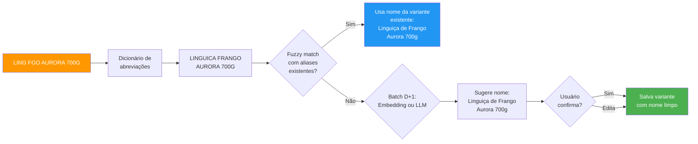
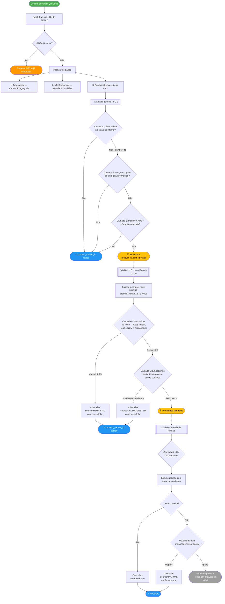

# Product Price Tracking — Requirements Document

**Service:** Invistus Banking Service
**Module:** Personal Finance — Product Price Tracking
**Document date:** 2026-03-31
**Status:** Fase 0 em andamento — parser NFC-e concluído, persistência pendente

---

## 1. Overview

Product Price Tracking permite que o usuário acompanhe o preço dos produtos que consome ao longo do tempo, usando como fonte primária a **NF-e / NFC-e** (Nota Fiscal Eletrônica do Consumidor). Hoje, o import de NFC-e já existe e cria uma transação agregada, mas **descarta os itens individuais**. Esta feature persiste cada item, normaliza produtos, e habilita análises de preço e consumo.

### Objetivos

**Fase 1 — Preço & Consumo Pessoal:**
- Quanto estou pagando em média pelo produto X?
- Meu consumo do produto Y aumentou/diminuiu em %?
- Estou pagando X% acima/abaixo da média regional?

**Fase 2 — Inflação & Custo de Vida:**
- Qual minha inflação pessoal (cesta pessoal vs IPCA)?
- Se eu mudasse de cidade, qual seria meu custo de vida estimado?

---

## Status de Implementação

### Fase 0 — Infraestrutura de Dados

| Item | Status | Arquivo(s) |
|---|---|---|
| Strategy Pattern: `NfceFetcher` interface + `NfceFetcherRouter` | ✅ Concluído | `service/import/nfce/NfceFetcher.kt`, `NfceFetcherRouter.kt` |
| `SpNfceFetcher` — scraper HTML SP (validado com NFC-e real, 46 itens) | ✅ Concluído | `service/import/nfce/SpNfceFetcher.kt`, `SpNfceHtmlParser.kt` |
| `DefaultNfceClient` como fallback XML (implementa `NfceFetcher`) | ✅ Concluído | `service/import/nfce/DefaultNfceClient.kt` |
| `NfceItem` com campos adicionais | ✅ Concluído | `cEAN`, `vUnCom`, `vDesc`, `cProd`, `nItem`, `vTribItem` |
| `NfceData` com `cpfDestinatario` e `vTotTrib` | ✅ Concluído | `domain/import/nfce/NfceData.kt` |
| Testes unitários do parser SP e roteador | ✅ Concluído | `SpNfceHtmlParserTest`, `SpNfceFetcherTest`, `NfceFetcherRouterTest`, `NfceClientTest` |
| **Fase 0.1** — `NfceData` com `cMunFG` (código IBGE do município) | 🔲 Pendente | — |
| **Fase 0.2** — `SvrsNfceFetcher` (~19 estados) | ⏸ Adiado — ver Fase 1A | — |
| **Fase 0.3** — Migration: todas as novas tabelas (`nfce_documents`, `purchase_items`, `products`, `product_variants`, `product_alias`, `ncm_codes`) | 🔲 Pendente | — |
| **Fase 0.4** — JPA entities + mappers + repos para as novas tabelas | 🔲 Pendente | — |
| **Fase 0.5** — `ImportJobService.importNfce()`: persistir `NfceDocument` + `PurchaseItem` com camadas 1-3 | 🔲 Pendente | `service/import/ImportJobService.kt` |
| **Fase 0.6** — Seed `ncm_codes` (~14.000 linhas Receita Federal) | 🔲 Pendente | — |

### Fase 1A — Catálogo + Normalização Síncrona

| Item | Status |
|---|---|
| CRUD de `Product` e `ProductVariant` | 🔲 Pendente |
| GraphQL queries + mutations de produtos e itens | 🔲 Pendente |
| Tela de itens não mapeados (revisão) | 🔲 Pendente |

### Fase 1B, 1C, 1D, 2A, 2B

Todas pendentes. Ver seção 9 — Faseamento.

---

## 2. O Problema da Normalização de Produtos

Este é o maior desafio técnico da feature. Um mesmo produto aparece de formas completamente diferentes entre estabelecimentos:

```
"PIPOCA YOKI 500G"
"PIPOCA P/MICRO YOKI"
"PIPOCA"
"MILHO P/ PIPOCA 500G"
"PIPOCA DOCE 100G"
```

Além disso:
- Unidades variam: UN, KG, G, L, ML, PCT, CX, FD, DZ, M, M2, M3
- Gramatura pode ou não estar na descrição
- Marca pode ou não estar presente
- NCM (8 dígitos) agrupa por tipo fiscal, mas é muito amplo (ex: 19042000 = todos os cereais preparados)
- EAN/GTIN (código de barras) quando presente é o melhor identificador, mas nem sempre consta na NFC-e

### 2.1 Estratégia de Normalização (6 Camadas — mais barata → mais cara)

A normalização segue uma pipeline em camadas. Cada item percorre as camadas em ordem até ser resolvido. O objetivo é que **AI seja o último recurso, não o primeiro**.

| Camada | Método | Custo | Cobertura (início) | Cobertura (maduro*) |
|---|---|---|---|---|
| 1 | EAN/GTIN catálogo interno | Zero | ~0% (catálogo vazio) | ~40-60% |
| 2 | Alias reutilizado (cache) | Zero | ~0% | ~30-40% |
| 3 | Same CNPJ + cProd | Zero | ~0% | ~5-10% |
| 4 | Heurísticas de texto | Zero | ~15-20% | ~15-20% |
| 5 | Embeddings (batch offline) | Baixo | ~10% | ~5% |
| 6 | LLM (sob demanda do usuário) | Alto | ~5% | ~2% |
| — | **Não resolvido / manual** | Zero | **~65-70%** | **~3-5%** |

\* "Maduro" = após ~6 meses de uso ativo com base de usuários crescente. As camadas 1-3 têm efeito de rede: a cobertura cresce organicamente conforme mais usuários mapeiam produtos. No início, a maior parte dos itens dependerá de mapeamento manual ou ficará pendente para o batch D+1 (heurísticas + embeddings).

#### Camada 1 — EAN/GTIN via Catálogo Interno (Automática, custo zero)

Quando o código de barras está presente na NFC-e (`cEAN` / `cEANTrib`), ele identifica unicamente o produto + apresentação. O match é feito contra o **catálogo interno cross-tenant** (`product_variants.ean`): se qualquer usuário já mapeou aquele EAN, o novo item é resolvido automaticamente. O catálogo se auto-alimenta — quanto mais NFC-e importadas na plataforma, maior a cobertura.

> **Fontes externas de EAN — Avaliação:**
>
> Não existe hoje uma base aberta e confiável de EAN/GTIN para produtos brasileiros. Todas as opções avaliadas são inviáveis na v1:
>
> | Fonte | Problema |
> |---|---|
> | Bluesoft Cosmos | ToS proíbe uso comercial sem acordo; free = 25 req/dia; pago = R$ 2.000/mês por 500 req |
> | Open Food Facts | ~33K produtos BR, cobertura muito baixa para o mercado brasileiro |
> | DotCompany | 50 req/dia no free, pricing enterprise não público |
> | GS1 Brasil (CNP) | Acesso restrito a associados, pricing não público |
> | SEFAZ CCG | API exige certificado digital de emissor NF-e; portal manual não é automável |
> | EAN-Search.org | Pago (a partir de EUR 19/mês), sem foco Brasil |
> | RSC Sistemas | Base pequena, qualidade baixa |
>
> **Decisão:** Sem dependência de fonte externa de EAN. O EAN é usado exclusivamente como **chave de dedup interna** no catálogo cross-tenant. Quando um produto com determinado EAN é mapeado (por qualquer camada), o EAN passa a resolver automaticamente para todos os usuários. O catálogo se constrói organicamente com o uso da plataforma. Fontes externas podem ser reavaliadas no futuro se surgir uma opção viável.

#### Camada 2 — Alias Reutilizado (Cache permanente, custo zero)

Se a `raw_description` já foi mapeada antes (por este ou outro usuário), reutilizar direto via tabela `product_alias`. Funciona como cache: quanto mais NFC-e importadas, maior a cobertura. Efeito de rede entre usuários.

#### Camada 3 — Same CNPJ + cProd (Custo zero)

Mesmo estabelecimento (CNPJ) + mesmo código interno (`cProd`) = certamente o mesmo produto. Resolve itens de um estabelecimento que o usuário já comprou antes, mesmo que a descrição tenha mudado levemente.

#### Camada 4 — Heurísticas de Texto + Dicionário de Abreviações (Custo zero, batch D+1)

Regras determinísticas, sem AI, executadas no job noturno:
- Normalizar texto: uppercase, remover acentos, trim espaços extras
- **Expansão de abreviações** via dicionário (ver seção 2.5)
- Fuzzy match (Jaro-Winkler) contra aliases existentes, threshold ≥ 0.85
- Regex para extrair padrões recorrentes: `(marca)? (produto) (quantidade)(unidade)`
- Mesmo NCM + similaridade textual alta → sugerir match com `confidence` alta

Exemplo de fluxo:
```
raw: "LING FGO AURORA 700G"
  → expandir abreviações: "LINGUICA FRANGO AURORA 700G"
  → fuzzy match contra aliases existentes
  → se match ≥ 0.85 com "LINGUICA DE FRANGO AURORA 700G" → vincula à mesma variante
```

#### Camada 5 — Embeddings em Batch (Custo baixo, batch D+1)

Para itens que nenhuma camada anterior resolveu:
- Job offline (noturno ou semanal, não em tempo real)
- Gerar embedding dos itens pendentes e comparar via similaridade coseno com catálogo existente
- **~100x mais barato que LLM** por token processado
- Gera sugestões com `confidence` score na tabela `product_alias`
- Pode também sugerir nome expandido para a variante usando o embedding mais próximo do catálogo
- Usuário confirma ou rejeita na tela de revisão

#### Camada 6 — LLM Sob Demanda (Custo alto, uso controlado)

Último recurso. Invocado **somente quando o usuário abre a tela de revisão de itens pendentes**, nunca automaticamente. O LLM recebe o item + contexto (NCM, itens similares do catálogo) e faz duas coisas:
1. **Expande a descrição** abreviada em nome legível: `"LING FGO AURORA 700G"` → `"Linguiça de Frango Aurora 700g"`
2. **Sugere classificação**: produto canônico ("Linguiça de Frango") + variante

### 2.2 Mitigação de Custos AI

#### Catálogo Compartilhado (Cross-Tenant)

A maior alavanca de redução de custo. Se o usuário A mapeou `"ARROZ CAMIL T1 5KG"` → Arroz Camil 5kg, o usuário B recebe o mesmo mapeamento automaticamente via Camada 2 (alias reutilizado). Efeito de rede: quanto mais usuários, menos AI necessária.

**Privacidade:** Compartilhar apenas `raw_description → product_variant` (mapeamento anônimo). Nunca dados do usuário, valores pagos, ou informações do estabelecimento.

#### Priorização Inteligente

Não normalizar tudo indiscriminadamente. Critérios para priorizar gastos com AI:
- **Recorrência:** Itens comprados 3+ vezes têm mais valor analítico — priorizar
- **Valor:** Itens com `effective_price` < R$ 1,00 provavelmente não justificam o custo
- **Impacto:** Focar nos itens que representam maior % do gasto total do usuário

#### Rate Limiting por Conta

Limitar chamadas AI por período para controle de custo:
- Plano free: até N normalizações AI/mês (ex: 50)
- Plano premium: limite mais alto ou ilimitado
- O usuário sempre pode fazer mapeamento manual sem limite

#### Mapeamento Manual (Sempre disponível, custo zero)

Usuário pode sempre:
- Criar um produto canônico manualmente
- Vincular qualquer item de NFC-e a um produto existente
- Desagrupar itens incorretamente agrupados
- Isso vale tanto como fallback quanto como correção de sugestões erradas

### 2.3 Limitações do NCM

O NCM tem boa cobertura (~90% dos itens de supermercado), mas existem exceções:

| Caso | Exemplo | Impacto |
|---|---|---|
| **NCM genérico (catch-all)** | `21069090` "Outras preparações alimentícias" | NCM existe mas não ajuda — agrupa coisas diferentes |
| **Produtos in natura / a granel** | Hortifruti, padaria, açougue | NCM correto (`07`=hortaliças) mas descrição genérica ("HORTIFRUTI") |
| **Serviços** | Estacionamento, lavagem | Sem NCM (campo vazio ou `00000000`) |
| **NCM errado** | Erro de cadastro do emitente | Mais comum em comércios pequenos |
| **Cancelamentos (CFOP 5.929)** | Itens cancelados dentro da NFC-e | Podem vir sem NCM |

**Tratamento:** Itens sem NCM válido (`NULL`, `00000000`, ou catch-all como `21069090`, `39249000`) são excluídos das analytics por NCM mas continuam elegíveis para normalização por produto canônico via as outras camadas.

### 2.4 Descrições Abreviadas — Expansão e Nome Legível

As descrições de NFC-e são propriedade do estabelecimento e tipicamente abreviadas. O mesmo produto aparece de formas diferentes em lojas diferentes:

```
Supermercado A:  "LING FGO AURORA 700G"
Supermercado B:  "LINGUICA FRANGO AURORA 700"
Supermercado C:  "LG FGO AUR 700G"
Atacadão:        "AURORA LING FRANGO 700G"
```

São **4 aliases diferentes** para a mesma variante. O modelo de dados separa claramente:

```
raw_description (imutável, do estabelecimento) ──── chave de matching
       ↓ alias
product_variant.name = "Linguiça de Frango Aurora 700g" ──── nome limpo, exibido ao usuário
       ↓ pertence a
product.name = "Linguiça de Frango" ──── produto canônico, para analytics agregados
```

O usuário nunca vê "LING FGO AURORA 700G" nas analytics — vê "Linguiça de Frango Aurora 700g".

#### Dicionário de Abreviações Comuns

Supermercados usam abreviações recorrentes. Um dicionário estático (custo zero) resolve boa parte dos casos na camada 4:

| Abreviação | Expansão | | Abreviação | Expansão |
|---|---|---|---|---|
| LING | LINGUIÇA | | DET | DETERGENTE |
| FGO, FRANG | FRANGO | | SAB | SABÃO/SABONETE |
| CX | CAIXA | | COND | CONDICIONADOR |
| PCT | PACOTE | | DESINF | DESINFETANTE |
| BG, BEB | BEBIDA | | ALM, ALMOND | ALMÔNDEGA |
| ACU, ACUC | AÇÚCAR | | HAMB | HAMBÚRGUER |
| MARG | MARGARINA | | MC, MACA | MAÇÃ |
| SC, SUC | SUCO | | BAN | BANANA |
| ERV | ERVA | | ARR | ARROZ |
| PP, PAP | PAPEL | | FJ, FEIJ | FEIJÃO |
| LT, LTE | LEITE | | MANT | MANTEIGA |
| BISQ, BSC | BISCOITO | | SAMP | SHAMPOO |
| MACA, MAC | MACARRÃO | | DESOD | DESODORANTE |
| MOL | MOLHO | | AMACIANTE, AMAC | AMACIANTE |
| PASS | PASSARINHO* | | PRES | PRESUNTO |

\* Contexto-dependente: "FGO PASS" = "Frango à Passarinho", "PASS ROUPA" = "Passar Roupa".

O dicionário é extensível e pode ser enriquecido com o tempo conforme novos padrões aparecem. A expansão é usada para:
1. **Melhorar o fuzzy match** — "LING FGO" expandido para "LINGUICA FRANGO" dá match melhor com aliases existentes
2. **Sugerir nome para variante** — quando o usuário mapeia, o sistema pode pré-preencher o nome expandido
3. **Agrupar por NCM + descrição expandida** — reduz ambiguidade na camada 4

#### Fluxo de Expansão de Nome



> **Nota sobre fabricante/distribuidor:** Informações como "COOPERATIVA CENTRAL AURORA ALIMENTOS" **não estão na NFC-e** — vêm do cadastro GS1 via EAN. Sem fonte externa de EAN, não teremos automaticamente na v1. O fabricante pode ser inferido pela marca no nome da variante ("Aurora"), mas o dado formal fica para quando/se integrarmos com uma base de EAN.

### 2.5 Conceito de Produto Canônico

Um **Produto Canônico** (`Product`) representa o conceito abstrato do produto, independente de marca, tamanho ou fornecedor:

- **Exemplo:** "Arroz Branco" é o produto canônico
  - "ARROZ CAMIL T1 5KG" → Arroz Branco, marca Camil, 5kg
  - "ARROZ PRATO FINO 1KG" → Arroz Branco, marca Prato Fino, 1kg

Isso permite responder tanto "quanto pago por arroz?" (canônico) quanto "quanto pago por arroz Camil 5kg?" (variante específica).

---

## 3. Data Model

### 3.1 Tabela `banking.products` — Produto Canônico

Representa o conceito normalizado do produto.

| Field | Type | Required | Notes |
|---|---|---|---|
| `id` | UUID v7 PK | Yes | |
| `account_id` | UUID | Yes | Tenant — cada usuário tem seu catálogo |
| `name` | TEXT | Yes | Nome normalizado ("Arroz Branco", "Leite Integral") |
| `ncm_code` | CHAR(8) | No | NCM code mais comum associado |
| `default_unit` | TEXT | No | Unidade padrão para comparação (KG, L, UN) |
| `category` | TEXT | No | Categoria do produto (Alimentos, Limpeza, Higiene...) |
| `created_at` | TIMESTAMPTZ | Yes | |
| `updated_at` | TIMESTAMPTZ | Yes | |

**Unique:** `(account_id, name)` — impede duplicatas no catálogo do usuário.

### 3.2 Tabela `banking.product_variants` — Variante/Apresentação

Representa uma apresentação específica (marca + tamanho + embalagem).

| Field | Type | Required | Notes |
|---|---|---|---|
| `id` | UUID v7 PK | Yes | |
| `product_id` | UUID FK → products | Yes | Produto canônico pai |
| `account_id` | UUID | Yes | Tenant |
| `name` | TEXT | Yes | Nome completo ("Arroz Camil Tipo 1 5kg") |
| `brand` | TEXT | No | Marca extraída |
| `ean` | TEXT | No | Código de barras (EAN/GTIN) quando disponível |
| `quantity_value` | NUMERIC(12,4) | No | Quantidade da embalagem (ex: 500) |
| `quantity_unit` | TEXT | No | Unidade da embalagem (ex: G, ML, UN) |
| `normalized_quantity_value` | NUMERIC(12,4) | No | Quantidade convertida p/ unidade padrão (ex: 0.5 KG) |
| `normalized_quantity_unit` | TEXT | No | Unidade padrão (KG, L, UN) |
| `created_at` | TIMESTAMPTZ | Yes | |
| `updated_at` | TIMESTAMPTZ | Yes | |

**Unique:** `(account_id, ean)` WHERE ean IS NOT NULL — EAN é globalmente único.

### 3.3 Tabela `banking.product_alias` — Mapeamento de Descrição Crua → Variante

Cada descrição distinta de NFC-e (`xProd`) é um alias que aponta para uma variante.

| Field | Type | Required | Notes |
|---|---|---|---|
| `id` | UUID v7 PK | Yes | |
| `product_variant_id` | UUID FK → product_variants | Yes | Variante associada |
| `account_id` | UUID | Yes | Tenant |
| `raw_description` | TEXT | Yes | xProd original da NFC-e |
| `source` | TEXT | Yes | Como foi criado: MANUAL, AI_SUGGESTED, EAN_MATCH, HEURISTIC |
| `confidence` | NUMERIC(3,2) | No | Confiança do match (0.00–1.00); null para MANUAL |
| `confirmed` | BOOLEAN | Yes | Se o usuário confirmou o mapeamento |
| `created_at` | TIMESTAMPTZ | Yes | |

**Unique:** `(account_id, raw_description)` — mesma descrição sempre mapeia para a mesma variante.

### 3.4 Tabela `banking.purchase_items` — Itens de Compra

Cada item individual de cada NFC-e importada.

| Field | Type | Required | Notes |
|---|---|---|---|
| `id` | UUID v7 PK | Yes | |
| `transaction_id` | UUID FK → transactions | Yes | Transação pai (a compra) |
| `account_id` | UUID | Yes | Tenant |
| `product_variant_id` | UUID FK → product_variants | No | Null se ainda não normalizado |
| `sequence` | INT | Yes | Ordem do item na NFC-e (nItem, 1-based) |
| `raw_description` | TEXT | Yes | xProd original |
| `ncm_code` | CHAR(8) | No | NCM do item |
| `ean` | TEXT | No | cEAN do item ("SEM GTIN" tratado como null) |
| `issuer_product_code` | TEXT | No | cProd — código interno do produto no emissor |
| `quantity` | NUMERIC(12,4) | Yes | qCom |
| `unit` | TEXT | Yes | uCom |
| `unit_price` | NUMERIC(18,4) | Yes | vUnCom (preço unitário bruto, sem desconto) |
| `total_price` | NUMERIC(18,4) | Yes | vProd (valor bruto = qCom × vUnCom, **sem desconto**) |
| `discount` | NUMERIC(18,4) | No | vDesc (desconto aplicado neste item; default 0) |
| `effective_price` | NUMERIC(18,4) | Yes | vProd - vDesc (valor efetivamente pago; computed on insert) |
| `created_at` | TIMESTAMPTZ | Yes | |

**Regra de consistência:** `Σ(effective_price)` de todos os itens ≈ `vNF` (total da NFC-e), podendo divergir por arredondamento ou acréscimos (frete, seguro, ICMS ST).

**Index:** `(product_variant_id, created_at)` — para queries de histórico de preço.

### 3.5 Tabela `banking.nfce_documents` — Metadados do Documento

Persiste os metadados da NFC-e separadamente da transação, permitindo reprocessamento.

| Field | Type | Required | Notes |
|---|---|---|---|
| `id` | UUID v7 PK | Yes | |
| `transaction_id` | UUID FK → transactions | Yes | 1:1 com a transação |
| `account_id` | UUID | Yes | Tenant |
| `access_key` | CHAR(44) | Yes | chNFe — chave de acesso |
| `issuer_cnpj` | CHAR(14) | Yes | CNPJ do emitente |
| `issuer_name` | TEXT | Yes | Nome/razão social |
| `emission_date` | TIMESTAMPTZ | Yes | dhEmi |
| `total_value` | NUMERIC(18,4) | Yes | vNF |
| `municipality_code` | TEXT | No | cMunFG (código IBGE) |
| `municipality` | TEXT | No | xMun |
| `state` | CHAR(2) | Yes | UF |
| `xml_url` | TEXT | No | URL original do QR code |
| `created_at` | TIMESTAMPTZ | Yes | |

**Unique:** `(account_id, access_key)` — impede duplicata de NFC-e.

### 3.6 Tabela `banking.ncm_codes` — Referência NCM (lookup estático)

Tabela de referência para traduzir código NCM em nome legível. Dados públicos da Receita Federal (~14.000 linhas). Atualização anual.

| Field | Type | Notes |
|---|---|---|
| `code` | TEXT PK | Código NCM (2, 4, 6 ou 8 dígitos) |
| `description` | TEXT | Descrição oficial |
| `depth` | INT | Nível: 1=capítulo, 2=posição, 3=subposição, 4=item |

Hierarquia do NCM:

```
Capítulo  (2 dígitos)  → "Cereais"                  (10)
Posição   (4 dígitos)  → "Arroz"                     (1006)
Subposição(6 dígitos)  → "Arroz branqueado"           (1006.30)
Item      (8 dígitos)  → "Arroz parboilizado polido"  (1006.30.21)
```

---

## 4. Unidade de Medida — Normalização

Para permitir comparação de preço unitário entre diferentes apresentações, precisamos normalizar unidades para uma **unidade base** por categoria:

| Grupo | Unidades aceitas | Unidade base | Conversão |
|---|---|---|---|
| Massa | G, KG, MG | KG | 1 KG = 1000 G |
| Volume | ML, L | L | 1 L = 1000 ML |
| Unidade | UN, PCT, CX, DZ, FD, SC, PR | UN | Sem conversão automática* |
| Comprimento | M, CM, MM | M | 1 M = 100 CM |

\* Para UN-like: a conversão depende do contexto (1 PCT de 6 = 6 UN). Isso pode ser informado manualmente ou extraído da descrição.

O campo `normalized_quantity_value` + `normalized_quantity_unit` em `product_variants` armazena o resultado da conversão.

**Preço unitário normalizado** = `effective_price / normalized_quantity_value`

> **Importante:** O preço para analytics é sempre o `effective_price` (valor pago), não o `total_price` (valor bruto).
> `vProd` na NFC-e é **sempre o valor bruto (sem desconto)**. O desconto fica separado em `vDesc`.
> A soma que bate com o total da nota é: `vNF = Σ(vProd - vDesc) + frete + seguro + ICMS ST - outros descontos`.

Exemplo:
- "LEITE INTEGRAL 1L" → vProd=5.99, vDesc=0.00 → effective=5.99 → 1.0 L → R$ 5.99/L
- "LEITE PARMALAT 200ML" → vProd=3.50, vDesc=1.00 → effective=2.50 → 0.2 L → R$ 12.50/L

---

## 5. Fluxos de Usuário

### 5.1 Import de NFC-e — Fluxo Completo

O fluxo separa **persistência (síncrona)** de **normalização (assíncrona D+1)**:



### 5.2 Normalização de Itens Pendentes

Itens com `product_variant_id = null` ou `confirmed = false` ficam acessíveis na tela de revisão:

1. **Itens com sugestão (do batch):** Exibe sugestão com score de confiança, usuário confirma ou rejeita
2. **Itens sem sugestão:** Usuário pode:
   - Pedir sugestão AI (camada 6, sob demanda)
   - Escolher produto existente do catálogo → cria alias
   - Criar novo produto + variante → cria tudo e alias
   - Ignorar → item fica sem produto (não entra em analytics de produto, mas entra em analytics por NCM)

### 5.3 Deduplicação NFC-e ↔ Transação Manual

**Cenário 1: Usuário criou transação manual, depois importa NFC-e**
- Dedup por: mesmo `financial_account_id` + `date` ± 1 dia + `amount` igual
- Se match encontrado → oferecer ao usuário:
  - "Encontramos uma transação de R$ 157,32 em 20/03 que pode ser a mesma compra. Vincular?"
  - Se sim → enriquece a transação existente com dados da NFC-e (itens, CNPJ, etc.)
  - Se não → cria nova transação

**Cenário 2: Usuário importou NFC-e, depois tenta importar de novo**
- Dedup por `access_key` (chNFe) — já implementado hoje via `SameSourceDedupService`

**Cenário 3: Usuário importou NFC-e, depois cria transação manual similar**
- Não bloquear — transação manual é sempre permitida
- Opcionalmente: mostrar aviso "Você já tem uma compra de R$ X no mesmo dia neste estabelecimento"

### 5.4 Criação de Movimentação por Item (import granular)

Para o cenário onde o usuário quer controle fino, oferecer opção de **importar por item**:

- Em vez de 1 transação de R$ 350 no Supermercado, criar N transações (uma por item)
- Cada transação filha vinculada ao `nfce_document`
- Isso facilita categorização (item de limpeza vs alimento) e evita duplicidade granular
- **Configurável por usuário** — nem todos vão querer isso

---

## 6. Parser NFC-e — Arquitetura por Estado

### 6.1 Problema: cada SEFAZ retorna dados de forma diferente

O QR code da NFC-e aponta para o portal de consulta pública da SEFAZ do estado emissor. **Cada estado retorna os dados em formato diferente:**

- **Alguns retornam XML** (nós `<infNFe>`, `<det>`, `<prod>`) — o parser atual assume este formato
- **SP (e outros) retornam HTML** — página renderizada para consulta do consumidor
- A **página resumida** (HTML) geralmente mostra apenas: `xProd`, `cProd`, `qCom`, `uCom`, `vUnCom`, `vProd`
- A **página detalhada** ("Visualizar em Abas" em SP) contém `NCM`, `cEAN` e outros campos — mas requer interação (postback ASP.NET)

### 6.2 Agrupamento por sistema de consulta

A maioria dos estados compartilha o sistema SVRS, o que reduz o número de parsers necessários:

| Sistema | Estados | URL base | Formato |
|---|---|---|---|
| **SVRS** | RS, AC, AL, AP, BA, CE, DF, ES, MA, PA, PB, PI, RJ, RN, RO, RR, SC, SE, TO (~19) | `dfe-portal.svrs.rs.gov.br` | A verificar |
| **SP** | SP | `nfce.fazenda.sp.gov.br` | HTML (scraper) |
| **MG** | MG | `nfce.fazenda.mg.gov.br` | A verificar |
| **PR** | PR | `nfce.fazenda.pr.gov.br` | A verificar |
| **MT** | MT | `nfce.sefaz.mt.gov.br` | A verificar |
| **MS** | MS | `nfce.fazenda.ms.gov.br` | A verificar |
| **GO** | GO | `nfe.sefaz.go.gov.br` | A verificar |
| **AM** | AM | `nfce.sefaz.am.gov.br` | A verificar |
| **PE** | PE | `nfce.sefaz.pe.gov.br` | A verificar |

**Estratégia:** Implementar SP + SVRS primeiro cobre a grande maioria dos usuários. Os demais estados podem ser adicionados incrementalmente.

### 6.3 SP — Scraper validado (2-step HTTP, sem CAPTCHA)

O scraper de SP foi **validado com sucesso** em NFC-e real (46 itens). O fluxo consiste em 2 requisições HTTP simples, sem necessidade de headless browser ou CAPTCHA:

#### Passo 1 — GET na URL do QR code
```
GET https://www.nfce.fazenda.sp.gov.br/NFCeConsultaPublica/...
Headers:
  User-Agent: Mozilla/5.0 (Macintosh; Intel Mac OS X 10_15_7) ...
  Accept: text/html,application/xhtml+xml,...
  Accept-Language: pt-BR,pt;q=0.9,en-US;q=0.8
```
Retorna a página resumida (HTML). Dela extrair:
- Cookies de sessão (Set-Cookie)
- `__VIEWSTATE`, `__VIEWSTATEGENERATOR`, `__EVENTVALIDATION` (campos hidden do form)

#### Passo 2 — POST do postback "Visualizar em Abas"
```
POST https://www.nfce.fazenda.sp.gov.br/.../ConsultaResumidaRJFrame_v400.aspx
Headers: (mesmos do GET + Content-Type: application/x-www-form-urlencoded + Cookie + Origin + Referer)
Body:
  __EVENTTARGET=btnVisualizarAbas
  __EVENTARGUMENT=
  __VIEWSTATE=<valor extraído>
  __VIEWSTATEGENERATOR=<valor extraído>
  __EVENTVALIDATION=<valor extraído>
```
Retorna a página detalhada (~700KB HTML) com **todos os campos** de cada item, incluindo NCM e EAN.

#### Regex patterns para extração dos campos (validados)
```
xProd:   fixo-prod-serv-descricao">\s*<span>([^<]+)</span>
NCM:     Código NCM</label>\s*<span[^>]*>([^<]*)</span>
cEAN:    Código EAN Comercial</label>\s*<span[^>]*>([^<]*)</span>
cProd:   Código do Produto</label>\s*<span[^>]*>([^<]*)</span>
vUnCom:  Valor unitário de comercialização</label>\s*<span[^>]*>([^<]*)</span>
vDesc:   Valor do Desconto</label>\s*<span[^>]*>([^<]*)</span>
qCom:    Quantidade Comercial</label>\s*<span[^>]*>([^<]*)</span>
uCom:    Unidade Comercial</label>\s*<span[^>]*>([^<]*)</span>
vProd:   Valor do Produto</label>\s*<span[^>]*>([^<]*)</span>
```

> **Importante:** Headers de browser (User-Agent, Accept, Accept-Language) são essenciais. Sem eles, a SEFAZ redireciona para página de CAPTCHA. Com headers adequados, não há CAPTCHA.

> **Atenção NBSP:** O HTML do SEFAZ SP usa non-breaking spaces (`U+00A0`) dentro dos labels (ex: `Valor\u00A0Total\u00A0da\u00A0Nota\u00A0Fiscal`). O parser deve normalizar NBSPs para espaços regulares antes de aplicar regex.

> **Município:** O campo retorna no formato `"CÓDIGO_IBGE - NomeCidade"` (ex: `"3547809 - Santo Andre"`). Extrair apenas a parte após o `-`.

### 6.4 Arquitetura: Strategy Pattern por Estado

```kotlin
interface NfceFetcher {
    /** States this fetcher supports (UF codes). */
    fun supportedStates(): Set<String>

    /** Fetch and parse full NFC-e data from the QR code URL. */
    fun fetch(qrCodeUrl: String): NfceData
}

// Implementations:
// - SpNfceFetcher      → scraper HTML para SP (2-step HTTP, seção 6.3)
// - SvrsNfceFetcher    → parser para SVRS (~19 estados)
// - MgNfceFetcher      → parser para MG
// - GenericNfceFetcher  → fallback: extrai o que puder da resposta
```

O estado emissor pode ser identificado pelo **2 primeiros dígitos do chNFe** (código UF no access key):

| UF code | Estado |
|---|---|
| 35 | SP |
| 43 | RS |
| 33 | RJ |
| 31 | MG |
| 41 | PR |
| ... | ... |

Roteamento: `chNFe[0..1]` → UF → seleciona o `NfceFetcher` correto.

### 6.5 Campos a extrair (todos os parsers)

O parser atual (`NfceItem`) extrai:
- `xProd`, `vProd`, `qCom`, `uCom`, `ncm`

Todos os parsers/scrapers devem extrair adicionalmente:

| Campo | Descrição | Prioridade |
|---|---|---|
| `cEAN` / `cEANTrib` | Código de barras EAN/GTIN — melhor identificador único de produto | Essencial |
| `vUnCom` | Valor unitário comercial — preço sem risco de arredondamento | Importante |
| `vDesc` | Valor do desconto no item — necessário para calcular effective_price | Importante |
| `nItem` | Número sequencial do item no XML/HTML — ordenação/referência | Nice to have |
| `cProd` | Código interno do produto no emissor — dedup por estabelecimento (camada 3) | Nice to have |
| `vTotTrib` (item) | Valor Aproximado dos Tributos por item (Lei 12.741/2012) — analytics de carga tributária | Importante |

E no nível do documento:
- `cMunFG` — código IBGE do município (para análise regional)
- `cpfDestinatario` — CPF do comprador (para analytics de BI, cross-reference entre contas)
- `vTotTrib` — Valor total dos tributos da NF (Lei 12.741/2012) — "quanto de imposto paguei nesta compra"

> **Nota:** Nem todos os parsers conseguirão extrair todos os campos (depende do que a SEFAZ disponibiliza). Campos não disponíveis ficam `null`. O sistema funciona com dados parciais — a normalização por camadas lida com ausências.

---

## 7. GraphQL API

### 7.1 Tipos

```graphql
type Product {
  id: ID!
  name: String!
  ncmCode: String
  defaultUnit: String
  category: String
  variants: [ProductVariant!]!
  # Analytics
  averagePrice: BigDecimal          # preço médio unitário normalizado
  priceHistory: [PricePoint!]!      # série temporal
  totalSpent: BigDecimal            # total gasto neste produto
  purchaseCount: Int!               # quantas vezes comprou
}

type ProductVariant {
  id: ID!
  product: Product!
  name: String!
  brand: String
  ean: String
  quantityValue: BigDecimal
  quantityUnit: String
  normalizedQuantityValue: BigDecimal
  normalizedQuantityUnit: String
  averageUnitPrice: BigDecimal      # preço médio normalizado desta variante
}

type PurchaseItem {
  id: ID!
  transaction: Transaction!
  productVariant: ProductVariant
  sequence: Int!
  rawDescription: String!
  ncmCode: String
  ean: String
  quantity: BigDecimal!
  unit: String!
  unitPrice: BigDecimal!
  totalPrice: BigDecimal!           # vProd — valor bruto (sem desconto)
  discount: BigDecimal              # vDesc — desconto no item
  effectivePrice: BigDecimal!       # vProd - vDesc — valor efetivamente pago
  normalizedUnitPrice: BigDecimal   # computed: effectivePrice / normalized qty
  taxAmount: BigDecimal             # vTotTrib item — tributos aproximados (Lei 12.741)
}

type PricePoint {
  date: Date!
  unitPrice: BigDecimal!
  storeName: String
  municipality: String
  state: String
}

type NfceDocument {
  id: ID!
  transaction: Transaction!
  accessKey: String!
  issuerCnpj: String!
  issuerName: String!
  emissionDate: DateTime!
  totalValue: BigDecimal!
  totalTax: BigDecimal              # vTotTrib — tributos totais da NF (Lei 12.741)
  buyerCpf: String                  # CPF do destinatário (comprador)
  municipality: String
  state: String!
  items: [PurchaseItem!]!
}

type UnmappedItemGroup {
  rawDescription: String!
  count: Int!
  suggestedProduct: Product
  suggestedVariant: ProductVariant
  confidence: Float
  sampleItems: [PurchaseItem!]!
}

type NcmSpending {
  ncmCode: String!
  ncmDescription: String            # nome legível da tabela de lookup
  totalSpent: BigDecimal!
  itemCount: Int!
  months: [NcmMonthlySpending!]!
}

type NcmMonthlySpending {
  month: Date!
  totalSpent: BigDecimal!
  itemCount: Int!
}
```

### 7.2 Queries

```graphql
type Query {
  # Catálogo de produtos
  products(accountId: ID!, search: String, category: String): [Product!]!
  product(id: ID!): Product

  # Itens de uma transação
  purchaseItems(transactionId: ID!): [PurchaseItem!]!

  # Documento NFC-e
  nfceDocument(transactionId: ID!): NfceDocument

  # Itens pendentes de normalização
  unmappedItems(accountId: ID!, limit: Int): [UnmappedItemGroup!]!

  # Analytics — Fase 1
  productPriceHistory(
    productId: ID!
    variantId: ID
    startDate: Date
    endDate: Date
  ): [PricePoint!]!

  productConsumptionTrend(
    productId: ID!
    periodMonths: Int = 6
  ): ConsumptionTrend!

  # Analytics por NCM (automático, sem normalização)
  spendingByNcm(
    accountId: ID!
    depth: Int = 4          # 2=capítulo, 4=posição, 6=subposição, 8=item
    startDate: Date
    endDate: Date
  ): [NcmSpending!]!
}
```

### 7.3 Mutations

```graphql
type Mutation {
  # Produto canônico
  createProduct(input: CreateProductInput!): Product!
  updateProduct(id: ID!, input: UpdateProductInput!): Product!
  mergeProducts(sourceId: ID!, targetId: ID!): Product!

  # Variante
  createProductVariant(input: CreateProductVariantInput!): ProductVariant!
  updateProductVariant(id: ID!, input: UpdateProductVariantInput!): ProductVariant!

  # Mapeamento de itens
  mapItemToVariant(rawDescription: String!, variantId: ID!): ProductAlias!
  confirmAiSuggestion(aliasId: ID!, accepted: Boolean!): ProductAlias!
  unmapItem(aliasId: ID!): Boolean!

  # Import NFC-e (atualizado)
  importNfce(financialAccountId: ID!, qrCodeUrl: String!): ImportResult!
}
```

---

## 8. Análises — Fase 1

### 8.1 Preço Médio do Produto

```sql
SELECT
  pv.product_id,
  p.name AS product_name,
  AVG(pi.effective_price / pv.normalized_quantity_value) AS avg_unit_price,
  MIN(pi.effective_price / pv.normalized_quantity_value) AS min_unit_price,
  MAX(pi.effective_price / pv.normalized_quantity_value) AS max_unit_price,
  COUNT(*) AS purchase_count
FROM banking.purchase_items pi
JOIN banking.product_variants pv ON pv.id = pi.product_variant_id
JOIN banking.products p ON p.id = pv.product_id
JOIN banking.transactions t ON t.id = pi.transaction_id
WHERE t.account_id = :accountId
  AND t.deleted_at IS NULL
  AND t.date BETWEEN :startDate AND :endDate
GROUP BY pv.product_id, p.name;
```

### 8.2 Tendência de Consumo

```sql
SELECT
  DATE_TRUNC('month', t.date) AS month,
  SUM(pi.quantity) AS total_quantity,
  SUM(pi.effective_price) AS total_spent,
  COUNT(DISTINCT t.id) AS purchase_count
FROM banking.purchase_items pi
JOIN banking.transactions t ON t.id = pi.transaction_id
WHERE pi.product_variant_id IN (
  SELECT id FROM banking.product_variants WHERE product_id = :productId
)
AND t.account_id = :accountId
AND t.deleted_at IS NULL
GROUP BY DATE_TRUNC('month', t.date)
ORDER BY month;
```

### 8.3 Comparação entre Estabelecimentos

Na Fase 1, sem dados regionais externos, a comparação é **entre estabelecimentos do próprio usuário**:

```sql
SELECT
  nd.issuer_name AS store_name,
  nd.municipality,
  AVG(pi.effective_price / pv.normalized_quantity_value) AS avg_unit_price,
  COUNT(*) AS purchase_count
FROM banking.purchase_items pi
JOIN banking.product_variants pv ON pv.id = pi.product_variant_id
JOIN banking.transactions t ON t.id = pi.transaction_id
JOIN banking.nfce_documents nd ON nd.transaction_id = t.id
WHERE pv.product_id = :productId
  AND t.account_id = :accountId
  AND t.deleted_at IS NULL
  AND t.date BETWEEN :startDate AND :endDate
GROUP BY nd.issuer_name, nd.municipality
ORDER BY avg_unit_price;
```

Resultado: *"Você paga 15% menos por arroz no Atacadão vs Pão de Açúcar"*.

### 8.4 Analytics por NCM (automático, sem normalização)

Funciona **desde o dia zero**, sem que o usuário normalize nenhum produto:

```sql
SELECT
  LEFT(pi.ncm_code, :depth) AS ncm_group,   -- 2, 4, 6 ou 8 dígitos
  nc.description AS ncm_description,
  SUM(pi.effective_price) AS total_spent,
  COUNT(*) AS item_count,
  DATE_TRUNC('month', t.date) AS month
FROM banking.purchase_items pi
JOIN banking.transactions t ON t.id = pi.transaction_id
LEFT JOIN banking.ncm_codes nc ON nc.code = LEFT(pi.ncm_code, :depth)
WHERE t.account_id = :accountId
  AND t.deleted_at IS NULL
  AND pi.ncm_code IS NOT NULL
  AND pi.ncm_code NOT IN ('00000000')
  AND t.date BETWEEN :startDate AND :endDate
GROUP BY LEFT(pi.ncm_code, :depth), nc.description, DATE_TRUNC('month', t.date)
ORDER BY total_spent DESC;
```

#### Complementaridade NCM × Produto canônico

| Dimensão | NCM | Produto canônico |
|---|---|---|
| Esforço do usuário | Zero | Requer mapeamento |
| Granularidade | Grossa (tipo fiscal) | Fina (marca + apresentação) |
| Cobertura | ~90% dos itens NFC-e | Apenas itens mapeados |
| Preço unitário normalizado | Não (mistura apresentações) | Sim (normalizado por kg/L/un) |
| Disponível desde | Dia zero | Após normalização |

**Estratégia:** NCM fornece o panorama geral automático; produto canônico adiciona precisão onde o usuário investir esforço.

---

## 9. Faseamento de Implementação

> Os tickets detalhados de cada fase estão na seção 13 — Backlog Detalhado.
> Nomenclatura: **Fase 0.1**, **Fase 0.2** etc. = sub-tarefas da Fase 0; **Fase 1A.1** etc. = sub-tarefas da Fase 1A.

### Fase 0 — Infraestrutura de Dados (pré-requisito)

- [x] Parser NFC-e refatorado para Strategy Pattern (`NfceFetcher`, `NfceFetcherRouter`)
- [x] `SpNfceFetcher` (scraper HTML SP) implementado e validado com NFC-e real
- [x] `DefaultNfceClient` como fallback XML
- [x] `NfceItem` com campos adicionais (`cEAN`, `vUnCom`, `vDesc`, `cProd`, `nItem`, `vTribItem`)
- [x] `NfceData` com `cpfDestinatario` e `vTotTrib`
- [ ] **Fase 0.1** — Adicionar `cMunFG` em `NfceData`
- [ ] **Fase 0.3** — Migration: novas tabelas (`nfce_documents`, `purchase_items`, `products`, `product_variants`, `product_alias`, `ncm_codes`)
- [ ] **Fase 0.4** — JPA entities + mappers + repos para as novas tabelas
- [ ] **Fase 0.5** — Atualizar `ImportJobService.importNfce()` para persistir `NfceDocument` + `PurchaseItem` com resolução síncrona (camadas 1-3)
- [ ] **Fase 0.6** — Seed `ncm_codes` (~14.000 linhas Receita Federal)

### Fase 1A — Catálogo de Produtos + Normalização Síncrona + Expansão de Estados
- [ ] CRUD de `Product` e `ProductVariant`
- [ ] Mapeamento manual: tela de itens não mapeados
- [ ] GraphQL queries e mutations básicas (seção 7)
- [ ] **Fase 0.2** (adiado) — `SvrsNfceFetcher` (~19 estados) ⚠️ requer investigação do formato SVRS

### Fase 1B — Job Batch D+1 + Heurísticas
- [ ] Job scheduled (diário) para itens pendentes
- [ ] Camada 4: heurísticas de texto (fuzzy match, regex, NCM+similaridade)
- [ ] Analytics por NCM (funciona desde aqui, sem normalização — ver seção 8.4)

### Fase 1C — Normalização AI-Assisted
- [ ] Camada 5: serviço de embeddings em batch
- [ ] Camada 6: LLM sob demanda na tela de revisão
- [ ] Fila de revisão com sugestões pendentes
- [ ] Aliases confirmados alimentam camadas 1-2 para futuras importações

### Fase 1D — Analytics de Preço
- [ ] Histórico de preço por produto/variante
- [ ] Tendência de consumo mensal
- [ ] Comparação entre estabelecimentos (mesmo usuário)
- [ ] Dashboard de produtos

### Fase 2A — Deduplicação NFC-e ↔ Manual
- [ ] Matching por data + valor + conta
- [ ] UX de confirmação/vinculação
- [ ] Import granular (1 transação por item) como opção

### Fase 2B — Inflação Pessoal & Custo de Vida
- [ ] Cálculo de índice de inflação pessoal (cesta do usuário vs IPCA)
- [ ] Integração com dados regionais (IBGE/POF)
- [ ] Simulação de custo de vida por município

---

## 10. Decisões Tomadas

| # | Decisão | Resolução |
|---|---|---|
| 1 | Granularidade do import | **1 transação por NFC-e** (como hoje). Import por item é futuro (Fase 2A). |
| 2 | Cross-tenant aliases | **Aliases compartilhados como sugestão** (confirmed=false). Catálogo de produtos canônicos é por tenant. Efeito de rede sem poluição. |
| 3 | Retroatividade | **Sim, síncrono.** Ao criar alias, UPDATE imediato em todos `purchase_items` com mesma `raw_description` e `product_variant_id IS NULL`. |
| 4 | NF-e modelo 55 | **Sim**, suportar. Estrutura XML similar; precisa de fetcher específico por estado. |
| 5 | ICMS ST e acréscimos | **Compor tudo.** `vICMSST`, `vFrete`, `vSeg` devem ser incluídos e apresentados ao usuário. |
| 6 | Fonte externa de EAN | **Nenhuma na v1.** Catálogo 100% auto-alimentado via cross-tenant. |
| 7 | Parser por estado | **Strategy Pattern.** SP = scraper HTML; SVRS = ~19 estados; demais incrementais. |
| 8 | CPF destinatário | **Importar.** CPF do comprador armazenado em `nfce_documents.buyer_cpf` para analytics de BI. |
| 9 | Tributos | **Importar ambos.** Total por NF (`vTotTrib` em `nfce_documents`) e por item (`vTribItem` em `purchase_items`). Permite analytics de carga tributária por categoria/produto. |
| 10 | Cobertura de estados na Fase 0 | **SP only.** `SpNfceFetcher` já implementado e validado. `SvrsNfceFetcher` (~19 estados) adiado para Fase 1A — depende de investigação prévia do formato de resposta do portal SVRS, e a base de usuários inicial é SP. |

## 11. Questões em Aberto

1. **SVRS — formato de resposta:** Verificar se o portal SVRS retorna XML ou HTML. Se XML, o parser atual pode ser reaproveitado com poucas mudanças.
2. **Cobertura de estados:** Priorizar SP + SVRS na v1. Mapear quais estados adicionais são necessários com base na distribuição de usuários.
3. **Índices no banco:** Definir índices adequados para `purchase_items` e `product_alias` antes de implementar, considerando os padrões de query das analytics (seção 8).

## 12. Questões Resolvidas

1. **~~Scraper SP — "Visualizar em Abas"~~:** Validado com sucesso. Postback ASP.NET funciona via 2 requisições HTTP simples (sem headless browser, sem CAPTCHA). Requer headers de browser. Ver seção 6.3.

---

## 13. Backlog Detalhado — Fase 0

Tickets detalhados para todas as sub-tarefas da Fase 0, na mesma nomenclatura usada na seção 9.
Itens paralelos podem ser desenvolvidos simultaneamente.

> **Contexto para implementação:**
> - Framework: **Micronaut** (não Spring Boot). Usar `@Singleton`, `@Repository`, `@Transactional` de `jakarta.*`.
> - JPA: `JpaRepository<Entity, UUID>`. Queries customizadas via `@Query(nativeQuery = true)`.
> - IDs: gerados pelo banco via `uuidv7()` — usar `@Generated(event = [EventType.INSERT])` com `insertable = false`.
> - Padrão arquitetural: interface de domínio em `repo/<subpacote>/` → implementação `Default*` no mesmo pacote → `*EntityRepository` (JPA). Ver `CreditCardBillRepository` + `DefaultCreditCardBillRepository` + `CreditCardBillEntityRepository` como referência canônica.
> - Padrão de entity: ver `CreditCardBillEntity` — `open class`, extends `BaseEntity<UUID?>`, campos `open var`.
> - Padrão de mapper: ver `CreditCardBillMapper` — `object` com `toDomain(entity)`.
> - Testes unitários: JUnit 5 + Mockito-Kotlin + AssertJ. Testes de integração estendem `BankingPostgresIntegrationTest`.

---

### Fase 0.1 — Adicionar `cMunFG` em `NfceData`

**Dependências:** nenhuma | **Paralelo com Fase 0.2, 0.3, 0.6**

#### Escopo

Adicionar o código IBGE do município emissor (`cMunFG`) ao domínio e aos dois parsers existentes.

#### Como implementar

**`domain/import/nfce/NfceData.kt`**
```kotlin
val cMunFG: String? = null,   // Código IBGE do município emissor (ex: "3547809")
```

**`service/import/nfce/DefaultNfceClient.kt`** — no bloco de extração do XML:
```kotlin
val cMunFG = doc.getElementsByTagName("cMunFG").item(0)?.textContent?.trim()
```
Adicionar ao construtor do `NfceData` retornado.

**`service/import/nfce/SpNfceHtmlParser.kt`** — a string de município já chega como `"3547809 - Santo Andre"`. Extrair apenas a parte numérica antes do `-`:
```kotlin
val cMunFG = extractMunicipio(html)
    ?.let { raw -> raw.substringBefore("-").trim().takeIf { it.isNotEmpty() } }
```
Onde `extractMunicipio` retorna a string raw do campo. Ajustar a extração para retornar o código e o nome separadamente, ou criar `extractMunicipioCodigo` e `extractMunicipioNome`.

#### Critérios de aceite

- [ ] `NfceData.cMunFG` compilado sem quebrar chamadores existentes (campo nullable com default null).
- [ ] `DefaultNfceClientTest` (já existente): adicionar caso com XML que contém `<cMunFG>3547809</cMunFG>` → assertar `nfceData.cMunFG == "3547809"`.
- [ ] `SpNfceHtmlParserTest` (já existente): adicionar assert em `minimalSpHtml(municipio = "3547809 - Santo Andre")` → `nfceData.cMunFG == "3547809"`.
- [ ] Quando `<cMunFG>` ausente do XML → `cMunFG == null` (não lançar exceção).

---

### Fase 0.2 — `SvrsNfceFetcher` (~19 estados)

**Dependências:** nenhuma | **Paralelo com Fase 0.1, 0.3, 0.6**

> ⚠️ **Pré-requisito de investigação:** Este ticket só pode ser implementado após verificar o formato de resposta real do portal SVRS. Fazer uma requisição HTTP à URL de um QR code de NFC-e de RS, RJ ou BA e inspecionar a resposta antes de codificar.

#### Escopo

Criar `SvrsNfceFetcher` cobrindo ~19 estados que usam o portal `dfe-portal.svrs.rs.gov.br`.

**Estados UF codes:** 43 (RS), 33 (RJ), 29 (BA), 23 (CE), 53 (DF), 32 (ES), 21 (MA), 15 (PA), 25 (PB), 22 (PI), 24 (RN), 11 (RO), 14 (RR), 42 (SC), 28 (SE), 17 (TO), 12 (AC), 16 (AP), 27 (AL)

#### Como implementar

**Caminho A — SVRS retorna XML** (mais provável):

Criar `SvrsNfceFetcher` que apenas repassa para `DefaultNfceClient` internamente:
```kotlin
@Singleton
class SvrsNfceFetcher(private val defaultNfceClient: DefaultNfceClient) : NfceFetcher {
    override fun supportedUfCodes() = setOf("43", "33", "29", "23", "53", "32", "21",
        "15", "25", "22", "24", "11", "14", "42", "28", "17", "12", "16", "27")

    override fun fetch(qrCodeUrl: String): NfceData = defaultNfceClient.fetch(qrCodeUrl)
}
```

**Caminho B — SVRS retorna HTML:**

Implementar `SvrsNfceHtmlParser` análogo ao `SpNfceHtmlParser`, adaptando os seletores CSS/regex para o HTML do SVRS.

#### Critérios de aceite

- [ ] `SvrsNfceFetcher.supportedUfCodes()` retorna os 19 códigos UF listados acima.
- [ ] `NfceFetcherRouterTest`: adicionar caso com URL cujo chNFe começa com `43` (RS) → roteia para `SvrsNfceFetcher`.
- [ ] Teste unitário com HTML ou XML de amostra real do SVRS (capturar e salvar como fixture em `test/resources`).
- [ ] Caminho A: `SvrsNfceFetcherTest` verifica que `fetch()` delega para `DefaultNfceClient`.
- [ ] Caminho B: parser extrai `xProd`, `vProd`, `qCom`, `uCom`, `ncm`, `cEAN` corretamente da amostra.

---

### Fase 0.3 — Migration: novas tabelas

**Dependências:** nenhuma | **Paralelo com Fase 0.1, 0.2, 0.6**

**Arquivo:** `service/kotlin/banking/src/main/resources/db/migration/V0_11__create_product_price_tracking_tables.sql`

#### Escopo

Criar as 6 tabelas no schema `banking` com todos os índices. Próxima migration disponível é V0_11 (V0_10 já existe).

#### DDL completo

```sql
-- nfce_documents: metadados da NF-e (1:1 com transactions)
CREATE TABLE banking.nfce_documents (
    id                UUID PRIMARY KEY DEFAULT uuidv7(),
    transaction_id    UUID NOT NULL REFERENCES banking.transactions(id),
    account_id        UUID NOT NULL,
    access_key        CHAR(44) NOT NULL,
    issuer_cnpj       CHAR(14) NOT NULL,
    issuer_name       TEXT NOT NULL,
    emission_date     TIMESTAMPTZ NOT NULL,
    total_value       NUMERIC(18,4) NOT NULL,
    total_tax         NUMERIC(18,4),
    buyer_cpf         TEXT,
    municipality_code TEXT,
    municipality      TEXT,
    state             CHAR(2) NOT NULL,
    xml_url           TEXT,
    created_at        TIMESTAMPTZ NOT NULL DEFAULT now(),
    CONSTRAINT uq_nfce_documents_account_key UNIQUE (account_id, access_key)
);

-- products: produto canônico por tenant
CREATE TABLE banking.products (
    id           UUID PRIMARY KEY DEFAULT uuidv7(),
    account_id   UUID NOT NULL,
    name         TEXT NOT NULL,
    ncm_code     CHAR(8),
    default_unit TEXT,
    category     TEXT,
    created_at   TIMESTAMPTZ NOT NULL DEFAULT now(),
    updated_at   TIMESTAMPTZ NOT NULL DEFAULT now(),
    CONSTRAINT uq_products_account_name UNIQUE (account_id, name)
);

-- product_variants: apresentação específica (marca + tamanho + embalagem)
CREATE TABLE banking.product_variants (
    id                        UUID PRIMARY KEY DEFAULT uuidv7(),
    product_id                UUID NOT NULL REFERENCES banking.products(id),
    account_id                UUID NOT NULL,
    name                      TEXT NOT NULL,
    brand                     TEXT,
    ean                       TEXT,
    quantity_value            NUMERIC(12,4),
    quantity_unit             TEXT,
    normalized_quantity_value NUMERIC(12,4),
    normalized_quantity_unit  TEXT,
    created_at                TIMESTAMPTZ NOT NULL DEFAULT now(),
    updated_at                TIMESTAMPTZ NOT NULL DEFAULT now(),
    CONSTRAINT uq_product_variants_ean UNIQUE (ean) -- EAN é globalmente único entre todos os tenants
);

-- product_alias: mapeamento raw_description → variant
-- Cross-tenant: qualquer usuário pode ter um alias para a mesma raw_description
-- account_id é por tenant; confirmed=true significa que o usuário validou
CREATE TABLE banking.product_alias (
    id                  UUID PRIMARY KEY DEFAULT uuidv7(),
    product_variant_id  UUID NOT NULL REFERENCES banking.product_variants(id),
    account_id          UUID NOT NULL,
    raw_description     TEXT NOT NULL,
    source              TEXT NOT NULL CHECK (source IN ('MANUAL','AI_SUGGESTED','EAN_MATCH','HEURISTIC')),
    confidence          NUMERIC(3,2),
    confirmed           BOOLEAN NOT NULL DEFAULT false,
    created_at          TIMESTAMPTZ NOT NULL DEFAULT now(),
    CONSTRAINT uq_product_alias_account_description UNIQUE (account_id, raw_description)
);

-- purchase_items: itens individuais de cada NFC-e importada
CREATE TABLE banking.purchase_items (
    id                  UUID PRIMARY KEY DEFAULT uuidv7(),
    transaction_id      UUID NOT NULL REFERENCES banking.transactions(id),
    account_id          UUID NOT NULL,
    product_variant_id  UUID REFERENCES banking.product_variants(id),
    sequence            INT NOT NULL,
    raw_description     TEXT NOT NULL,
    ncm_code            CHAR(8),
    ean                 TEXT,
    issuer_product_code TEXT,
    quantity            NUMERIC(12,4) NOT NULL,
    unit                TEXT NOT NULL,
    unit_price          NUMERIC(18,4) NOT NULL,
    total_price         NUMERIC(18,4) NOT NULL,   -- vProd (bruto, sem desconto)
    discount            NUMERIC(18,4),             -- vDesc
    effective_price     NUMERIC(18,4) NOT NULL,    -- vProd - vDesc
    tax_amount          NUMERIC(18,4),             -- vTribItem (Lei 12.741)
    created_at          TIMESTAMPTZ NOT NULL DEFAULT now()
);

-- ncm_codes: referência estática (dados Receita Federal)
CREATE TABLE banking.ncm_codes (
    code        TEXT PRIMARY KEY,
    description TEXT NOT NULL,
    depth       INT  NOT NULL CHECK (depth BETWEEN 1 AND 4)
);
```

**Índices:**
```sql
CREATE INDEX idx_nfce_documents_transaction  ON banking.nfce_documents(transaction_id);
CREATE INDEX idx_nfce_documents_account_date ON banking.nfce_documents(account_id, emission_date DESC);

CREATE INDEX idx_purchase_items_transaction  ON banking.purchase_items(transaction_id);
CREATE INDEX idx_purchase_items_account      ON banking.purchase_items(account_id);
CREATE INDEX idx_purchase_items_variant_date ON banking.purchase_items(product_variant_id, created_at DESC)
    WHERE product_variant_id IS NOT NULL;
CREATE INDEX idx_purchase_items_unmapped     ON banking.purchase_items(account_id)
    WHERE product_variant_id IS NULL;
CREATE INDEX idx_purchase_items_ncm          ON banking.purchase_items(account_id, ncm_code)
    WHERE ncm_code IS NOT NULL;

CREATE INDEX idx_product_alias_variant       ON banking.product_alias(product_variant_id);
CREATE INDEX idx_product_alias_description   ON banking.product_alias(raw_description); -- cross-tenant EAN/alias lookup
CREATE INDEX idx_product_variants_product    ON banking.product_variants(product_id);
CREATE INDEX idx_product_variants_ean        ON banking.product_variants(ean)
    WHERE ean IS NOT NULL;
```

#### Critérios de aceite

- [ ] Migration aplica sem erros no Docker local (`./gradlew :banking:testIntegration` sobe o container).
- [ ] Todas as constraints UNIQUE e CHECK foram criadas.
- [ ] `product_variants.ean` é globalmente único (sem `account_id` na constraint) — refletindo que EAN identifica o produto independente de tenant.
- [ ] Flyway não reclama de checksum ou conflito com migrations existentes.

---

### Fase 0.4 — JPA Entities + Mappers + Repositories

**Dependências:** Fase 0.3

#### Escopo

Criar a camada de infraestrutura para `nfce_documents` e `purchase_items`. As tabelas `products`, `product_variants` e `product_alias` são criadas pela migration B0-3 mas suas entidades JPA completas (com CRUD) ficam para a Fase 1A — aqui criar apenas o mínimo necessário para o B0-5.

#### Padrão a seguir

Seguir exatamente o padrão de `CreditCardBill*`:
- Entity: `model/transaction/CreditCardBillEntity.kt`
- Mapper: `model/transaction/CreditCardBillMapper.kt`
- Domain interface: `repo/transaction/CreditCardBillRepository.kt`
- JPA repo: `repo/transaction/CreditCardBillEntityRepository.kt`
- Default impl: `repo/transaction/DefaultCreditCardBillRepository.kt`

#### Arquivos a criar

**Pacote `model/import/nfce/`:**

`NfceDocumentEntity.kt`
```kotlin
@Entity
@Table(name = "nfce_documents", schema = "banking")
open class NfceDocumentEntity(
    @Id @Generated(event = [EventType.INSERT])
    @Column(columnDefinition = "uuid", insertable = false, updatable = false)
    override val id: UUID? = null,
    @Column(name = "transaction_id", nullable = false) open var transactionId: UUID,
    @Column(name = "account_id",     nullable = false) open var accountId: UUID,
    @Column(name = "access_key",     nullable = false) open var accessKey: String,
    @Column(name = "issuer_cnpj",    nullable = false) open var issuerCnpj: String,
    @Column(name = "issuer_name",    nullable = false) open var issuerName: String,
    @Column(name = "emission_date",  nullable = false) open var emissionDate: Instant,
    @Column(name = "total_value",    nullable = false, precision = 18, scale = 4) open var totalValue: BigDecimal,
    @Column(name = "total_tax",      precision = 18, scale = 4) open var totalTax: BigDecimal? = null,
    @Column(name = "buyer_cpf")      open var buyerCpf: String? = null,
    @Column(name = "municipality_code") open var municipalityCode: String? = null,
    @Column(name = "municipality")   open var municipality: String? = null,
    @Column(name = "state",          nullable = false) open var state: String,
    @Column(name = "xml_url")        open var xmlUrl: String? = null,
    @Column(name = "created_at",     nullable = false) open var createdAt: Instant = Instant.now(),
) : BaseEntity<UUID?>(id)
```

`NfceDocumentMapper.kt` — `object NfceDocumentMapper` com `toDomain(entity)` e `toEntity(domain)`.

`PurchaseItemEntity.kt` — campos conforme DDL da B0-3. Mesmo padrão de `NfceDocumentEntity`.

`PurchaseItemMapper.kt` — `object PurchaseItemMapper` com `toDomain(entity)`.

**Pacote `repo/import/nfce/`:**

`NfceDocumentRepository.kt` — interface de domínio:
```kotlin
interface NfceDocumentRepository {
    fun findByAccountKeyAndAccountId(accessKey: String, accountId: UUID): NfceDocument?
    fun save(document: NfceDocument): NfceDocument
}
```

`NfceDocumentEntityRepository.kt` — JPA:
```kotlin
@Repository
interface NfceDocumentEntityRepository : JpaRepository<NfceDocumentEntity, UUID> {
    fun findByAccessKeyAndAccountId(accessKey: String, accountId: UUID): NfceDocumentEntity?
}
```

`DefaultNfceDocumentRepository.kt` — `@Singleton`, delega para `NfceDocumentEntityRepository`.

`PurchaseItemRepository.kt` — interface de domínio:
```kotlin
interface PurchaseItemRepository {
    fun saveAll(items: List<PurchaseItem>): List<PurchaseItem>
    fun findByTransactionId(transactionId: UUID, accountId: UUID): List<PurchaseItem>
}
```

`PurchaseItemEntityRepository.kt` — JPA com `saveAll` herdado do `JpaRepository`.

`DefaultPurchaseItemRepository.kt` — `@Singleton`.

#### Critérios de aceite

- [ ] `./gradlew :banking:compileKotlin` BUILD SUCCESS.
- [ ] `NfceDocumentRepository.save()` persiste e retorna com `id` preenchido (gerado pelo banco).
- [ ] `NfceDocumentEntityRepository.findByAccessKeyAndAccountId()` retorna null quando não existe.
- [ ] `PurchaseItemRepository.saveAll()` persiste todos os itens em batch.
- [ ] Nenhum campo nullable na entity usa tipo primitivo (usar `BigDecimal?`, `String?`, não `BigDecimal`, `String` para opcionais).

---

### Fase 0.5 — Atualizar `ImportJobService.importNfce()`

**Dependências:** Fase 0.4

#### Escopo

Após criar a `Transaction` (fluxo existente, linhas 160-201 de `ImportJobService.kt`), persistir `NfceDocument` e `PurchaseItem[]` com resolução síncrona das camadas 1-3.

#### Como implementar

**Injetar via construtor:**
```kotlin
private val nfceDocumentRepository: NfceDocumentRepository,
private val purchaseItemRepository: PurchaseItemRepository,
```

**No método `importNfce()`, após `transactionRepository.save(transaction)` (linha 191):**

```kotlin
// 1. Persistir NfceDocument
val nfceDocument = nfceDocumentRepository.save(
    NfceDocument(
        transactionId  = requireNotNull(savedTransaction.id),
        accountId      = accountId,
        accessKey      = nfce.chNFe,
        issuerCnpj     = nfce.cnpjEmitente,
        issuerName     = nfce.nomeEmitente,
        emissionDate   = nfce.dhEmi,
        totalValue     = nfce.vNF,
        totalTax       = nfce.vTotTrib,
        buyerCpf       = nfce.cpfDestinatario,
        municipalityCode = nfce.cMunFG,
        municipality   = nfce.municipio,
        state          = nfce.uf,
        xmlUrl         = qrCodeUrl,
        createdAt      = now,
    )
)

// 2. Mapear itens com resolução síncrona (camadas 1-3)
val purchaseItems = nfce.items.mapIndexed { index, item ->
    val resolvedVariantId = resolveProductVariant(item, nfce.cnpjEmitente, accountId)
    PurchaseItem(
        transactionId      = requireNotNull(savedTransaction.id),
        accountId          = accountId,
        productVariantId   = resolvedVariantId,
        sequence           = item.nItem ?: (index + 1),
        rawDescription     = item.xProd,
        ncmCode            = item.ncm.takeIf { it.isNotBlank() },
        ean                = item.cEAN,                         // parser já filtra "SEM GTIN" → null
        issuerProductCode  = item.cProd,
        quantity           = item.qCom,
        unit               = item.uCom,
        unitPrice          = item.vUnCom ?: (item.vProd / item.qCom), // fallback: calcular
        totalPrice         = item.vProd,
        discount           = item.vDesc,
        effectivePrice     = item.vProd - (item.vDesc ?: BigDecimal.ZERO),
        taxAmount          = item.vTribItem,
        createdAt          = now,
    )
}
purchaseItemRepository.saveAll(purchaseItems)
```

**Método privado `resolveProductVariant()`** — camadas 1-3 síncronas:
```kotlin
private fun resolveProductVariant(
    item: NfceItem,
    issuerCnpj: String,
    accountId: UUID,
): UUID? {
    // Camada 1: EAN lookup (cross-tenant — EAN é globalmente único)
    if (item.cEAN != null) {
        val byEan = productVariantEntityRepository.findByEan(item.cEAN)
        if (byEan != null) return byEan.id
    }
    // Camada 2: Alias por raw_description (scoped por tenant)
    val byAlias = productAliasEntityRepository
        .findByAccountIdAndRawDescription(accountId, item.xProd)
    if (byAlias != null) return byAlias.productVariantId
    // Camada 3: Mesmo CNPJ + cProd (scoped por tenant)
    if (item.cProd != null) {
        val byCnpjProd = purchaseItemEntityRepository
            .findFirstResolvedByCnpjAndProduct(accountId, issuerCnpj, item.cProd)
        if (byCnpjProd != null) return byCnpjProd.productVariantId
    }
    return null
}
```

**Queries nativas necessárias (adicionar em `PurchaseItemEntityRepository`):**
```kotlin
@Query("""
    SELECT pi.* FROM banking.purchase_items pi
    JOIN banking.nfce_documents nd ON nd.transaction_id = pi.transaction_id
    WHERE pi.account_id = :accountId
      AND nd.issuer_cnpj = :issuerCnpj
      AND pi.issuer_product_code = :issuerProductCode
      AND pi.product_variant_id IS NOT NULL
    LIMIT 1
""", nativeQuery = true)
fun findFirstResolvedByCnpjAndProduct(
    accountId: UUID,
    issuerCnpj: String,
    issuerProductCode: String,
): PurchaseItemEntity?
```

**Dedup:** O dedup existente (linha 162-165) via `sameSourceDedupService.isDuplicate(chNFe)` **permanece como está** — ele protege a `transactions` table. A constraint `uq_nfce_documents_account_key` é um safety net adicional no banco, mas não adicionar dedup em código no B0-5.

#### Critérios de aceite

- [ ] `./gradlew :banking:compileKotlin` BUILD SUCCESS.
- [ ] Teste de integração: `importNfce()` com NFC-e de 3 itens persiste 1 `NfceDocument` + 3 `PurchaseItems` na mesma transação DB.
- [ ] Teste de integração: re-import da mesma NFC-e (mesmo `chNFe`) retorna job existente sem criar duplicatas.
- [ ] `NfceDocument.totalValue`, `emissionDate`, `issuerCnpj` batem com os dados do `NfceData`.
- [ ] `PurchaseItem.effectivePrice = vProd - vDesc` para item com desconto.
- [ ] `PurchaseItem.effectivePrice = vProd` para item sem desconto (`vDesc = null`).
- [ ] `PurchaseItem.productVariantId = null` quando nenhuma camada 1-3 resolve.
- [ ] Camada 1: item com EAN que já existe em `product_variants` → `productVariantId` preenchido.
- [ ] Camada 2: item com `raw_description` já em `product_alias` → `productVariantId` preenchido.
- [ ] Falha no `purchaseItemRepository.saveAll()` faz rollback de `NfceDocument` e `Transaction` (tudo na mesma `@Transactional`).

---

### Fase 0.6 — Seed `ncm_codes`

**Dependências:** Fase 0.3 | **Paralelo com Fase 0.4 e 0.5**

#### Escopo

Popular a tabela `banking.ncm_codes` com os ~14.000 códigos NCM da Receita Federal, nos 4 níveis hierárquicos.

#### Estratégia

Usar **migration Flyway separada** `V0_12__seed_ncm_codes.sql`. Apesar do volume (~14K linhas), é a abordagem mais simples e garante que todo ambiente (dev, staging, prod) receba os dados automaticamente no deploy.

**Fonte dos dados:** Download da tabela NCM no site da Receita Federal:
- URL: https://www.gov.br/receitafederal/pt-br/assuntos/aduana-e-comercio-exterior/classificacao-fiscal-de-mercadorias/tabela-ncm
- Formato: XLS/XLSX, exportar para CSV

**Formato de cada linha no SQL:**
```sql
INSERT INTO banking.ncm_codes (code, description, depth) VALUES
('01',      'Animais vivos',                                      1),
('0101',    'Cavalos, asininos e muares, vivos',                  2),
('010110',  'Reprodutores de raca pura',                          3),
('01011010','Cavalos reprodutores de raca pura',                  4),
-- ...
;
```

**Acentos:** Usar UTF-8 sem acentos para evitar problemas de encoding em diferentes ambientes, ou garantir que o arquivo SQL declare `SET client_encoding = 'UTF8'` no início.

**Script de conversão:** Criar um script Python/Node auxiliar (fora do projeto, descartável) para converter o CSV da Receita Federal no SQL de INSERT. Não commitar o script no repositório.

#### Critérios de aceite

- [ ] Migration V0_12 aplica sem erros.
- [ ] `SELECT COUNT(*) FROM banking.ncm_codes` ≥ 10.000 após migration.
- [ ] Todos os 4 valores de `depth` presentes: `SELECT DISTINCT depth FROM banking.ncm_codes` = {1, 2, 3, 4}.
- [ ] Código NCM de arroz (`1006`) existe com descrição correta.
- [ ] Código de 8 dígitos `01011010` existe com `depth = 4`.

---

### Resumo de dependências

```
Fase 0.1 (cMunFG)  ─────────────────────────────────────────────────────────────┐
Fase 0.3 (Migration DDL) ──→ Fase 0.4 (JPA/Repos) ──→ Fase 0.5 (ImportJobService) ─→ Fase 0 completa
Fase 0.6 (Seed NCM) ────────── (após 0.3, paralelo com 0.4/0.5) ───────────────┘

Fase 0.2 (SvrsNfceFetcher) ── ⏸ adiado para Fase 1A
```

Fase 0.1, 0.3 e 0.6 podem ser iniciados imediatamente em paralelo.
Fase 0.4 depende de 0.3. Fase 0.5 depende de 0.4.
