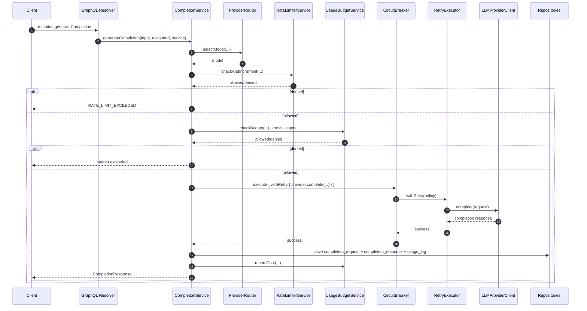
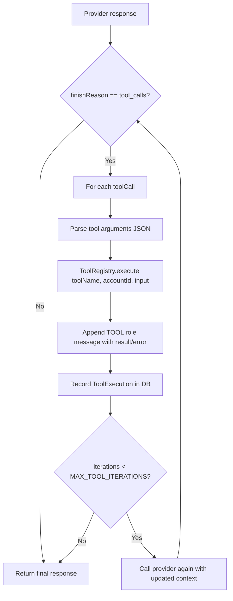
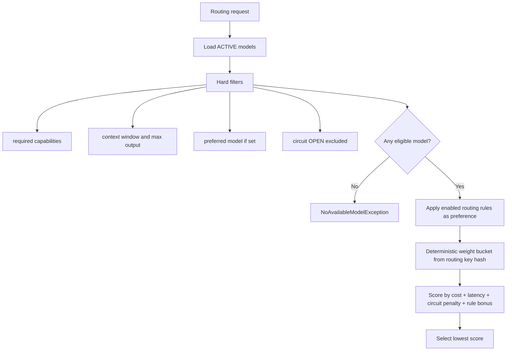
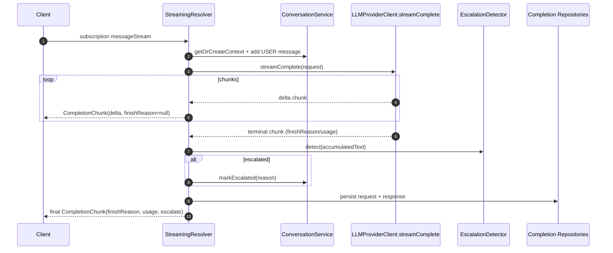

# Assistant Service

Neotool assistant orchestration service.

It exposes GraphQL APIs for:
- conversational chat (`chat`, `conversation`, `clearConversation`)
- one-shot completions (`generateCompletion`)
- token streaming (`messageStream` subscription)
- prompt management
- tool registry/metadata
- usage and budget operations

It also includes provider abstractions (OpenAI/Gemini), model routing/failover, tool-calling loop, retry + circuit breaker, rate limiting, usage budgets, escalation detection, and Micrometer metrics.

## Quick Start

### Prerequisites

- Java 21+
- Docker (for PostgreSQL / PgBouncer and integration tests)
- An LLM API key (`GEMINI_API_KEY` or `OPENAI_API_KEY`)

### 1) Start database dependencies

From repository root:

```bash
docker compose -f infra/docker/docker-compose.local.yml --profile database up -d
```

Default app DB settings already match local compose (`localhost:6432`, `neotool/neotool`, `neotool_db`).

### 2) Run the assistant service

From `service/kotlin`:

```bash
cd service/kotlin

# required today for repository-backed features
export JPA_DEFAULT_ENABLED=true
export MICRONAUT_ENVIRONMENTS=local

# provider selection
export LLM_PROVIDER=gemini            # or openai

# choose one
export GEMINI_API_KEY=<your-gemini-key>
# export OPENAI_API_KEY=<your-openai-key>

# optional JWT validation source for authenticated GraphQL operations
export JWT_ISSUER=http://localhost:8080
# export JWT_JWKS_URL=http://localhost:8080/.well-known/jwks.json

./gradlew :assistant:run --no-daemon
```

Service endpoints:
- GraphQL HTTP: `http://localhost:8082/graphql`
- Health: `http://localhost:8082/health`
- Metrics (Prometheus): `http://localhost:8082/prometheus`

## GraphQL API

### Endpoint

- `POST /graphql`
- Subscription field `messageStream` is available in schema `Subscription`.

### Authentication and permissions

Some operations are public/currently unguarded, others require JWT context.

Authenticated operations require account context in token (`currentAccountId` or `accountIds`).

Admin mutations require explicit permissions:
- `assistant:tool:register` for `registerTool`
- `assistant:usage-budget:set` for `setUsageBudget`

### Operations

Queries:
- `conversation(sessionId: String!): Conversation`
- `prompts(category: String, tags: [String!]): [Prompt!]!`
- `prompt(id: ID!): Prompt`
- `promptVersions(promptId: ID!): [PromptVersion!]!`
- `availableTools: [Tool!]!`
- `myUsage(period: UsagePeriod!): UsageStats!`
- `serviceUsage(serviceId: String!, period: UsagePeriod!): UsageStats!`

Mutations:
- `chat(input: ChatInput!): ChatResponse!`
- `clearConversation(sessionId: String!): Boolean!`
- `generateCompletion(input: CompletionInput!): CompletionResponse!`
- `createPrompt(input: CreatePromptInput!): Prompt!`
- `publishPromptVersion(promptId: ID!, versionId: ID!): PromptVersion!`
- `registerTool(input: RegisterToolInput!): Tool!`
- `setUsageBudget(input: SetBudgetInput!): UsageBudget!`

Subscriptions:
- `messageStream(conversationId: ID!, input: MessageInput!): CompletionChunk!`

### Example: `generateCompletion`

```graphql
mutation GenerateCompletion($input: CompletionInput!) {
  generateCompletion(input: $input) {
    id
    content
    finishReason
    model
    latencyMs
    cost
    escalate
    usage {
      promptTokens
      completionTokens
      totalTokens
    }
    toolCalls {
      id
      name
      arguments
    }
  }
}
```

```json
{
  "input": {
    "messages": [
      {
        "role": "USER",
        "content": "Summarize account spend in one line"
      }
    ],
    "requiredCapabilities": ["JSON_MODE"],
    "outputFormat": "JSON",
    "purpose": "faq_summary"
  }
}
```

### Example: `messageStream`

```graphql
subscription Stream($conversationId: ID!, $input: MessageInput!) {
  messageStream(conversationId: $conversationId, input: $input) {
    delta
    finishReason
    escalate
    usage {
      promptTokens
      completionTokens
      totalTokens
    }
  }
}
```

```json
{
  "conversationId": "faq-session-1",
  "input": {
    "role": "USER",
    "content": "What is the refund policy?"
  }
}
```

## Use Case: PDF Text to Transactions JSON

Scenario: you already extracted plain text from a PDF, and now want structured transactions.

### Do I need a template?

- No, for one-off extraction.
- Yes (recommended), for reusable/stable extraction behavior across clients.

### Option A: no template (quick one-off)

Send `generateCompletion` with:
- a `SYSTEM` message describing strict JSON output contract
- a `USER` message containing the extracted text
- `outputFormat: JSON`
- `requiredCapabilities: [JSON_MODE]`

```graphql
mutation Extract($input: CompletionInput!) {
  generateCompletion(input: $input) {
    content
    finishReason
    usage { totalTokens }
  }
}
```

```json
{
  "input": {
    "purpose": "pdf_transaction_extraction",
    "outputFormat": "JSON",
    "requiredCapabilities": ["JSON_MODE"],
    "messages": [
      {
        "role": "SYSTEM",
        "content": "Extract bank transactions from raw statement text. Return ONLY valid JSON with shape: {\"transactions\":[{\"date\":\"YYYY-MM-DD\",\"description\":\"string\",\"amount\":number,\"currency\":\"BRL\",\"type\":\"DEBIT|CREDIT\"}],\"unparsedLines\":[\"...\"]}."
      },
      {
        "role": "USER",
        "content": "<PASTE PDF EXTRACTED TEXT HERE>"
      }
    ]
  }
}
```

### Option B: with template (recommended for production)

1. Create prompt template (this is your reusable system prompt):

```graphql
mutation CreatePrompt($input: CreatePromptInput!) {
  createPrompt(input: $input) {
    id
    name
  }
}
```

```json
{
  "input": {
    "name": "bank_statement_extractor",
    "category": "finance",
    "createdBy": "11111111-1111-1111-1111-111111111111",
    "tags": ["pdf", "transactions", "json"],
    "outputFormat": "JSON",
    "template": "You are a transaction extraction engine. Extract transactions from this text: {{statementText}}. Return only JSON with: {\"transactions\":[{\"date\":\"YYYY-MM-DD\",\"description\":\"string\",\"amount\":number,\"currency\":\"BRL\",\"type\":\"DEBIT|CREDIT\"}],\"unparsedLines\":[\"...\"]}.",
    "variablesSchema": {
      "type": "object",
      "required": ["statementText"],
      "properties": {
        "statementText": { "type": "string" }
      }
    }
  }
}
```

2. Publish the version (new prompt versions are created as `DRAFT`):
- query `promptVersions(promptId)` to get `versionId`
- call `publishPromptVersion(promptId, versionId)`

3. Call completion with `promptId` + `promptVariables`:

```json
{
  "input": {
    "promptId": "<PROMPT_ID>",
    "promptVariables": {
      "statementText": "<PASTE PDF EXTRACTED TEXT HERE>"
    },
    "purpose": "pdf_transaction_extraction",
    "requiredCapabilities": ["JSON_MODE"]
  }
}
```

### Where do I set the system prompt?

- `generateCompletion` flow:
  - Recommended: prompt template (`createPrompt` + `publishPromptVersion`), used as system prompt automatically when `promptId` is passed.
  - Alternative: send `messages` with `role: SYSTEM` directly.
- `chat` flow:
  - hardcoded in `AssistantAgent.systemPrompt` (code constant).
- `messageStream` flow:
  - hardcoded in `StreamingResolver.DEFAULT_STREAM_SYSTEM_PROMPT` (code constant).

If your PDF text is large, chunk it before calling `generateCompletion` to avoid model context-limit errors.

## Main Workflows

### 1) `generateCompletion` orchestration



### 2) Tool calling loop (OpenAI function calling)



### 3) Routing and failover



### 4) Streaming (`messageStream`)



### 5) Escalation pattern

```mermaid
flowchart TD
    A[LLM content] --> B[EscalationDetector.detect]
    B --> C{JSON matches <br/> {"escalate": true, "reason": "..."}?}
    C -- No --> D[Escalate = false]
    C -- Yes --> E[mark conversation ESCALATED]
    E --> F[increment assistant_escalations_total{reason}]
    F --> G[return escalate=true and conversation history]
```

## Configuration

Primary config file: `src/main/resources/application.yml`.

Key settings:
- `micronaut.server.port` (default `8082`)
- `llm.provider` (`gemini` or `openai`)
- `llm.retry.*` (exponential backoff)
- `llm.circuit-breaker.*`
- `datasources.default.*` (PostgreSQL/PgBouncer)
- `flyway.datasources.default.enabled=true`
- `management.endpoints.web.exposure.include=health,info,prometheus,metrics`

Provider-specific:
- Gemini: `GEMINI_API_KEY`, optional `GEMINI_MODEL`
- OpenAI: `OPENAI_API_KEY` (resolved through `llm.openai.api-key-ref`)

## Data Model (high level)

Core tables under schema `assistant`:
- prompts: `prompts`, `prompt_versions`
- providers/models: `llm_providers`, `llm_models`, `model_routing_rules`
- completions: `completion_requests`, `completion_responses`
- tooling: `tools`, `tool_executions`
- governance: `usage_budgets`, `rate_limit_counters`, `usage_log`

Migrations:
- `V001__initial_schema.sql`
- `V003__tools.sql`
- `V004__rate_limits.sql`
- `V005__routing_rules.sql`

## Testing

From `service/kotlin`:

```bash
# full module tests
./gradlew :assistant:test --no-daemon

# integration tests only (Testcontainers)
./gradlew :assistant:testIntegration --no-daemon

# run a specific test class
./gradlew :assistant:test --tests "io.github.salomax.neotool.assistant.test.unit.service.CompletionServiceTest" --no-daemon
```

Notes:
- Integration tests require Docker.
- Integration tests bootstrap PostgreSQL containers and seed required security schema data.

## Observability

Prometheus metrics include:
- `assistant_requests_total{service,model,status,output_format,stream}`
- `assistant_request_duration_ms{service,model}`
- `assistant_tokens_total{service,model,token_type}`
- `assistant_cost_total{service,model}`
- `assistant_provider_errors_total{provider,error_type}`
- `assistant_circuit_breaker_state{provider}` (`0=CLOSED`, `1=HALF_OPEN`, `2=OPEN`)
- `assistant_escalations_total{reason}`
- `assistant_rate_limit_exceeded_total{scope}`
- `assistant_budget_alert_total{scope}`

Alert rules live at:
- `infra/observability/alerts/assistant-alerts.yml`

## Project Structure

```text
assistant/
├── src/main/kotlin/io/github/salomax/neotool/assistant/
│   ├── service/         # Completion, prompt, tool, budget, rate limit, routing
│   ├── provider/        # LLMProviderClient + OpenAI/Gemini clients and mappers
│   ├── resilience/      # RetryExecutor, CircuitBreaker
│   ├── graphql/         # DTOs, mappers, resolvers
│   ├── entity/          # JPA entities
│   ├── repository/      # Micronaut Data repositories
│   ├── tool/            # ToolExecutor, ToolRegistry, built-in executors
│   └── observability/   # AssistantMetrics
└── src/main/resources/
    ├── application.yml
    ├── graphql/schema.graphqls
    └── db/migration/
```
