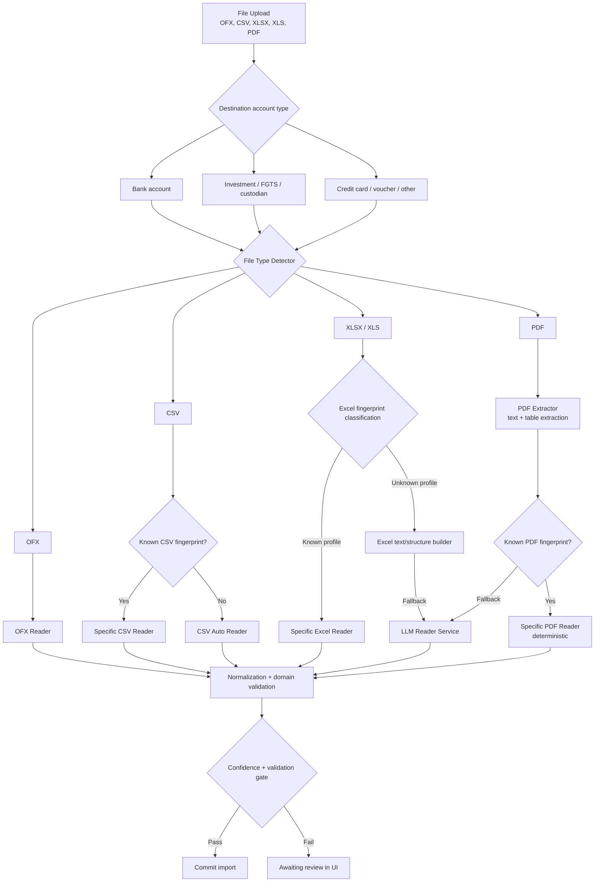

# Banking Service

## Configuration

### JWT Authentication

- `MICRONAUT_ENVIRONMENTS`: Use `local` for local runs that set `JWT_ISSUER=http://localhost:8080`
- `JWT_ISSUER`: Absolute issuer URL expected in incoming tokens (required)
- `JWT_JWKS_URL`: URL to the security service's JWKS endpoint (required)

## GraphQL Investments

- `holdingPerformance`: performance series for a single holding.
- `portfolioPerformance`: aggregated performance series for the authenticated account portfolio, optionally filtered by `groupKey` and optionally scoped to a custodian `financialAccountId` (same as `investmentHoldings`).
- Current limitation: portfolio aggregation is single-currency only; mixed currencies return an error.

## File Import Flow

This document defines the high-level import architecture for uploaded files:
`OFX`, `CSV`, `XLSX`, `XLS`, and `PDF`.

The same routing model applies to different destination account categories:
- Bank accounts
- Investment/FGTS/custodian accounts
- Credit card/voucher/other accounts

### End-to-End Routing Diagram



### Core Definitions

1. `File Type Detector`
- Detects technical format (`OFX`, `CSV`, `XLSX/XLS`, `PDF`) using binary signature, content hints, and extension.
- This step does not decide business semantics.

2. `Fingerprint Detector` (Profile Detector)
- Detects known provider/layout templates inside a file type.
- Examples: `CSV_B3_POSITIONS_V1`, `XLSX_CUSTODIAN_X_V2`, `PDF_BANK_Y_STATEMENT_V1`.
- Classifies the file as either:
  - known profile -> route to a specific deterministic reader
  - unknown profile -> route to LLM path for that file type (current scope for Excel/PDF)
- Current implementation:
  - Interface: `domain/import/fingerprint/FingerprintClassifier.kt`
  - Registry: `domain/import/fingerprint/FingerprintClassifierRegistry.kt`
  - PDF: `domain/import/fingerprint/PdfFingerprintClassifier.kt`
  - Excel: `domain/import/fingerprint/ExcelFingerprintClassifier.kt`

3. `Reader Router`
- Selects the best reader for the `(account_type, file_type, fingerprint_classification)` tuple.
- Priority order:
  - Specific deterministic reader (known fingerprint)
  - Generic reader for unknown profiles (CSV)
  - LLM path for unknown Excel/PDF profiles

4. `Deterministic Reader`
- Rule-based parser for known templates.
- Highest precision and lowest cost/latency.
- PDF deterministic stack (current):
  - Reader contract: `domain/pdfimport/reader/DeterministicPdfReader.kt`
  - Registry: `domain/pdfimport/reader/DeterministicPdfReaderRegistry.kt`
  - Router: `domain/pdfimport/reader/DeterministicPdfReaderRouter.kt`
  - First reader: `domain/pdfimport/reader/NubankCreditCardBillPdfReader.kt`
  - Routing behavior: known PDF profile parses deterministically and moves job to `AWAITING_REVIEW` with canonical `review_payload`
- Excel deterministic stack (current):
  - Reader contract: `domain/import/excel/reader/DeterministicExcelReader.kt`
  - Registry: `domain/import/excel/reader/DeterministicExcelReaderRegistry.kt`
  - Router: `domain/import/excel/reader/DeterministicExcelReaderRouter.kt`
  - First reader: `domain/import/excel/reader/TabularBankStatementExcelReader.kt`
  - Routing behavior: known Excel profile (`excel-bank-statement-tabular-v1`) parses deterministically to canonical transaction records
  - Import pipeline integration: `infra/kafka/parser/ExcelImportParserStrategy.kt` + `infra/kafka/ImportFileConsumer.kt`
    - unknown Excel publishes `assistant.banking-reader.requested` with workbook text/metadata payload

5. `Generic Reader` (Auto/Structural)
- Heuristic/structural parser used when fingerprint is unknown but the format is still parseable.
- In current scope, this applies to CSV unknown profiles.

6. `LLM Reader`
- Final fallback parser for ambiguous/unstructured cases.
- For Excel: used directly when fingerprint is unknown (current scope).
- For PDF: used when no known deterministic profile matches.

7. `Normalization + Domain Validation`
- Converts reader output into a canonical domain contract.
- Runs business rules (required fields, date/amount consistency, sign rules, totals).

8. `Confidence + Validation Gate`
- Decides whether import can be auto-committed or must go to manual review.
- Any hard validation failure forces `Awaiting Review`.

### Canonical Reader Output Contract

Every reader (`deterministic`, `auto`, `llm`) should produce a shared output contract:
- `schema_id`: canonical schema name
- `schema_version`
- `processor_type`: `DETERMINISTIC | AUTO | LLM`
- `reader_id`
- `confidence`: `0.0..1.0`
- `warnings`: list of non-fatal issues
- `normalized_records`: canonical records ready for import pipeline
- `raw_metadata`: extraction metadata for observability/audit

Implementation in code:
- Model: `domain/import/CanonicalReaderOutput.kt`
- Mapper: `domain/import/CanonicalReaderOutputMapper.kt`

#### Mapping Rules (Current Parsers -> Canonical Contract)

`OFXParser` and CSV readers emit `ParsedTransaction`. Canonical mapping is field-preserving:

| ParsedTransaction field | normalized_records field |
|---|---|
| `providerTransactionId` | `provider_transaction_id` |
| `creditDebitType` | `credit_debit_type` |
| `amount` | `amount` |
| `date` | `date` |
| `transactionDatetime` | `transaction_datetime` |
| `description` | `description` |
| `descriptionRaw` | `description_raw` |
| `counterpartyName` | `counterparty_name` |
| `counterpartyDocument` | `counterparty_document` |
| `currencyCode` | `currency_code` |
| `totalInstallments` | `total_installments` |

Parser routing to canonical processor type:
- OFX strategy (`ofx-parser`) -> `DETERMINISTIC`, confidence `1.0`
- CSV specific readers (Nubank/Itaú/Bradesco/Santander/etc.) -> `DETERMINISTIC`, confidence from matcher score
- CSV generic reader (`csv-generic`) -> `AUTO`, confidence from generic matcher score

Parser selection diagnostics are kept in `raw_metadata` (selection mode, detected format/source, ranked matches, fallback flags).

### Safety Rules

- Never auto-commit only because parsing succeeded.
- Require domain validation success for auto-commit.
- Require minimum confidence threshold for non-deterministic readers.
- Route to manual review on:
  - Validation mismatch
  - Low confidence
  - Ambiguous account mapping
  - Conflicting totals or date windows

### OFX Destination Compatibility Rule

OFX imports must be compatible with the destination account type.

- `BANK_STATEMENT` OFX can only be imported into bank accounts.
- `CREDIT_CARD_STATEMENT` OFX can only be imported into credit card/charge card accounts.
- Any mismatch is rejected before persistence.

Expected behavior on mismatch:
- Import is rejected with a validation/business-rule error.
- No transactions are inserted.
- Job is marked as failed/rejected with an explicit incompatibility reason.

Compatibility matrix:

| Uploaded OFX intent | Destination account type | Expected result |
|---|---|---|
| `BANK_STATEMENT` | Bank account | Allowed |
| `CREDIT_CARD_STATEMENT` | Credit card account | Allowed |
| `BANK_STATEMENT` | Credit card account | Rejected (incompatible destination) |
| `CREDIT_CARD_STATEMENT` | Bank account | Rejected (incompatible destination) |

### Why Excel Has LLM Fallback

Unlike CSV and OFX, Excel files often contain:
- Multiple sheets
- Header offsets and merged cells
- Non-tabular notes and mixed blocks
- Provider-specific visual layouts

Because of this variability, and given current scope constraints, unknown Excel profiles are converted into a textual/structured payload and sent directly to the `LLM Reader`.

### LLM Post-Validation Rule (Excel/PDF)

Even when parsing is performed by LLM, final commit still requires deterministic post-validation:
- Required fields present
- Valid date and amount types
- Basic domain consistency checks

If post-validation fails, the import must go to `Awaiting review` (no auto-commit).

Current gate policy (banking service):
- `processor_type=LLM` and any invalid parsed row -> `FAILED` (no insert)
- `processor_type=LLM` and confidence below `0.85` -> `REVIEW_REQUIRED` (no insert)
- `processor_type=LLM` and warnings present -> `REVIEW_REQUIRED` (no insert)
- Otherwise, final status still follows processing counters:
  - duplicate candidates -> `REVIEW_REQUIRED`
  - only row errors with no imported/skipped rows -> `FAILED`
  - else -> `COMPLETED`

### Import Review Payload (Unified Shape)

`transaction_imports.review_payload` now uses one canonical envelope for both deterministic and LLM-driven review states:

- `schema_id`: `banking.import.review-payload`
- `schema_version`: `1.0.0`
- `duplicate_candidates`: duplicate rows requiring user resolution
- `gate`: optional validation-gate metadata (for low-confidence/warning review decisions)

Compatibility notes:
- GraphQL continues exposing `duplicateCandidates` from this envelope.
- Legacy payloads stored as raw array of duplicate candidates remain readable.

### Assistant Request Idempotency

For unknown Excel/PDF routes dispatched from file import flow:
- `transaction_imports.assistant_request_published_at` is used as idempotency marker.
- Once set, reprocessing `banking.import.file-requested` for the same job will not publish duplicate
  `assistant.banking-reader.requested` events.
- Transient assistant-publish failures are treated as retryable (offset remains uncommitted for redelivery).

## How To Validate (Backend)

Complete backend validation flow for OFX/XLSX/PDF, including file prep, base64 conversion,
execution order, GraphQL checks, DB checks, and Kafka topics.

Use Bruno requests in:
`contracts/api-collections/bruno/collections/supergraph/Banking/Import`.

### 1) Prerequisites

1. Backend stack running (router + banking + dependencies):
- GraphQL router reachable (`http://localhost:4000/graphql` by default)
- Kafka reachable (`localhost:9094` by default)
- PostgreSQL reachable
2. JWT token with banking permissions.
3. Valid `financial_account_id` for the tenant.
4. Bruno CLI installed (`bruno`).

### 2) Prepare test files

Repository examples:
- OFX: `service/kotlin/banking/src/test/resources/fixtures/ofx/ofx_sgml_sample.ofx`
- PDF: `service/kotlin/banking/src/test/resources/import-files/card_bill/nubank_2026-03-14.pdf`

For unknown XLSX path, use request `Import XLSX File (Unknown Profile)` or your own XLSX file.

### 3) Convert files to base64 (single line)

macOS:
```bash
base64 -i service/kotlin/banking/src/test/resources/fixtures/ofx/ofx_sgml_sample.ofx | tr -d '\n' > /tmp/import.ofx.b64
base64 -i service/kotlin/banking/src/test/resources/import-files/card_bill/nubank_2026-03-14.pdf | tr -d '\n' > /tmp/import.pdf.b64
```

Linux:
```bash
base64 -w 0 service/kotlin/banking/src/test/resources/fixtures/ofx/ofx_sgml_sample.ofx > /tmp/import.ofx.b64
base64 -w 0 service/kotlin/banking/src/test/resources/import-files/card_bill/nubank_2026-03-14.pdf > /tmp/import.pdf.b64
```

### 4) Configure Bruno env (`localhost`)

File: `contracts/api-collections/bruno/collections/supergraph/environments/localhost.bru`

Set values (Bruno UI or env file):
- `jwt_token`
- `financial_account_id`
- `import_file_name` (example: `sample.ofx`)
- `import_source` (example: `OFX`, `AUTO`, `CSV_AUTO`)
- `import_file_base64` (content from `/tmp/import.ofx.b64` or any other file)
- `pdf_file_name` (example: `nubank_2026-03-14.pdf`)
- `pdf_file_base64` (content from `/tmp/import.pdf.b64`)

Built-in fixture requests are still available:
- `Import OFX File`
- `Submit PDF Bill Import`
- `Import XLSX File (Unknown Profile)`

### 5) Run requests (recommended order)

From repo root:
```bash
cd contracts/api-collections/bruno
```

Validate accounts:
```bash
bruno run "collections/supergraph/Banking/List Financial Accounts.bru" -e localhost
```

#### 5.1 OFX / CSV (custom base64)
```bash
bruno run "collections/supergraph/Banking/Import/Import Transactions File (Custom Base64).bru" -e localhost
bruno run "collections/supergraph/Banking/Import/Get Import Job.bru" -e localhost
```

#### 5.2 XLSX unknown profile (assistant async route)
```bash
bruno run "collections/supergraph/Banking/Import/Import XLSX File (Unknown Profile).bru" -e localhost
bruno run "collections/supergraph/Banking/Import/Get Import Job.bru" -e localhost
```

#### 5.3 PDF bill (custom base64)
```bash
bruno run "collections/supergraph/Banking/Import/Submit PDF Bill Import (Custom Base64).bru" -e localhost
bruno run "collections/supergraph/Banking/Import/Get PDF Import Job.bru" -e localhost
```

#### 5.4 Confirm PDF (when status is `AWAITING_REVIEW`)
```bash
bruno run "collections/supergraph/Banking/Import/Confirm PDF Bill Import.bru" -e localhost
bruno run "collections/supergraph/Banking/Import/Get PDF Import Job.bru" -e localhost
```

`import_job_id` and `pdf_import_job_id` are persisted automatically by post-response scripts.

### 6) Verification queries (GraphQL)

Import job:
```graphql
query TransactionImport($id: ID!) {
  transactionImport(id: $id) {
    id
    status
    importedCount
    skippedCount
    duplicateReviewCount
    errorCount
    errorDetails
  }
}
```

PDF import job:
```graphql
query PdfImportJob($jobId: ID!) {
  pdfImportJob(jobId: $jobId) {
    id
    status
    errorMessage
    reviewPayload {
      extractionConfidence
      needsReview
      warnings
    }
  }
}
```

### 7) Database verification (SQL)

File import (`transaction_imports`):
```sql
SELECT id, status, source, total_rows, imported_count, skipped_count,
       duplicate_review_count, error_count, assistant_request_published_at,
       error_details, updated_at
FROM banking.transaction_imports
WHERE id = '<import_job_id>';
```

PDF import (`pdf_import_jobs`):
```sql
SELECT id, status, extraction_confidence, error_message, error_details, updated_at
FROM banking.pdf_import_jobs
WHERE id = '<pdf_import_job_id>';
```

Materialized transactions for one import:
```sql
SELECT COUNT(*) AS tx_count
FROM banking.transactions
WHERE import_job_id = '<import_job_id>' AND deleted_at IS NULL;
```

### 8) Kafka topics involved

#### File import (OFX/CSV/XLSX)
- `banking.import.file-requested` (import pipeline input)
- `assistant.banking-reader.requested` (only when async route is used)
- `assistant.banking-pdf-reader.done` / `assistant.banking-pdf-reader.failed` (async callback)
- `banking.import.job-completed` (terminal event)

#### PDF bill import
- `pdf-extractor.submitted`
- `pdf-extractor.extracted` or `pdf-extractor.dlq`
- `assistant.banking-reader.requested` (when LLM fallback is needed)
- `assistant.banking-pdf-reader.done` / `assistant.banking-pdf-reader.failed`

### 9) Inspect Kafka messages (kcat)

```bash
export KAFKA_BROKER=localhost:9094
kcat -b "$KAFKA_BROKER" -C -t banking.import.file-requested -o -10 -e
kcat -b "$KAFKA_BROKER" -C -t assistant.banking-reader.requested -o -10 -e
kcat -b "$KAFKA_BROKER" -C -t assistant.banking-pdf-reader.done -o -10 -e
kcat -b "$KAFKA_BROKER" -C -t assistant.banking-pdf-reader.failed -o -10 -e
kcat -b "$KAFKA_BROKER" -C -t pdf-extractor.extracted -o -10 -e
kcat -b "$KAFKA_BROKER" -C -t pdf-extractor.dlq -o -10 -e
```

### 10) Success criteria

- OFX/CSV:
  - `transactionImport.status` becomes terminal (`COMPLETED`, `FAILED`, `REVIEW_REQUIRED`)
  - counters are coherent with processing result
- XLSX async:
  - initial status usually `PROCESSING`
  - later transition to terminal state after callback
  - `assistant_request_published_at` is populated when async dispatch occurs
- PDF:
  - status transitions are coherent (`EXTRACTING` -> ... -> `AWAITING_REVIEW`/`FAILED`/`COMPLETED`)
  - `Confirm PDF Bill Import` ends in `COMPLETED` when review input is valid

### Extending The Flow

To onboard a new provider/template:
1. Add a new fingerprint signature.
2. Add a deterministic reader implementation.
3. Map it in `Reader Router` with high priority.
4. Add validation tests and golden fixtures.
5. Keep LLM as fallback only.
