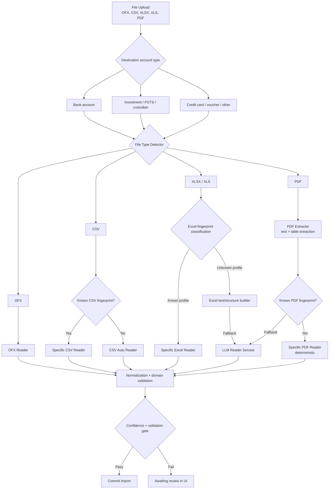

# Banking Service

## File Import Flow

This document defines the high-level import architecture for uploaded files:
`OFX`, `CSV`, `XLSX`, `XLS`, and `PDF`.

The same routing model applies to different destination account categories:
- Bank accounts
- Investment/FGTS/custodian accounts
- Credit card/voucher/other accounts

### End-to-End Routing Diagram

### Core Definitions

1. `File Type Detector`
- Detects technical format (`OFX`, `CSV`, `XLSX/XLS`, `PDF`) using binary signature, content hints, and extension.
- This step does not decide business semantics.

2. `Fingerprint Detector` (Profile Detector)
- Detects known provider/layout templates inside a file type.
- Examples: `CSV_B3_POSITIONS_V1`, `XLSX_CUSTODIAN_X_V2`, `PDF_BANK_Y_STATEMENT_V1`.
- Classifies the file as either:
  - known profile -> route to a specific deterministic reader
  - unknown profile -> route to LLM path for that file type (current scope for Excel/PDF)

3. `Reader Router`
- Selects the best reader for the `(account_type, file_type, fingerprint_classification)` tuple.
- Priority order:
  - Specific deterministic reader (known fingerprint)
  - Generic reader for unknown profiles (CSV)
  - LLM path for unknown Excel/PDF profiles

4. `Deterministic Reader`
- Rule-based parser for known templates.
- Highest precision and lowest cost/latency.

5. `Generic Reader` (Auto/Structural)
- Heuristic/structural parser used when fingerprint is unknown but the format is still parseable.
- In current scope, this applies to CSV unknown profiles.

6. `LLM Reader`
- Final fallback parser for ambiguous/unstructured cases.
- For Excel: used directly when fingerprint is unknown (current scope).
- For PDF: used when no known deterministic profile matches.

7. `Normalization + Domain Validation`
- Converts reader output into a canonical domain contract.
- Runs business rules (required fields, date/amount consistency, sign rules, totals).

8. `Confidence + Validation Gate`
- Decides whether import can be auto-committed or must go to manual review.
- Any hard validation failure forces `Awaiting Review`.

### Canonical Reader Output Contract

Every reader (`deterministic`, `auto`, `llm`) should produce a shared output contract:
- `schema_id`: canonical schema name
- `schema_version`
- `processor_type`: `DETERMINISTIC | AUTO | LLM`
- `reader_id`
- `confidence`: `0.0..1.0`
- `warnings`: list of non-fatal issues
- `normalized_records`: canonical records ready for import pipeline
- `raw_metadata`: extraction metadata for observability/audit

### Safety Rules

- Never auto-commit only because parsing succeeded.
- Require domain validation success for auto-commit.
- Require minimum confidence threshold for non-deterministic readers.
- Route to manual review on:
  - Validation mismatch
  - Low confidence
  - Ambiguous account mapping
  - Conflicting totals or date windows

### OFX Destination Compatibility Rule

OFX imports must be compatible with the destination account type.

- `BANK_STATEMENT` OFX can only be imported into bank accounts.
- `CREDIT_CARD_STATEMENT` OFX can only be imported into credit card/charge card accounts.
- Any mismatch is rejected before persistence.

Expected behavior on mismatch:
- Import is rejected with a validation/business-rule error.
- No transactions are inserted.
- Job is marked as failed/rejected with an explicit incompatibility reason.

Compatibility matrix:

| Uploaded OFX intent | Destination account type | Expected result |
|---|---|---|
| `BANK_STATEMENT` | Bank account | Allowed |
| `CREDIT_CARD_STATEMENT` | Credit card account | Allowed |
| `BANK_STATEMENT` | Credit card account | Rejected (incompatible destination) |
| `CREDIT_CARD_STATEMENT` | Bank account | Rejected (incompatible destination) |

### Why Excel Has LLM Fallback

Unlike CSV and OFX, Excel files often contain:
- Multiple sheets
- Header offsets and merged cells
- Non-tabular notes and mixed blocks
- Provider-specific visual layouts

Because of this variability, and given current scope constraints, unknown Excel profiles are converted into a textual/structured payload and sent directly to the `LLM Reader`.

### LLM Post-Validation Rule (Excel/PDF)

Even when parsing is performed by LLM, final commit still requires deterministic post-validation:
- Required fields present
- Valid date and amount types
- Basic domain consistency checks

If post-validation fails, the import must go to `Awaiting review` (no auto-commit).

### Extending The Flow

To onboard a new provider/template:
1. Add a new fingerprint signature.
2. Add a deterministic reader implementation.
3. Map it in `Reader Router` with high priority.
4. Add validation tests and golden fixtures.
5. Keep LLM as fallback only.
